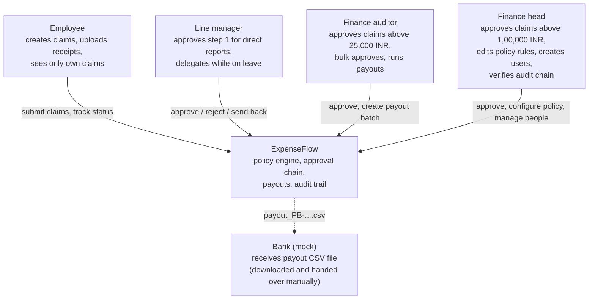
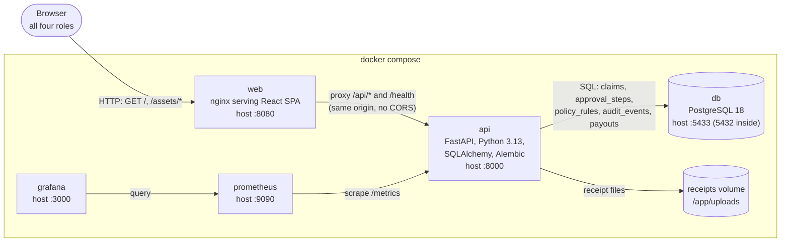
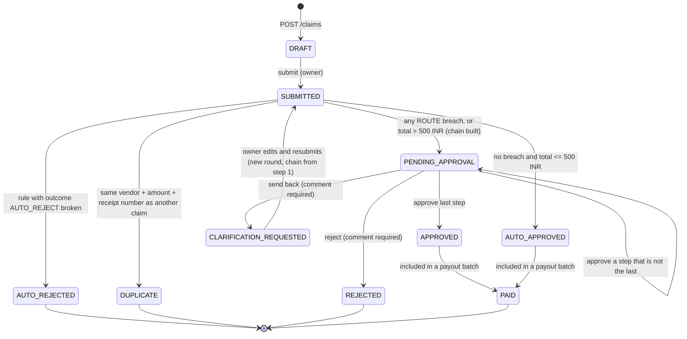

# ExpenseFlow architecture

27 Nov 2026 · team18 (Track A) · describes `main` plus the `frontend` branch

ExpenseFlow takes an employee's expense claim, runs it through a configurable policy engine, routes it through an approval chain when the policy says so, pays approved claims in a CSV payout batch, and records every step in an append-only audit trail. The API contract is [openapi.json](openapi.json); the detailed behaviour is in [claims-api.md](claims-api.md), [policy-approvals-api.md](policy-approvals-api.md), [payouts-api.md](payouts-api.md) and [audit-and-access.md](audit-and-access.md). Design decisions are in [adr/](adr/).

## 1. System context

There is no self-signup and no external identity provider: the finance head creates every user (see [ADR-003](adr/ADR-003-login-identity-and-session.md)). The bank is not integrated; the CSV is downloaded by a finance user.

## 2. Containers

Everything starts with `docker compose up --build` from a fresh clone (`docker-compose.yml`).

| Container | What it does | Notes |
| --- | --- | --- |
| `web` | nginx serves the built React app (`frontend/dist`), proxies `/api/` and `/health` to `api:8000`, falls back to `index.html` for client routes | `client_max_body_size 6m` (receipts are capped at 5 MB by the API) |
| `api` | REST API under `/api/v1`; OpenAPI docs at `/docs`; `/health`, `/health/ready`, `/metrics` | Policy engine, chain builder, payouts and audit writer all live here |
| `db` | PostgreSQL 18 | Host port 5433 so it does not clash with a local PostgreSQL on 5432 |
| `prometheus` | Scrapes the API's `/metrics` | Config in `deploy/prometheus` |
| `grafana` | Dashboards over Prometheus | Provisioned from `deploy/grafana/provisioning` |

In development the Vite dev server (`:5173`) proxies `/api` to `http://localhost:8000` instead of nginx.

### Key data flows

1. **Submit:** SPA → `POST /api/v1/claims/{id}/submit` → API loads the active `policy_rules` and settings, evaluates every line, stores one `claim_policy_results` row per line with the rule values used, sets the claim status, builds `approval_steps` if routed, writes `SUBMITTED`, `POLICY_EVALUATED` and `CHAIN_BUILT` audit rows, all in one transaction.
2. **Approve:** SPA → `POST /claims/{id}/approve` with `step_id` → API locks the claim, checks the caller is the current step's approver or their delegate, marks the step `APPROVED`, opens the next step or sets the claim `APPROVED`. The auditor's bulk approve in the UI is one approve call per selected step, in sequence.
3. **Payout:** finance user → `POST /payouts/batches` → API locks eligible `APPROVED`/`AUTO_APPROVED` claims, creates the batch and items, sets each claim `PAID`, writes `BATCH_CREATED` and `MARKED_PAID`; `GET /payouts/batches/{id}/export` returns the CSV and writes `CSV_EXPORTED`.
4. **Visibility:** every claim endpoint goes through `app/services/access.py`; an employee asking for someone else's claim gets the same `404 claim_not_found` as for a claim that does not exist.
5. **Audit:** `app/services/audit.py` inserts one hash-chained row per state change in the same transaction as the change; database triggers refuse `UPDATE`, `DELETE` and `TRUNCATE`.

## 3. Claim state machine

Statuses are the `ClaimStatus` enum in `backend/app/models/claim.py` (and `openapi.json`).

- `SUBMITTED` is transient: the policy runs in the same request, so a claim never rests there.
- The owner can edit only in `DRAFT` and `CLARIFICATION_REQUESTED`; any other status returns `409 claim_not_editable`.
- Approver actions on a claim that is not `PENDING_APPROVAL` return `409 claim_not_pending`.
- A claim reaches `PAID` only through a payout batch; for `APPROVED` claims every step of the latest round must be `APPROVED`, and `UNIQUE(payout_batch_items.claim_id)` stops a second payment.

## 4. Policy as configuration

The policy engine has no limits in code. Rules are rows in the `policy_rules` table; thresholds and lists are rows in `policy_settings`.

| `policy_rules` column | Meaning |
| --- | --- |
| `code` | Stable id, e.g. `MEAL_DAILY_LIMIT`, `HOTEL_NIGHTLY_LIMIT_T1`, `SPLIT_CLAIM` |
| `rule_type` | Which checker class in `backend/app/policy/rules.py` runs it (e.g. `DAILY_CATEGORY_LIMIT`) |
| `category` | Expense category the rule applies to, or none |
| `params` (JSON) | The values, e.g. `{"limit": "6000", "city_tier": "tier1"}`; validated against the rule type |
| `outcome_on_breach` | `ROUTE_FOR_APPROVAL`, `AUTO_REJECT` or `MARK_DUPLICATE` |
| `reason_template` | Text shown to users, e.g. `Hotel {per_night} INR per night in {city} exceeds tier-1 limit of {limit} INR`; only the rule type's placeholders are allowed |
| `active` | Rule on or off; replaced rules are kept with `active = false` |

Settings include `approval_thresholds` (`{"finance_auditor": "25000", "finance_head": "100000"}`), `auto_approve_max_total` (`500`) and `tier1_cities`.

- **Seeding:** the defaults live in `backend/app/policy/defaults.py`. At startup the API inserts any rule (by `code`) or setting (by `key`) that is missing and never overwrites an existing row, so edits survive restarts. Each inserted default writes a `RULE_CREATED` / `SETTING_CREATED` audit row with the SYSTEM actor.
- **Editing:** the finance head changes a rule with `PUT /api/v1/policy-rules/{code}` (params, outcome, template, active flag), from the Policy rules screen (`/admin/policy-rules`). Every change writes a `RULE_UPDATED` audit row.
- **When it applies:** from the next submit. There are no rule versions or "effective from" dates, and claims already pending are not re-evaluated.
- **History:** each evaluation stores a `rule_snapshot` of the params and outcome used, so a later limit change does not rewrite why an old claim was routed.
- **Outcome:** each line takes its most severe finding (`MARK_DUPLICATE` > `AUTO_REJECT` > `ROUTE_FOR_APPROVAL` > `AUTO_APPROVE`); the claim takes the most severe of its lines. A claim with no findings is auto-approved only if its total is at most `auto_approve_max_total`.
- **New rule type:** subclass `RuleType` in `rules.py`, register it, add a row. The engine core does not change.

## 5. Frontend architecture

`frontend/`: React 19, Vite, TypeScript, TanStack Router (file-based) and TanStack Query, Zod, Tailwind v4 with shadcn/ui on Base UI, react-hook-form, MSW. Decisions in [ADR-002](adr/ADR-002-frontend-contract-first.md) and [ADR-003](adr/ADR-003-login-identity-and-session.md).

**Routes per role** (`frontend/src/routes`). Everything except `/login` sits under the pathless `_authed` layout, whose `beforeLoad` loads the session (`GET /auth/me`) and redirects to `/login?redirect=…` when there is none. `/` and `/dashboard` forward to the role's landing page.

| Route | Screen | Roles |
| --- | --- | --- |
| `/login` | Sign in | Public |
| `/claims`, `/claims/new`, `/claims/$claimId/edit` | My claims (finance head: all claims), claim form | Everyone; employees only ever get their own claims |
| `/claims/$claimId` | Claim detail: lines, receipts, policy results, chain, audit, comments, approve / reject / send back | Anyone the server lets see the claim |
| `/approvals` | Pending queue with filters and bulk approve | Line manager, finance auditor, finance head (landing page) |
| `/delegations` | Delegate while on leave | Approver roles |
| `/payouts` | Payout preview, batch, CSV download | Finance auditor, finance head |
| `/insights` | Finance dashboard (`GET /dashboard/summary`) | Finance roles |
| `/audit-trail` | Search audit log, verify hash chain | Finance auditor, finance head (verify: head) |
| `/admin/policy-rules`, `/admin/people` | Edit rules, create users | Finance head |

Role checks in the UI only hide screens; the API enforces every permission and visibility rule on its own.

**Typed API layer.** `src/lib/api.ts` has one `apiRequest(path, {method, body, schema})` that calls `/api/v1`, attaches the bearer token, parses the `{error: {code, message, details}}` envelope into `ApiError` (with per-field errors for 422), and validates every success body with a Zod schema. Each feature has its own `api.ts` (`features/claims`, `approvals`, `admin`, `payouts`, `audit`, `auth`, `insights/summary-api.ts`) with Zod schemas mirroring `docs/openapi.json` and TanStack Query hooks.

**Mocks.** `src/mocks/handlers/*.ts` (one MSW handler file per feature, seeded Faker data) serve Vitest (`node.ts`) and Playwright E2E, and the dev server only when `VITE_ENABLE_MOCKS=true` (`browser.ts`). Without that flag, dev talks to the real API.
