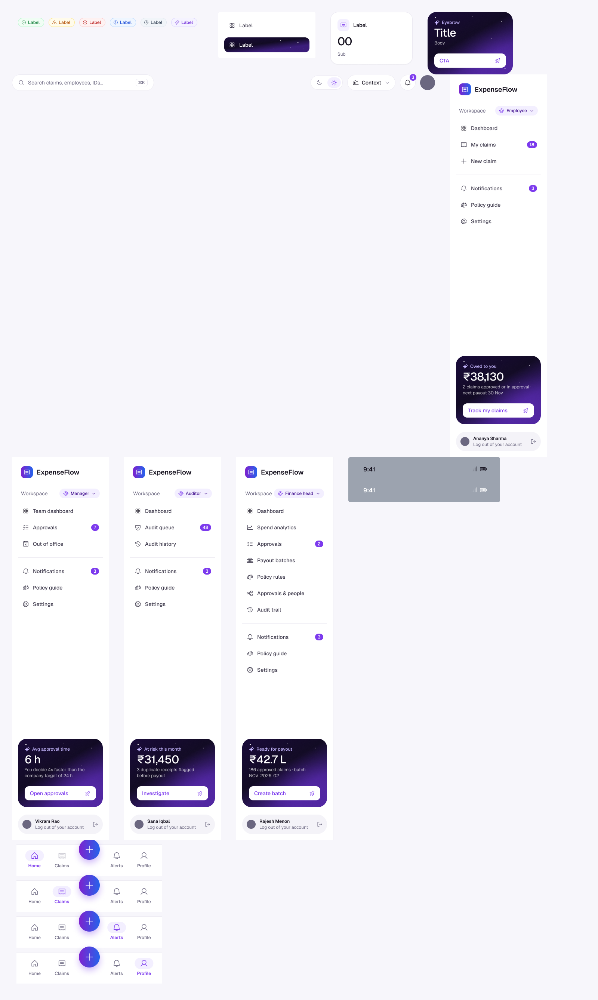

# Design foundations: tokens, shared layout, components

Source: Figma page **ExpenseFlow · UI** (file `1XAnGEKVeQflpveXADQ7MX`, node `4006:2`),
built on the *shadcn/ui kit, community edition*. The values below are the Figma variables,
read with the Figma MCP. Use them as Tailwind/shadcn CSS variables. Don't hard-code hex
values in components.



## Colour tokens (light theme)

Map these to the shadcn CSS variables in `frontend/src/index.css` (`:root`).

| shadcn variable | Figma variable | Hex |
|---|---|---|
| `--background` | general/background | `#f7f6fb` |
| `--foreground` | general/foreground | `#16121f` |
| `--card` | general/card | `#ffffff` |
| `--primary` | general/primary | `#7c3aed` (violet-600) |
| `--primary-foreground` | general/primary foreground | `#ffffff` |
| `--secondary` | general/secondary | `#f3efff` |
| `--secondary-foreground` | general/secondary foreground | `#5b21b6` |
| `--accent` | general/accent | `#f3efff` |
| `--accent-foreground` | general/accent foreground | `#4c1d95` |
| `--muted` | general/muted | `#f4f3f8` |
| `--muted-foreground` | general/muted foreground | `#6b6780` |
| `--border` | general/border | `#eceaf2` |
| `--input` | general/input | `#e2dfeb` |
| `--sidebar` | sidebar/sidebar | `#ffffff` |
| `--sidebar-foreground` | sidebar/sidebar foreground | `#3f3b4d` |
| `--sidebar-border` | sidebar/sidebar border | `#eceaf2` |

The design shows a dark-mode toggle (moon/sun in the Topbar), but no dark screens were
drawn. Use shadcn's default dark palette with the same violet primary until designs exist.

### Status tones (Status Chip)

Each tone is a light fill, a 1px border and a dark text/icon colour (Tailwind raw scale).

| Tone | Icon | Fill | Border | Text | Used for |
|---|---|---|---|---|---|
| success | ph/check-circle | green-50 `#f0fdf4` | green-200 `#bbf7d0` | green-700 `#15803d` | Approved, Paid, Within policy |
| warning | ph/warning | amber-50 `#fffbeb` | amber-200 `#fde68a` | amber-700 `#b45309` | Needs info, Over limit, Weekend flag |
| danger | ph/x-circle | red-50 | red-200 | red-700 | Rejected, Duplicate |
| info | ph/info | blue-50 `#eff6ff` | blue-200 `#bfdbfe` | blue-700 `#1d4ed8` | Submitted, In review |
| neutral | ph/clock | slate-100 `#f1f5f9` | slate-200 `#e2e8f0` | slate-700 `#334155` | Draft, Pending |
| purple | ph/sparkle | violet-50 `#f5f3ff` | violet-200 `#ddd6fe` | violet-700 `#6d28d9` | Smart/AI hints, sampled for audit |

The status-to-tone mapping above is a suggestion. Each screen spec lists the exact chips it shows.

## Typography

Font family: **Geist** (body and headings). Install with `npm i geist` or load from Google Fonts.

| Style | Size / line-height | Weight | Letter-spacing |
|---|---|---|---|
| Heading 2 | ? / 26* | 500 | -1 |
| Heading 3 | ? / 26.4* | 500 | -0.5 |
| Paragraph large | 18 / 27 | 400 / 500 / 600 | 0 |
| Paragraph regular | 16 / 24 | 400 / 500 / 600 | 0 |
| Paragraph small | 14 / 20 | 400 / 500 / 600 | 0 |
| Paragraph mini | 12 / 16 | 400 / 500 / 600 | 0 |

\* The Figma variables give the heading line-height, weight and tracking but not the font size.
Page titles in the PNGs look about 22–24px. Measure them in Figma if you need exact values.
Use tabular numerals (`font-variant-numeric: tabular-nums`) for amounts and IDs in tables.

## Spacing, radius, shadow

- Spacing scale: 2 (`3xs`), 4 (`2xs`), 6, 8 (`xs`), 10, 16 (`md`). Otherwise use the Tailwind 4px scale.
- Radius: `radius-md` 8px (inputs, buttons), `radius-lg` 10px (cards), `radius-full` 999px (chips, badges, pills).
- Shadow: `shadow-xs` = `0 1px 2px rgba(0,0,0,0.05)` on cards and inputs.

## Formatting conventions

- Currency: INR with Indian digit grouping, e.g. `₹38,450`, `₹1,20,000`. Large figures are shown as lakh: `₹42.7 L`.
  Use `Intl.NumberFormat('en-IN', { style: 'currency', currency: 'INR', maximumFractionDigits: 0 })`.
- Claim IDs: `EXP-YYYY-NNNN` (e.g. `EXP-2026-0813`). Payout batches: `MON-YYYY-NN` (e.g. `NOV-2026-02`).
- Dates: `16 Nov 2026`. Relative ages: `5 h`, `2 d`.

## Shared layout (every app screen except L1 Login)

```
┌──────────────┬──────────────────────────────────────────────────────┐
│ Sidebar 260  │ Topbar 44 (search · theme · Context · bell · avatar) │
│              ├──────────────────────────────────────────────────────┤
│ logo         │ Page header (title, subtitle, actions)               │
│ workspace ▾  │                                                      │
│ nav items    │ Page content (cards, tables, forms) on #f7f6fb       │
│ ───────      │                                                      │
│              │                                                      │
│ Promo card   │                                                      │
│ User card    │                                                      │
└──────────────┴──────────────────────────────────────────────────────┘
```

Canvas is 1440px wide. The main column is 1180px with ~32px side padding, so content is about 1116px wide.

## Components

### Sidebar (4 role variants)

Fixed 260px, white, right border `--sidebar-border`. From top: ExpenseFlow logo (violet square
with ph/receipt), **Workspace** role switcher (purple pill with ph/user-switch and caret), primary
nav, a divider (the old secondary group of Notifications, Policy guide and Settings was removed; see the note below),
then the **Sidebar Promo Card** and the user card (avatar, name, "Log out of your account", ph/sign-out).

| Variant | Primary nav (badge) | Promo card |
|---|---|---|
| Employee | Dashboard · My claims (18) · New claim | Owed to you · ₹38,130 · "Track my claims" |
| Manager | Team dashboard · Approvals (7) · Out of office | Avg approval time · 6 h · "Open approvals" |
| Auditor | Dashboard · Audit queue (48) · Audit history | At risk this month · ₹31,450 · "Investigate" |
| Finance head | Dashboard · Approvals (2) · Payout batches · Policy rules · Approvals & people · Audit trail | Ready for payout · ₹42.7 L · "Create batch" |

> **Updated design (re-export, 2026-11-27):** in the screens, the secondary group (Notifications, Policy
> guide, Settings) has been **removed** from the sidebars. The Finance head sidebar has also lost
> "Spend analytics", whose charts now live on F0. The manager screens disagree: M3 and M4 still show
> "Policy guide" below the divider, but M2 shows nothing there. The components sheet in Figma has not
> been updated and still shows the old items. **Build from the screens**, and check the Policy guide
> question with design.

The workspace switcher changes the role view. In the app it should only list the roles the
signed-in user actually has.

### Sidebar Nav Item

40px tall, 228px wide, icon (20px) + label + optional count badge (violet pill, white text).
States: **Default** (transparent) and **Active** (dark violet-to-navy gradient fill with white text).

### Topbar

44px row. Left: search input "Search claims, employees, IDs…" with ph/magnifying-glass and a
`⌘K` hint. Right: theme toggle (moon/sun segmented), **Context** dropdown (ph/buildings), bell
(ph/bell) with a count badge, avatar.

### KPI Card

220 × 140 card. Icon tile (violet-50 square with icon), label, large value (`00`), muted sub-text.
Shown in groups of 4 on the dashboards.

### Sidebar Promo Card

228 × 167, dark purple/navy gradient with a starfield. Eyebrow with ph/sparkle, big title, body
text, white CTA button with violet text and ph/rocket-launch icon.

### Status Chip

24px pill with an icon and a label, in six tones (see the table above). Map it to a shadcn `Badge` with
custom variants.

### Mobile / Status Bar

The iOS-style status bar ("9:41", signal and battery icons) comes in two variants. It is a device mock only,
so don't build it. In the app, leave room for it with `env(safe-area-inset-top)`.

### Mobile / Tab Bar

Bottom navigation for the mobile employee screens (MB1–MB9). It replaces the Sidebar below 640px.
Items: **Home** (ph/house) · **Claims** (ph/receipt) · a raised round violet-gradient **+** button
in the centre (new claim, opens scan or add) · **Alerts** (ph/bell) · **Profile** (ph/user). It has four
variants, one per active tab. The active tab has a light violet pill behind its icon and a violet label.
Pad the bottom with `env(safe-area-inset-bottom)`, and make each touch target at least 44px.

## Icons

Phosphor Icons, regular weight (`@phosphor-icons/react`). Icons used in the design:

squares-four, receipt, plus, check-circle, clock, warning, x-circle, info, bell, magnifying-glass,
caret-down, caret-right, sparkle, sparkle-fill, user, users, airplane-tilt, bed, fork-knife, taxi,
upload-simple, paper-plane-tilt, arrow-left, chart-bar, chart-line-up, bank, currency-inr,
sliders-horizontal, tree-structure, shield-check, list-checks, sign-out, calendar-blank,
calendar-x, copy, chat-circle-text, funnel, download-simple, export, flag, moon, sun,
dots-three-vertical, pencil-simple, trash, eye, lock-simple, arrow-u-up-left, user-switch,
file-csv, clock-counter-clockwise, buildings, seal-check, x, cloud-arrow-up, image, scales, gear,
rocket-launch, arrows-clockwise, wallet, hourglass-medium, check, note-pencil.

Added for mobile and the new login: envelope-simple, camera, house, lightning, caret-left, scan,
wifi-slash, cell-signal-full, battery-full, images.

Expense categories use: airplane-tilt (travel), bed (hotel), fork-knife (meals), taxi (local cab).

> Adding `@phosphor-icons/react` or `geist` is a dependency change. Agree it with the team first,
> per CLAUDE.md.
