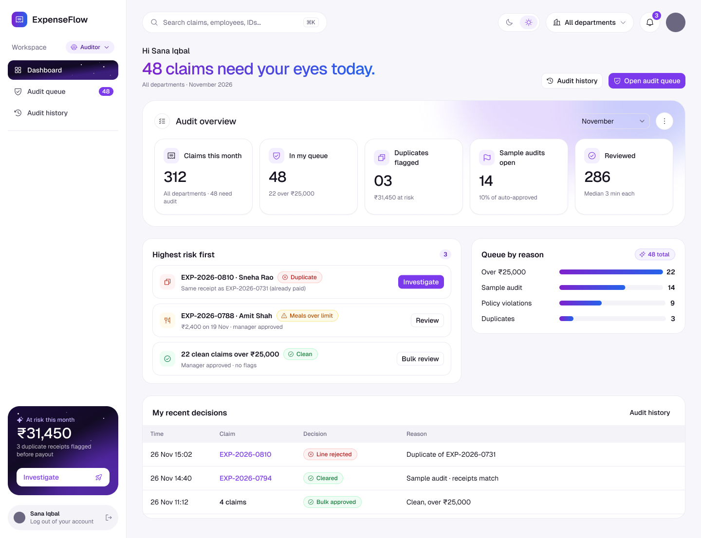

# A0 · Auditor dashboard

| | |
|---|---|
| Role | Finance auditor |
| Route (suggested) | /auditor |
| Figma node | 4016:2578 |
| Frame size | 1440 × 1106 |
| Sidebar variant | Auditor (Dashboard active) |

## Purpose
Landing page for the finance auditor (sample user Sana Iqbal). Shows how many claims need audit this month, the riskiest items first, the queue split by reason, and the auditor's own recent decisions, with shortcuts into the audit queue (A1), duplicate review (A2) and audit history (A3).

## Layout
1. Sidebar (260px, Auditor variant) + Main (1180px, 32px side padding, content width 1116px).
2. Topbar (44px) - Context dropdown reads "All departments".
3. Header row (90px): greeting block left (808px), two buttons right.
4. "Audit overview" card (full width, ~260px) with decorative purple gradient ellipses top-right: title row and 5 KPI cards in one row.
5. Two-column row (~299px): "Highest risk first" card (656px) left, "Queue by reason" card (440px) right.
6. "My recent decisions" card (full width, ~253px) with a table.

## Content & components

### Sidebar (Auditor)
Workspace switcher shows "Auditor". Nav: Dashboard (active, dark starry pill), Audit queue (badge **48**), Audit history; divider. The Notifications / Policy guide / Settings group that used to sit below the divider is no longer in the design (notifications remain reachable from the Topbar bell, badge **3**). Sidebar Promo Card: "At risk this month" / **₹31,450** / "3 duplicate receipts flagged before payout" / button "Investigate" (ph/rocket-launch icon). User card: "Sana Iqbal" / "Log out of your account".

### Header
- Eyebrow: "Hi Sana Iqbal"
- Heading (large, purple→blue gradient text): "48 claims need your eyes today."
- Sub-text (muted, small): "All departments · November 2026"
- Buttons: "Audit history" (outline, ph/clock-counter-clockwise), "Open audit queue" (primary, ph/shield-check).

### Audit overview card
- Title row: icon chip (ph/list-checks) + "Audit overview"; right: Select "November" and a round kebab button (ph/dots-three-vertical).
- KPI Cards (5, equal width, icon in tinted square, label, big value, sub-text):

| Icon | Label | Value | Sub-text |
|---|---|---|---|
| ph/receipt | Claims this month | 312 | All departments · 48 need audit |
| ph/shield-check | In my queue | 48 | 22 over ₹25,000 |
| ph/copy | Duplicates flagged | 03 | ₹31,450 at risk |
| ph/flag | Sample audits open | 14 | 10% of auto-approved |
| ph/check-circle | Reviewed | 286 | Median 3 min each |

### Highest risk first card
Title "Highest risk first", count badge **3** (purple, top-right). Three bordered list rows, each: tinted icon square, title + Status Chip, sub-text, action button right.

| Icon (tone) | Title | Chip (tone) | Sub-text | Button |
|---|---|---|---|---|
| ph/copy (danger) | EXP-2026-0810 · Sneha Rao | Duplicate (danger) | Same receipt as EXP-2026-0731 (already paid) | Investigate (primary) |
| ph/fork-knife (warning) | EXP-2026-0788 · Amit Shah | Meals over limit (warning) | ₹2,400 on 19 Nov · manager approved | Review (outline) |
| ph/check-circle (success) | 22 clean claims over ₹25,000 | Clean (success) | Manager approved · no flags | Bulk review (outline) |

### Queue by reason card
Title "Queue by reason", chip "48 total" (purple, ph/sparkle). Four rows of label + horizontal bar (purple→blue gradient fill, grey track) + count:

| Reason | Count |
|---|---|
| Over ₹25,000 | 22 |
| Sample audit | 14 |
| Policy violations | 9 |
| Duplicates | 3 |

### My recent decisions card
Header: "My recent decisions" left, ghost link-button "Audit history" right. Table (grey header row):

| Time | Claim | Decision | Reason |
|---|---|---|---|
| 26 Nov 15:02 | EXP-2026-0810 (purple link) | Line rejected (danger) | Duplicate of EXP-2026-0731 |
| 26 Nov 14:40 | EXP-2026-0794 (purple link) | Cleared (success) | Sample audit · receipts match |
| 26 Nov 11:12 | 4 claims (plain text) | Bulk approved (success) | Clean, over ₹25,000 |

## Interactions & states
- "Open audit queue" / sidebar "Audit queue" → A1. "Audit history" buttons (header + table card) → A3.
- "Investigate" (risk row, promo card) → A2 for EXP-2026-0810.
- "Review" on EXP-2026-0788 → Behaviour (inferred): opens that claim's audit view (no dedicated violation screen in this set; A1 filtered to Policy violations is the nearest).
- "Bulk review" → Behaviour (inferred): A1 with the "Over ₹25,000" tab active.
- Queue by reason rows → Behaviour (inferred): A1 with matching tab.
- Month Select changes all overview figures. Kebab menu contents not shown.
- Claim links in the decisions table → claim audit view.
- Empty states not designed; suggest "Nothing in your queue" in the risk card and hiding the table when no decisions.

## Data & API
- Auditor name: logged-in user (`/auth/login` / users API).
- Not yet in API: auditor dashboard summary (claims this month, queue size, duplicates flagged + amount at risk, open sample audits, reviewed count, median review time) - needs e.g. `GET /audit/summary?month=`.
- Not yet in API: risk-ranked queue items and queue counts by reason (`GET /audit/queue` with reason facets).
- Not yet in API: auditor decisions log (`GET /audit/decisions?auditor=me`). Existing `GET /claims/{id}/audit` is per-claim only and has no auditor decision actions.
- Claim list for "Claims this month" could partly come from `GET /claims`, but there are no auditor statuses (only DRAFT, SUBMITTED today).

## Build notes
- shadcn: Card, Button, Badge (Status Chip), Select, DropdownMenu (kebab), Table, Progress (custom gradient fill for reason bars).
- Reuse KPI Card (also on A3), Status Chip, Sidebar Promo Card.
- Gradient headline: `bg-clip-text text-transparent` with purple→blue gradient.
- The decorative ellipses in the overview card are blurred background shapes - use an absolutely positioned radial gradient, `pointer-events-none`.
- Format numbers with `Intl.NumberFormat('en-IN')`; "03" for duplicates is zero-padded in the design.
