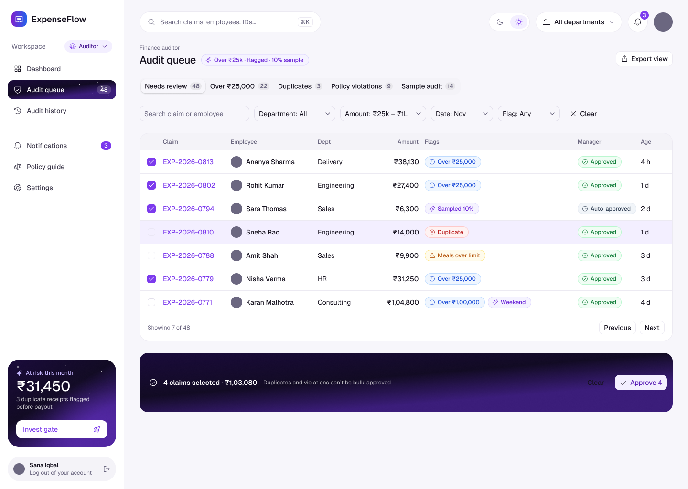

# A1 · Audit queue

| | |
|---|---|
| Role | Finance auditor |
| Route (suggested) | /auditor/queue |
| Figma node | 4016:2953 |
| Frame size | 1440 × 1024 |
| Sidebar variant | Auditor (Audit queue active) |

## Purpose
The auditor's working list of manager-approved claims that need audit: claims over ₹25,000, flagged claims (duplicates, policy violations) and a 10% random sample of auto-approved claims. The auditor filters the list, opens a claim to audit it, or bulk-approves clean claims.

## Layout
1. Sidebar (260px) + Main (content width 1116px).
2. Topbar (44px), Context dropdown "All departments".
3. Page header (47px): eyebrow + title + info chip left; "Export view" button right.
4. Tab row (35px, ~672px wide segmented control).
5. Filter row (32px): search input (230px), four selects (170/180/130/130px), "Clear" ghost button.
6. Table card (437px): table (379px) + footer (56px) with count and pager.
7. Bulk action bar (124px, full width, dark purple gradient) below the table.

## Content & components

### Header
- Eyebrow: "Finance auditor"; title: "Audit queue".
- Chip (purple, ph/sparkle): "Over ₹25k · flagged · 10% sample".
- Button: "Export view" (outline, ph/export).

### Tabs (segmented, count badge in each)
"Needs review" **48** (selected, white pill) · "Over ₹25,000" **22** · "Duplicates" **3** · "Policy violations" **9** · "Sample audit" **14**.

### Filters
- Input, placeholder "Search claim or employee".
- Select "Department: All".
- Select "Amount: ₹25k – ₹1L".
- Select "Date: Nov".
- Select "Flag: Any".
- Ghost button "Clear" (ph/x).

### Queue table
Columns: [checkbox] · Claim · Employee (avatar + name) · Dept · Amount (right-aligned) · Flags · Manager · Age.

| ☐ | Claim | Employee | Dept | Amount | Flags (tone) | Manager (tone) | Age |
|---|---|---|---|---|---|---|---|
| ☑ | EXP-2026-0813 | Ananya Sharma | Delivery | ₹38,130 | Over ₹25,000 (info) | Approved (success) | 4 h |
| ☑ | EXP-2026-0802 | Rohit Kumar | Engineering | ₹27,400 | Over ₹25,000 (info) | Approved (success) | 1 d |
| ☑ | EXP-2026-0794 | Sara Thomas | Sales | ₹6,300 | Sampled 10% (purple, ph/sparkle) | Auto-approved (neutral, ph/clock) | 2 d |
| ☐ (disabled) | EXP-2026-0810 | Sneha Rao | Engineering | ₹14,000 | Duplicate (danger) | Approved (success) | 1 d |
| ☐ | EXP-2026-0788 | Amit Shah | Sales | ₹9,900 | Meals over limit (warning) | Approved (success) | 3 d |
| ☑ | EXP-2026-0779 | Nisha Verma | HR | ₹31,250 | Over ₹25,000 (info) | Approved (success) | 3 d |
| ☐ | EXP-2026-0771 | Karan Malhotra | Consulting | ₹1,04,800 | Over ₹1,00,000 (info) + Weekend (purple) | Approved (success) | 4 d |

- Claim IDs are purple links. Checked boxes are filled primary purple.
- Row EXP-2026-0810 shows a light purple hover/highlight background.
- Footer: "Showing 7 of 48" left; "Previous" and "Next" outline buttons right.

### Bulk action bar
Dark purple gradient panel, rounded. Left: ph/check-circle + "**4 claims selected · ₹1,03,080**" + muted "Duplicates and violations can’t be bulk-approved". Right: ghost "Clear" (low-contrast on dark) and light button "Approve 4" (ph/check, white bg, purple text).

## Interactions & states
- Tabs filter the table and update counts; tab state should be in the URL (`?tab=duplicates`) so A0 can deep-link.
- Filters narrow the list; "Clear" resets all four selects and the search.
- Click a Claim ID (or row) → audit view of that claim; Duplicate-flagged claims → A2.
- Checkbox selects a row; the bulk bar appears only when ≥1 row is selected and shows count + summed amount (₹38,130 + ₹27,400 + ₹6,300 + ₹31,250 = ₹1,03,080).
- Rows flagged Duplicate or a policy violation cannot be bulk-approved: checkbox disabled (shown on EXP-2026-0810). Behaviour (inferred): EXP-2026-0788 (Meals over limit) is also blocked; Tooltip explaining why is recommended.
- "Approve 4" → Behaviour (inferred): approves all selected claims as auditor, logs a "Bulk approved" decision (appears in A3), removes them from the queue. A confirm Dialog is advisable but not designed.
- Bulk bar "Clear" deselects all. Header checkbox (select all) is not visible in the design - column header text is blank.
- "Export view" → Behaviour (inferred): downloads current filtered view as CSV.
- Pagination: Previous/Next; disable Previous on first page.
- Empty / loading / error states not designed.

## Data & API
- Base list: `GET /claims` (limit, offset) gives id, employee, total_amount, status - but only DRAFT/SUBMITTED.
- Not yet in API: auditor-queue endpoint with reason filter (over threshold / duplicate / violation / sample), department, amount range, date, flag, search, plus per-tab counts.
- Not yet in API: claim flags (duplicate, policy violation codes, weekend), manager approval state (Approved / Auto-approved), age, employee name + department in list summaries, 10% sample selection.
- Not yet in API: bulk approve (`POST /audit/decisions/bulk`) with server-side refusal of duplicates/violations.
- Not yet in API: export of the filtered view.
- The ₹25,000 threshold and 10% sample rate must come from seeded policy config, not be hard-coded.

## Build notes
- shadcn: Tabs (or ToggleGroup) with Badge counts, Input, Select ×4, Button, Table, Checkbox, Avatar, Badge (Status Chip), Tooltip, Pagination (or two Buttons).
- Bulk bar: sticky/fixed at the bottom of Main is a reasonable enhancement; design shows it inline under the card.
- Reuse the table row/Status Chip pattern from A3 and the manager screens.
- Amounts right-aligned with tabular numerals, Indian grouping (₹1,04,800).
- Keep selection state keyed by claim id so it survives pagination; recompute the total from selected rows.
