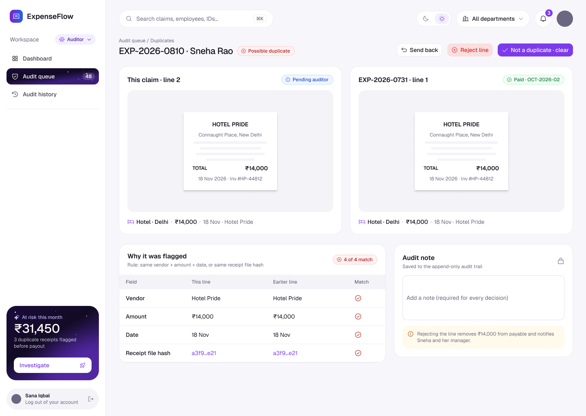

# A2 · Audit a claim (duplicate detection)

| | |
|---|---|
| Role | Finance auditor |
| Route (suggested) | /auditor/claims/:id (duplicate check) |
| Figma node | 4016:3416 |
| Frame size | 1440 × 1024 |
| Sidebar variant | Auditor (Audit queue active; nav is Dashboard / Audit queue / Audit history only - no Notifications / Policy guide / Settings group) |

## Purpose
Lets the auditor compare a flagged claim line side by side with the earlier, already-paid line it appears to duplicate, see which match rules fired, write a mandatory audit note, and decide: send back, reject the line, or clear it as not a duplicate.

## Layout
1. Sidebar (260px) + Main (content width 1116px).
2. Topbar (44px).
3. Header (47px): breadcrumb + title + chip left (671px); three action buttons right.
4. Comparison row (414px): two equal cards (548px each) - "This claim" left, earlier claim right.
5. Bottom row (292px): "Why it was flagged" card (656px) left, "Audit note" card (440px) right.

## Content & components

### Header
- Breadcrumb: "Audit queue / Duplicates".
- Title: "EXP-2026-0810 · Sneha Rao" + Status Chip "Possible duplicate" (danger, ph/x-circle).
- Buttons (right): "Send back" (outline, ph/arrow-u-up-left), "Reject line" (danger-soft: pink bg, red text, ph/x-circle), "Not a duplicate · clear" (primary, ph/check).

### Receipt comparison cards (identical structure)
| | Left card | Right card |
|---|---|---|
| Title | This claim · line 2 | EXP-2026-0731 · line 1 |
| Chip | Pending auditor (info) | Paid · OCT-2026-02 (success) |
| Receipt preview | HOTEL PRIDE / Connaught Place, New Delhi / TOTAL ₹14,000 / 18 Nov 2026 · Inv #HP-44812 | same |
| Footer line | ph/bed + "Hotel · Delhi" · "₹14,000" · "18 Nov · Hotel Pride" (muted) | same |

Receipt preview sits on a grey rounded panel (~506×300) with a white receipt thumbnail centred.

### Why it was flagged card
- Title "Why it was flagged"; sub-text "Rule: same vendor + amount + date, or same receipt file hash".
- Chip top-right: "4 of 4 match" (danger).
- Table:

| Field | This line | Earlier line | Match |
|---|---|---|---|
| Vendor | Hotel Pride | Hotel Pride | ✓ (red check-circle) |
| Amount | ₹14,000 | ₹14,000 | ✓ |
| Date | 18 Nov | 18 Nov | ✓ |
| Receipt file hash | a3f9…e21 (purple, mono-ish link) | a3f9…e21 | ✓ |

### Audit note card
- Title "Audit note"; sub-text "Saved to the append-only audit trail"; ph/lock icon top-right.
- Textarea (~398×110), placeholder "Add a note (required for every decision)". Required.
- Warning callout (warning tone, ph/info): "Rejecting the line removes ₹14,000 from payable and notifies Sneha and her manager."

## Interactions & states
- All three decision buttons require a non-empty audit note; Behaviour (inferred): disable them, or show an inline error on the Textarea, until a note is entered.
- "Reject line" → Behaviour (inferred): rejects line 2 only, removes ₹14,000 from payable, notifies employee + manager, writes a "Line rejected" decision (source Duplicate) → back to A1; entry appears in A3.
- "Not a duplicate · clear" → clears the flag, logs "Cleared".
- "Send back" → returns the claim to the employee for correction, logs "Sent back".
- Breadcrumb "Audit queue" → A1 (Duplicates tab).
- Clicking a receipt preview → Behaviour (inferred): opens the full receipt (Dialog or new tab).
- Hash values look like links → Behaviour (inferred): show full hash in a Tooltip / copy.
- "EXP-2026-0731" title → Behaviour (inferred): opens that paid claim read-only.
- Match column: a non-matching field would show a neutral/grey icon (not designed).
- Loading and error states not designed.

## Data & API
- Claim header, line 2 (category, amount, expense_date, vendor, city, receipt_number) and receipt file: `GET /claims/{id}`, `GET /claims/{id}/attachments/{att_id}`.
- Earlier claim line + receipt: same endpoints with the matched claim id (auditor role can read any claim).
- Not yet in API: duplicate-detection result (matched claim/line ids, rule fired, per-field match) and receipt file hash on attachments.
- Not yet in API: payout state/batch of the earlier claim ("Paid · OCT-2026-02") and "Pending auditor" status - only DRAFT/SUBMITTED exist today.
- Not yet in API: auditor decision endpoint (send back / reject line / clear) with mandatory note, line-level rejection, notifications.
- Audit trail write: existing `GET /claims/{id}/audit` is read-only and has only CREATED/UPDATED/SUBMITTED actions; decision events need adding.

## Build notes
- shadcn: Breadcrumb, Button (outline / destructive-soft / primary), Badge, Card, Table, Textarea, Alert (warning callout), Tooltip, Dialog (receipt zoom).
- Build a reusable `ReceiptCompareCard` (title, chip, preview, footer meta) used twice.
- Render receipt previews as `` of the uploaded attachment; the HOTEL PRIDE mock is placeholder art.
- Truncate hashes as `first4…last3`.
- Destructive-soft button is not a default shadcn variant - add a `destructive-soft` variant.
