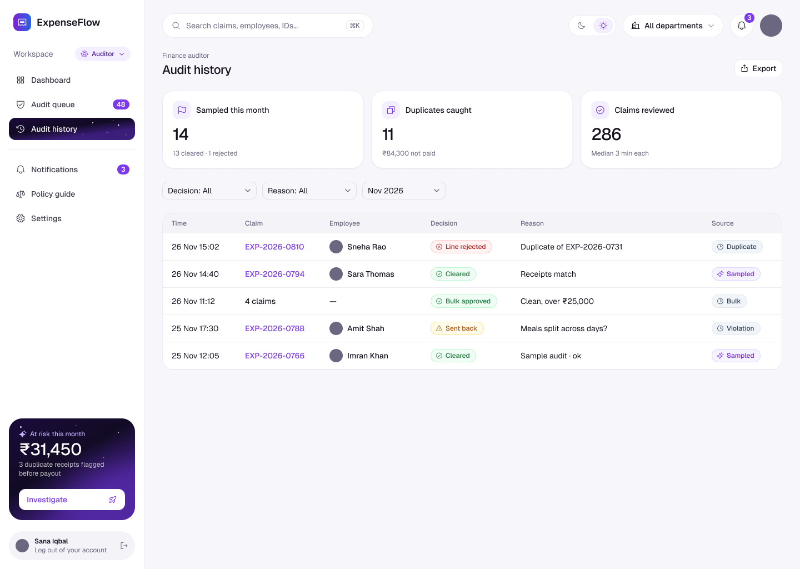

# A3 · Audit history

| | |
|---|---|
| Role | Finance auditor |
| Route (suggested) | /auditor/history |
| Figma node | 4016:3703 |
| Frame size | 1440 × 1024 |
| Sidebar variant | Auditor (Audit history active) |

## Purpose
Read-only log of the auditor's decisions (cleared, line rejected, bulk approved, sent back) with monthly totals, so the auditor and finance can trace what was audited, why, and how each claim entered the queue.

## Layout
1. Sidebar (260px) + Main (content width 1116px).
2. Topbar (44px).
3. Header (47px): eyebrow + title left; "Export" button right.
4. KPI row (140px): three equal KPI Cards (~363px each).
5. Filter row (32px): three selects (170/170/150px).
6. Table card (283px).

## Content & components

### Header
- Eyebrow: "Finance auditor"; title: "Audit history".
- Button: "Export" (outline, ph/export).

### KPI Cards
| Icon | Label | Value | Sub-text |
|---|---|---|---|
| ph/flag | Sampled this month | 14 | 13 cleared · 1 rejected |
| ph/copy | Duplicates caught | 11 | ₹84,300 not paid |
| ph/check-circle | Claims reviewed | 286 | Median 3 min each |

### Filters
- Select "Decision: All"
- Select "Reason: All"
- Select "Nov 2026"

### Decisions table
Columns: Time · Claim · Employee (avatar + name) · Decision · Reason · Source.

| Time | Claim | Employee | Decision (tone) | Reason | Source (tone) |
|---|---|---|---|---|---|
| 26 Nov 15:02 | EXP-2026-0810 | Sneha Rao | Line rejected (danger) | Duplicate of EXP-2026-0731 | Duplicate (neutral) |
| 26 Nov 14:40 | EXP-2026-0794 | Sara Thomas | Cleared (success) | Receipts match | Sampled (purple, ph/sparkle) |
| 26 Nov 11:12 | 4 claims | — | Bulk approved (success) | Clean, over ₹25,000 | Bulk (neutral) |
| 25 Nov 17:30 | EXP-2026-0788 | Amit Shah | Sent back (warning) | Meals split across days? | Violation (neutral) |
| 25 Nov 12:05 | EXP-2026-0766 | Imran Khan | Cleared (success) | Sample audit · ok | Sampled (purple) |

- Claim IDs are purple links; the bulk row shows plain "4 claims" and "—" for Employee.
- Neutral source chips use ph/clock icon. No pagination shown (5 rows).

## Interactions & states
- Filters: Decision (Cleared / Line rejected / Bulk approved / Sent back), Reason/source, month. Behaviour (inferred): update KPI cards to the chosen month too.
- Claim link → that claim's audit view (A2 for duplicate rows; read-only claim detail otherwise).
- "4 claims" → Behaviour (inferred): expands or opens a Popover listing the bulk-approved claim IDs.
- "Export" → Behaviour (inferred): CSV of the filtered log.
- History is append-only: no edit/delete actions anywhere on the page.
- Empty state (no decisions for month), loading and pagination not designed; add pagination when >N rows.

## Data & API
- Not yet in API: auditor decisions log across claims (time, claim id(s), employee, decision, reason/note, source) with filters - e.g. `GET /audit/decisions?decision=&source=&month=`.
- Not yet in API: monthly audit stats (sampled count with cleared/rejected split, duplicates caught + amount not paid, claims reviewed, median review time).
- Not yet in API: export.
- Existing `GET /claims/{id}/audit` provides a per-claim change history only (CREATED/UPDATED/SUBMITTED); usable for a drill-down, not for this list.

## Build notes
- shadcn: Card, Select ×3, Table, Avatar, Badge (Status Chip), Button, Popover (bulk row).
- Reuse KPI Card from A0; table + decision chips match A0 "My recent decisions" - build one `AuditDecisionsTable` with an optional Employee/Source column.
- Decision → tone map: Line rejected = danger, Cleared/Bulk approved = success, Sent back = warning. Source → tone: Sampled = purple, others neutral.
- Time format "26 Nov 15:02" in local time (IST).
