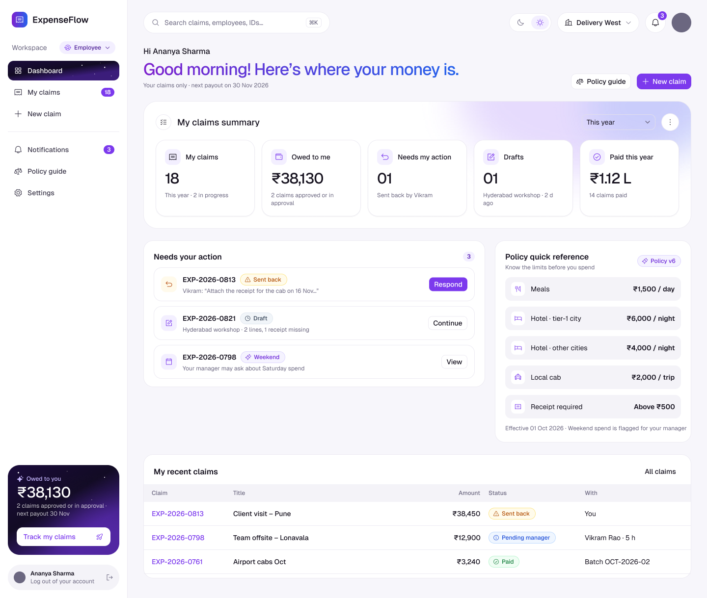

# E1 · Employee dashboard

| | |
|---|---|
| Role | Employee |
| Route (suggested) | /dashboard (employee home) |
| Figma node | 4011:232 |
| Frame size | 1440 × 1219 |
| Sidebar variant | Employee (active item: Dashboard) |

## Purpose
Landing page for an employee after login. Shows how much money is owed to them, which claims need their action, the key policy limits, and their most recent claims.

## Layout
Sidebar (260) + Main (1180, 32px side padding, content width 1116). Main, top to bottom:
1. Topbar (shared, 44px).
2. Greeting header (1116 × 90): greeting text block left, two buttons right (bottom-aligned).
3. **My claims summary** card (1116 × 260) with a soft purple glow top-right; header row + 5 KPI Cards in a row.
4. Two-column row (1116 × 412): **Needs your action** card left (696 wide), **Policy quick reference** card right (400 wide).
5. **My recent claims** table card (1116 × 253).

## Content & components

### Sidebar (Employee)
Items: Dashboard (active), My claims (badge 18), New claim; then Notifications (badge 3), Policy guide, Settings. Workspace switcher shows "Employee". Sidebar Promo Card: "Owed to you" · **₹38,130** · "2 claims approved or in approval · next payout 30 Nov" · button "Track my claims". User card: "Ananya Sharma" / "Log out of your account".

### Greeting header
- Small text: "Hi Ananya Sharma"
- H1 (gradient purple → blue, ~32px): "Good morning! Here’s where your money is."
- Muted caption: "Your claims only · next payout on 30 Nov 2026"
- Buttons: **Policy guide** (outline, icon ph/scales) · **New claim** (primary, icon ph/plus).

### My claims summary
- Header: icon tile (ph/list-checks) + "My claims summary"; right side: Select "This year" (~140px) and a round icon button ph/dots-three-vertical.
- KPI Cards (5, equal width):

| Icon | Label | Value | Sub-text |
|---|---|---|---|
| ph/receipt | My claims | 18 | This year · 2 in progress |
| ph/wallet | Owed to me | ₹38,130 | 2 claims approved or in approval |
| ph/arrow-u-up-left | Needs my action | 01 | Sent back by Vikram |
| ph/pencil-simple-line | Drafts | 01 | Hyderabad workshop · 2 d ago |
| ph/check-circle | Paid this year | ₹1.12 L | 14 claims paid |

### Needs your action (card)
Header "Needs your action" with a count pill "3" (purple). Three action rows (bordered, rounded, icon tile left, button right):

| Icon | Claim | Status Chip | Sub-text | Button |
|---|---|---|---|---|
| ph/arrow-u-up-left (amber tile) | EXP-2026-0813 | Sent back (warning, ph/warning) | Vikram: “Attach the receipt for the cab on 16 Nov…” | **Respond** (primary) |
| ph/pencil-simple (purple tile) | EXP-2026-0821 | Draft (neutral, ph/clock) | Hyderabad workshop · 2 lines, 1 receipt missing | **Continue** (outline) |
| ph/calendar (purple tile) | EXP-2026-0798 | Weekend (purple, ph/sparkle) | Your manager may ask about Saturday spend | **View** (outline) |

### Policy quick reference (card)
- Title "Policy quick reference"; subtitle "Know the limits before you spend"; chip "Policy v6" (purple, ph/sparkle).
- Five grey rows (icon, label left, bold value right):

| Icon | Label | Value |
|---|---|---|
| ph/fork-knife | Meals | ₹1,500 / day |
| ph/bed | Hotel · tier-1 city | ₹6,000 / night |
| ph/bed | Hotel · other cities | ₹4,000 / night |
| ph/car | Local cab | ₹2,000 / trip |
| ph/receipt | Receipt required | Above ₹500 |

- Footer caption: "Effective 01 Oct 2026 · Weekend spend is flagged for your manager"

### My recent claims (table card)
Header "My recent claims", right link "All claims". Columns: Claim · Title · Amount (right-aligned) · Status · With.

| Claim | Title | Amount | Status | With |
|---|---|---|---|---|
| EXP-2026-0813 | Client visit – Pune | ₹38,450 | Sent back (warning) | You |
| EXP-2026-0798 | Team offsite – Lonavala | ₹12,900 | Pending manager (info) | Vikram Rao · 5 h |
| EXP-2026-0761 | Airport cabs Oct | ₹3,240 | Paid (success) | Batch OCT-2026-02 |

Claim IDs are purple links.

## Interactions & states
- **New claim** (header and sidebar) → N1 (start new claim).
- **Policy guide** button / sidebar item → policy guide page (not in this set).
- **Respond** → E5 for EXP-2026-0813. **Continue** → E3 (draft editor) for EXP-2026-0821. **View** → E5 for EXP-2026-0798.
- KPI Cards — Behaviour (inferred): clicking navigates to E2 filtered by the matching tab (Drafts, Sent back, Paid…).
- "This year" Select — Behaviour (inferred): changes the period for the KPIs (other options not shown).
- ⋮ menu: contents not designed.
- Claim ID link / row click → E5. **All claims** → E2.
- Promo card **Track my claims** — Behaviour (inferred): → E2 filtered to In approval/Approved.
- Empty states (not designed): "Needs your action" with zero items, no recent claims for a new employee.

## Data & API
- Recent claims: `GET /claims?limit=3` (summaries, newest updated first): `id`, `title`, `total_amount`, `status`, `updated_at`.
- Drafts count: `GET /claims?status=DRAFT&limit=1` → `total`. My claims count: `GET /claims` → `total`.
- Display claim code `EXP-2026-0813`: Not yet in API (API returns numeric `id`; formatted reference needed).
- Owed to me, Paid this year, Needs my action, "With" column (current approver + waiting time), Sent back / Pending manager / Approved / Paid statuses, payout batch name, next payout date: **Not yet in API** (approval states and payouts are pending).
- Manager comment preview ("Vikram: …"): Not yet in API (send-back comments).
- Policy quick reference values and version "v6", effective date: Not yet in API (needs a read endpoint for seeded policy config, e.g. `GET /policy`).
- User name for greeting: from login / `/users/me` (confirm).

## Build notes
- shadcn: `Card`, `Badge` (Status Chip), `Button`, `Select`, `DropdownMenu` (⋮), `Table`.
- Reuse: KPI Card (also on M1/A0/F0), Status Chip, the recent-claims table is a trimmed version of the E2 table — share a `ClaimsTable` with configurable columns.
- Action rows: a small `ActionItem` component (icon tile tone, id, chip, subtitle, action button).
- Policy values must come from config, never hard-coded.
- Format money with `Intl.NumberFormat('en-IN', { style: 'currency', currency: 'INR', maximumFractionDigits: 0 })`; "₹1.12 L" needs a lakh/crore compact formatter.
- Greeting ("Good morning") depends on local time.
