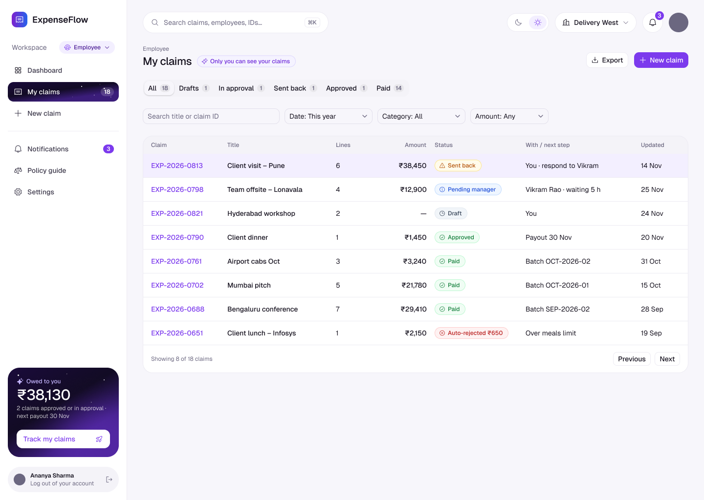

# E2 · My claims

| | |
|---|---|
| Role | Employee |
| Route (suggested) | /claims |
| Figma node | 4012:452 |
| Frame size | 1440 × 1024 |
| Sidebar variant | Employee (active item: My claims) |

## Purpose
The employee's full list of their own claims, filterable by status, date, category and amount, with who holds each claim and the next step.

## Layout
Sidebar (260) + Main (content width 1116). Main, top to bottom:
1. Topbar (shared).
2. Page header (1116 × 47): eyebrow + title + scope chip left; **Export** and **New claim** buttons right.
3. Status tabs (segmented control, ~545 × 35).
4. Filter row (1116 × 32): search input 280, three selects 180 / 180 / 160, 12px gaps.
5. Claims table card (1116 × 486) with footer (pagination).

## Content & components

### Page header
- Eyebrow (muted, small): "Employee"
- H1: "My claims"
- Chip (purple, ph/sparkle): "Only you can see your claims"
- Buttons: **Export** (outline, ph/download-simple) · **New claim** (primary, ph/plus).

### Status tabs
Segmented tabs on a light grey track; each tab has a small count pill. Active tab = white pill.

| Tab | Count |
|---|---|
| All (active) | 18 |
| Drafts | 1 |
| In approval | 1 |
| Sent back | 1 |
| Approved | 1 |
| Paid | 14 |

### Filters
- Input, placeholder "Search title or claim ID" (280px).
- Select "Date: This year" (180px).
- Select "Category: All" (180px).
- Select "Amount: Any" (160px).

### Claims table
Columns: Claim · Title · Lines · Amount (right) · Status · With / next step · Updated.

| Claim | Title | Lines | Amount | Status (tone) | With / next step | Updated |
|---|---|---|---|---|---|---|
| EXP-2026-0813 | Client visit – Pune | 6 | ₹38,450 | Sent back (warning) | You · respond to Vikram | 14 Nov |
| EXP-2026-0798 | Team offsite – Lonavala | 4 | ₹12,900 | Pending manager (info) | Vikram Rao · waiting 5 h | 25 Nov |
| EXP-2026-0821 | Hyderabad workshop | 2 | — | Draft (neutral) | You | 24 Nov |
| EXP-2026-0790 | Client dinner | 1 | ₹1,450 | Approved (success) | Payout 30 Nov | 20 Nov |
| EXP-2026-0761 | Airport cabs Oct | 3 | ₹3,240 | Paid (success) | Batch OCT-2026-02 | 31 Oct |
| EXP-2026-0702 | Mumbai pitch | 5 | ₹21,780 | Paid (success) | Batch OCT-2026-01 | 15 Oct |
| EXP-2026-0688 | Bengaluru conference | 7 | ₹29,410 | Paid (success) | Batch SEP-2026-02 | 28 Sep |
| EXP-2026-0651 | Client lunch – Infosys | 1 | ₹2,150 | Auto-rejected ₹650 (danger) | Over meals limit | 19 Sep |

- Claim IDs are purple links. First row (needs action) has a light purple highlighted background.
- Chip icons: Sent back ph/warning, Pending manager ph/info, Draft ph/clock, Approved/Paid ph/check-circle, Auto-rejected ph/x-circle.
- Draft with no amount shows "—".

### Footer
"Showing 8 of 18 claims" (muted) left; **Previous** and **Next** (outline, small) right.

## Interactions & states
- Tab click filters the table; Behaviour (inferred): tab is reflected in the URL (`?status=`).
- Search, Date, Category, Amount filters narrow the list (Behaviour inferred; option lists not designed).
- Row / claim ID click → E5 (claim detail); a Draft row → E3 (draft editor).
- Highlighted row = claim waiting on the employee (Sent back).
- **New claim** → N1. **Export** — Behaviour (inferred): downloads the filtered list as CSV.
- Pagination: Previous disabled on the first page (not shown as disabled in the design).
- Empty / loading / error states not designed: suggest a table skeleton and "No claims match these filters".

## Data & API
- List: `GET /claims?status=&limit=8&offset=` → `items[]` (`id`, `title`, `total_amount`, `status`, `updated_at`) + `total` for "Showing X of Y".
- Status filter today supports only `DRAFT`, `SUBMITTED`. Tabs In approval / Sent back / Approved / Paid and chips Pending manager / Auto-rejected: **Not yet in API** (approval and payout states).
- Per-tab counts: Not yet in API (would need N calls or a counts endpoint).
- Lines count per claim: Not yet in API (list returns summaries without lines; add `line_count`).
- "With / next step" text (current holder, waiting time, payout batch): Not yet in API.
- Auto-rejected amount (₹650) and reason: Not yet in API (policy engine).
- Search by title/ID, date, category and amount filters: Not yet in API (only `status`, `limit`, `offset`).
- Claim display code `EXP-YYYY-NNNN`: Not yet in API.
- Export CSV of own claims: Not yet in API.

## Build notes
- shadcn: `Tabs` (or `ToggleGroup`) with `Badge` counts, `Input`, `Select`, `Table`, `Badge` (Status Chip), `Button`, `Pagination` (or two Buttons).
- Shared `ClaimsTable` (also E1 recent claims, M2 queue, A1 queue) with column config.
- Central `statusToChip(status)` mapping so labels/tones stay identical across screens.
- Right-align the Amount column and use tabular numbers (`tabular-nums`).
