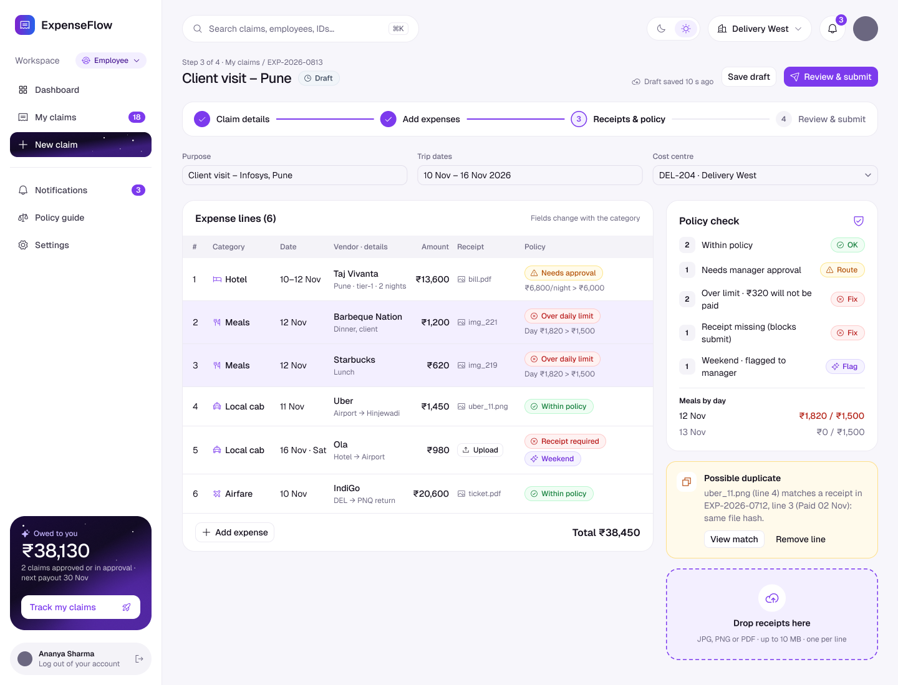

# E3 · Draft with expenses (lines, receipts, live policy)

| | |
|---|---|
| Role | Employee |
| Route (suggested) | /claims/:id/edit |
| Figma node | 4013:828 |
| Frame size | 1440 × 1099 |
| Sidebar variant | Employee (active item: New claim) |

## Purpose
The draft claim editor, step 3 of the new-claim wizard. The employee sees all expense lines with receipts, and a live policy check shows which lines pass, need approval, are over a limit, miss a receipt or look like duplicates before submitting.

## Layout
Sidebar (260) + Main (content width 1116). Main, top to bottom:
1. Topbar (shared).
2. Page header (1116 × 47): breadcrumb + title + chip left; autosave note + two buttons right.
3. Stepper card (1116 × 56): 4 steps joined by lines.
4. Claim header fields row (1116 × 54): 3 equal columns (~361 each).
5. Two-column body (1116 × 738): **Expense lines** card left (756 × 564); right column 340 wide with **Policy check** card, **Possible duplicate** alert, receipt drop zone.

## Content & components

### Page header
- Breadcrumb (muted): "Step 3 of 4 · My claims / EXP-2026-0813"
- H1 "Client visit – Pune" + Status Chip "Draft" (neutral, ph/clock).
- Autosave note (muted, ph/cloud-check): "Draft saved 10 s ago"
- Buttons: **Save draft** (outline) · **Review & submit** (primary, ph/paper-plane-tilt).

### Stepper
1 "Claim details" (done, purple check) — 2 "Add expenses" (done) — 3 "Receipts & policy" (current, purple outlined circle "3", bold) — 4 "Review & submit" (upcoming, grey "4"). Connector lines purple up to the current step, grey after.

### Claim header fields
| Label | Control | Value |
|---|---|---|
| Purpose | Input | Client visit – Infosys, Pune |
| Trip dates | Date-range picker (Input look) | 10 Nov – 16 Nov 2026 |
| Cost centre | Select | DEL-204 · Delivery West |

### Expense lines card
- Header "Expense lines (6)"; right caption "Fields change with the category".
- Columns: # · Category · Date · Vendor · details · Amount (right) · Receipt · Policy.

| # | Category (icon) | Date | Vendor · details | Amount | Receipt | Policy chip(s) + note |
|---|---|---|---|---|---|---|
| 1 | Hotel (ph/bed) | 10–12 Nov | Taj Vivanta / Pune · tier-1 · 2 nights | ₹13,600 | bill.pdf | Needs approval (warning) · "₹6,800/night > ₹6,000" |
| 2 | Meals (ph/fork-knife) | 12 Nov | Barbeque Nation / Dinner, client | ₹1,200 | img_221 | Over daily limit (danger) · "Day ₹1,820 > ₹1,500" |
| 3 | Meals | 12 Nov | Starbucks / Lunch | ₹620 | img_219 | Over daily limit (danger) · "Day ₹1,820 > ₹1,500" |
| 4 | Local cab (ph/car) | 11 Nov | Uber / Airport → Hinjewadi | ₹1,450 | uber_11.png | Within policy (success) |
| 5 | Local cab | 16 Nov · Sat | Ola / Hotel → Airport | ₹980 | **Upload** button (outline, ph/upload-simple) | Receipt required (danger) + Weekend (purple) |
| 6 | Airfare (ph/airplane) | 10 Nov | IndiGo / DEL → PNQ return | ₹20,600 | ticket.pdf | Within policy (success) |

- Receipt cells show a file icon (ph/image) + file name.
- Rows 2–3 (over-limit meals) have a light purple row background.
- Footer: **Add expense** (outline, ph/plus) left; "Total ₹38,450" (bold) right.

### Policy check card (right)
Title "Policy check" + ph/shield-check icon (purple). Rows: count box, label, outcome chip.

| Count | Label | Chip (tone) |
|---|---|---|
| 2 | Within policy | OK (success) |
| 1 | Needs manager approval | Route (warning) |
| 2 | Over limit · ₹320 will not be paid | Fix (danger) |
| 1 | Receipt missing (blocks submit) | Fix (danger) |
| 1 | Weekend · flagged to manager | Flag (purple) |

Divider, then "Meals by day":
- 12 Nov — **₹1,820 / ₹1,500** (red, over)
- 13 Nov — ₹0 / ₹1,500 (muted)

### Possible duplicate alert (amber card)
- Icon ph/copy; title "Possible duplicate".
- Text: "uber_11.png (line 4) matches a receipt in EXP-2026-0712, line 3 (Paid 02 Nov): same file hash."
- Buttons: **View match** (outline) · **Remove line** (ghost).

### Receipt drop zone
Dashed purple border, light purple fill; icon ph/cloud-arrow-up in a white circle; "Drop receipts here"; caption "JPG, PNG or PDF · up to 10 MB · one per line".

## Interactions & states
- Editing any field autosaves (Behaviour inferred: debounced `PUT … action: draft`) and updates "Draft saved N s ago".
- **Save draft** → explicit save. **Review & submit** → E4. Behaviour (inferred): blocked while "Receipt missing (blocks submit)" > 0, with the missing line highlighted.
- Stepper: completed steps clickable to go back (Behaviour inferred).
- **Add expense** → N3 (add-expense sheet). Row click → same sheet in edit mode (inferred).
- "Fields change with the category": hotel shows city + nights; others vendor/details (matches API required fields).
- **Upload** on a line / drop zone → upload receipt and link it to that line; Policy column re-evaluates live.
- **View match** → opens the matching claim/receipt (inferred: dialog or E5 of EXP-2026-0712). **Remove line** deletes line 4 (inferred: confirm first).
- Upload errors (not designed): wrong type, too large, limit of 10 reached — show toast or inline error.

## Data & API
- Load: `GET /claims/{id}` → `title`, `status`, `total_amount`, `lines[]` (`category`, `amount`, `expense_date`, `vendor`, `description`, `city`, `nights`, `receipt_number`, `receipt_id`), `attachments[]` (`original_name`, `sha256`).
- Save: `PUT /claims/{id}` with `action: "draft"` and **all** lines (lines left out are deleted).
- Receipt upload: `POST /claims/{id}/attachments` (multipart `file`), then `PUT` with the line's `receipt_id`.
- Field-level errors: 422 `details.fields[].field` like `lines.4.receipt_id` → highlight the cell.
- Purpose, Trip dates, Cost centre: **Not yet in API** (claim has only `title`; the H1 seems to be `title`, Purpose is separate).
- Category list: API has `meal, hotel, cab, airfare, other`; labels "Meals", "Local cab", "Airfare", "Hotel" map to these. Hotel tier ("tier-1") derived from city: Not yet in API.
- Live policy results per line, Policy check summary, Meals by day, weekend flag, excess amount (₹320): **Not yet in API** (policy engine; needs e.g. a dry-run evaluate endpoint).
- Duplicate detection: sha256 is stored, but cross-claim match lookup is Not yet in API.
- Upload size: design says "up to 10 MB", API limit is **5 MB** — copy must match the API.
- Claim display code (EXP-2026-0813): Not yet in API.

## Build notes
- shadcn: `Card`, `Table`, `Badge`, `Button`, `Input`, `Select`, `Popover` + `Calendar` (range mode) for trip dates, `Alert` (duplicate), `Sheet` (add/edit expense, N3), `Tooltip` on policy chips, `sonner` toast for autosave/upload errors.
- Reusable: `ClaimStepper` (also E4, N1–N2), `PolicyChip`, `AmountSummary`, `ReceiptDropzone` (native drag-and-drop + hidden file input; send `FormData` without setting Content-Type).
- A line can show two chips stacked (line 5) — Policy cell must wrap.
- Keep policy limits in config; the UI only renders results returned by the backend.
