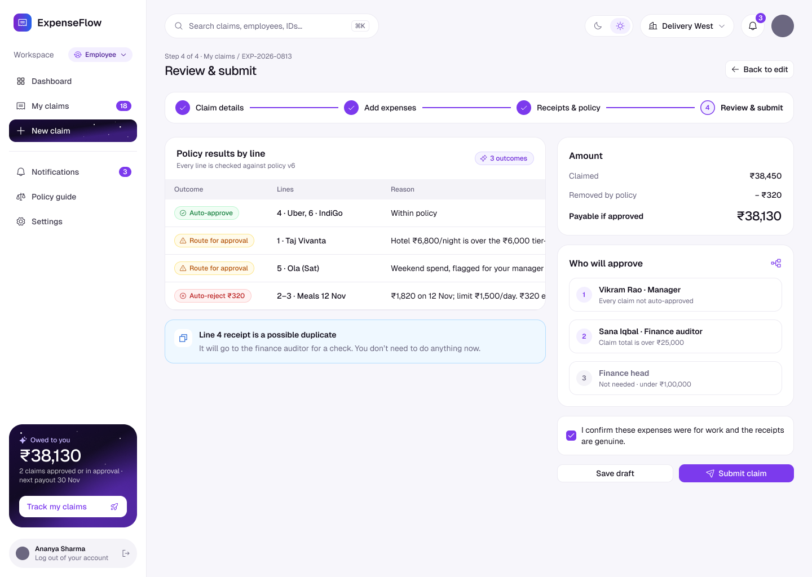

# E4 · Review & submit

| | |
|---|---|
| Role | Employee |
| Route (suggested) | /claims/:id/review |
| Figma node | 4013:1310 |
| Frame size | 1440 × 1024 |
| Sidebar variant | Employee (active item: New claim) |

## Purpose
Final step of the claim wizard. The employee sees the policy outcome for each line, the payable amount after policy, who will approve the claim, confirms a declaration and submits.

## Layout
Sidebar (260) + Main (content width 1116). Main, top to bottom:
1. Topbar (shared).
2. Page header (1116 × 47): breadcrumb + title left; **Back to edit** right.
3. Stepper card (1116 × 56), all steps done, step 4 current.
4. Two-column body (1116 × 613):
   - Left (676): **Policy results by line** card (676 × ~306) and an info alert below.
   - Right (420): **Amount** card, **Who will approve** card, declaration checkbox card, action buttons row.

## Content & components

### Page header
- Breadcrumb: "Step 4 of 4 · My claims / EXP-2026-0813"
- H1: "Review & submit"
- Button: **Back to edit** (outline, ph/arrow-left).

### Stepper
"Claim details" ✓ — "Add expenses" ✓ — "Receipts & policy" ✓ — "4 Review & submit" (current, bold). All connectors purple.

### Policy results by line (card)
- Title "Policy results by line"; subtitle "Every line is checked against policy v6"; chip "3 outcomes" (purple, ph/sparkle).
- Table columns: Outcome · Lines · Reason.

| Outcome (chip tone) | Lines | Reason |
|---|---|---|
| Auto-approve (success, ph/check-circle) | 4 · Uber, 6 · IndiGo | Within policy |
| Route for approval (warning, ph/warning) | 1 · Taj Vivanta | Hotel ₹6,800/night is over the ₹6,000 tier-1 limit |
| Route for approval (warning) | 5 · Ola (Sat) | Weekend spend, flagged for your manager |
| Auto-reject ₹320 (danger, ph/x-circle) | 2–3 · Meals 12 Nov | ₹1,820 on 12 Nov; limit ₹1,500/day. ₹320 excess removed |

Reason text is clipped at the card edge in the design (long reasons overflow) — wrap or truncate with tooltip.

### Duplicate info alert (light blue, info tone)
- Icon ph/copy in a white tile.
- Title: "Line 4 receipt is a possible duplicate"
- Text: "It will go to the finance auditor for a check. You don’t need to do anything now."

### Amount (card)
| Label | Value |
|---|---|
| Claimed | ₹38,450 |
| Removed by policy | − ₹320 |
| **Payable if approved** | **₹38,130** (large) |

### Who will approve (card)
Title + ph/tree-structure icon (purple). Three numbered rows:

| # | Approver | Reason | State |
|---|---|---|---|
| 1 | Vikram Rao · Manager | Every claim not auto-approved | active |
| 2 | Sana Iqbal · Finance auditor | Claim total is over ₹25,000 | active |
| 3 | Finance head | Not needed · under ₹1,00,000 | muted/disabled (grey text) |

### Declaration
Checkbox (checked, purple) + "I confirm these expenses were for work and the receipts are genuine."

### Actions
**Save draft** (outline, half width) · **Submit claim** (primary, half width, ph/paper-plane-tilt).

## Interactions & states
- **Back to edit** / clicking a completed step → E3.
- **Save draft** → saves and stays (or returns to E2; inferred).
- **Submit claim**: Behaviour (inferred) disabled until the declaration is checked; on success → N4 (claim submitted). On 422 `validation_error` → back to E3 with fields highlighted, or show an error list.
- Lines in the table may link to the line in E3 (inferred).
- No submit possible while a receipt is missing (E3 rule) — this screen assumes all blocking issues are fixed.

## Data & API
- Claim + lines: `GET /claims/{id}`.
- Submit: `PUT /claims/{id}` with `action: "submit"` and all lines → status `SUBMITTED`; 409 `claim_not_editable` if already submitted.
- Policy outcome per line, reasons, policy version "v6", removed amount and payable amount: **Not yet in API** (policy engine on submit; a pre-submit preview is needed to show this before submitting).
- Approval chain preview (named manager, auditor, finance head and whether needed): **Not yet in API** (approval-chain work; thresholds ₹25,000 / ₹1,00,000 must come from seeded config).
- Duplicate flag: Not yet in API.
- Declaration acceptance: Not yet in API (no field to record it; decide whether it is stored/audited).

## Build notes
- shadcn: `Card`, `Table`, `Badge`, `Alert` (info), `Checkbox` + `Label`, `Button`.
- Reuse `ClaimStepper` (E3), `AmountSummary` card (identical on E5), `PolicyChip`.
- `ApproverStep` row component (number badge, name · role, reason, muted variant) — similar to the timeline on E5 and the chain on F4.
- Money with Indian grouping; "− ₹320" uses a real minus sign.
