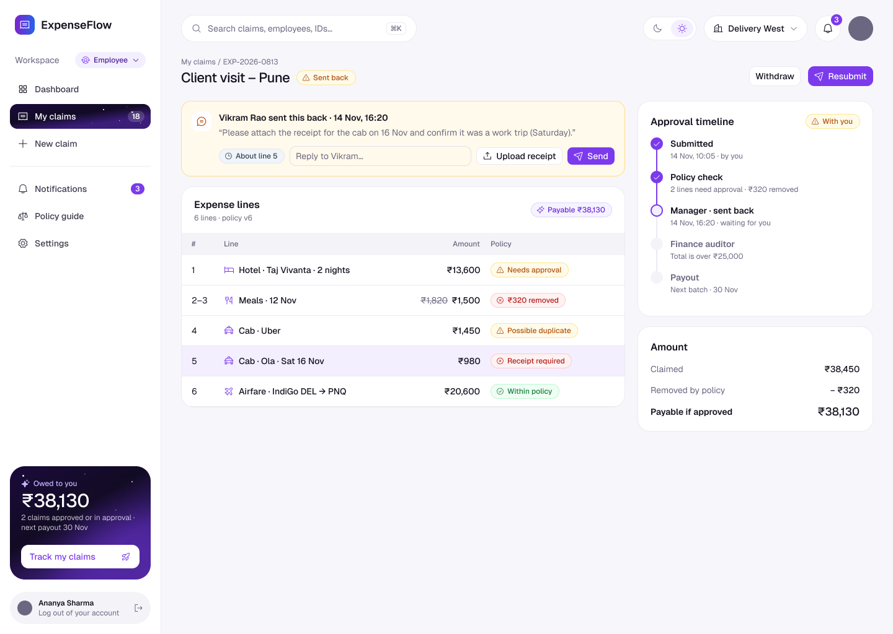

# E5 · Claim detail, timeline & clarification

| | |
|---|---|
| Role | Employee |
| Route (suggested) | /claims/:id |
| Figma node | 4012:836 |
| Frame size | 1440 × 1024 |
| Sidebar variant | Employee (active item: My claims) |

## Purpose
Read view of one submitted claim. Shown here in the "sent back" state: the employee reads the manager's question, replies or uploads the missing receipt, and resubmits (or withdraws). The timeline shows where the claim is in the approval chain.

## Layout
Sidebar (260) + Main (content width 1116). Main, top to bottom:
1. Topbar (shared).
2. Page header (1116 × 47): breadcrumb + title + chip left; **Withdraw** and **Resubmit** right.
3. Two-column body (1116 × 534):
   - Left (716): sent-back message card (amber), **Expense lines** card.
   - Right (380): **Approval timeline** card, **Amount** card.

## Content & components

### Page header
- Breadcrumb: "My claims / EXP-2026-0813"
- H1 "Client visit – Pune" + Status Chip "Sent back" (warning, ph/warning).
- Buttons: **Withdraw** (outline) · **Resubmit** (primary, ph/paper-plane-tilt).

### Sent-back message card (amber/warning background, amber border)
- Icon ph/chat-circle-dots in a tile.
- Title: "Vikram Rao sent this back · 14 Nov, 16:20"
- Quote: "“Please attach the receipt for the cab on 16 Nov and confirm it was a work trip (Saturday).”"
- Reply row: chip "About line 5" (neutral, ph/clock) · Input placeholder "Reply to Vikram..." · **Upload receipt** (outline, ph/upload-simple) · **Send** (primary, ph/paper-plane-tilt).

### Expense lines (card)
- Title "Expense lines"; subtitle "6 lines · policy v6"; chip "Payable ₹38,130" (purple, ph/sparkle).
- Columns: # · Line · Amount (right) · Policy.

| # | Line (icon) | Amount | Policy chip (tone) |
|---|---|---|---|
| 1 | Hotel · Taj Vivanta · 2 nights (ph/bed) | ₹13,600 | Needs approval (warning) |
| 2–3 | Meals · 12 Nov (ph/fork-knife) | ~~₹1,820~~ ₹1,500 | ₹320 removed (danger) |
| 4 | Cab · Uber (ph/car) | ₹1,450 | Possible duplicate (warning) |
| 5 | Cab · Ola · Sat 16 Nov | ₹980 | Receipt required (danger) |
| 6 | Airfare · IndiGo DEL → PNQ (ph/airplane) | ₹20,600 | Within policy (success) |

- Row 5 (the line the manager asked about) has a light purple highlight.
- Row 2–3 shows the original amount struck through in muted grey, then the allowed amount.

### Approval timeline (card)
Title "Approval timeline" + chip "With you" (warning). Vertical stepper:

| Step | State | Sub-text |
|---|---|---|
| Submitted | done (purple check) | 14 Nov, 10:05 · by you |
| Policy check | done | 2 lines need approval · ₹320 removed |
| Manager · sent back | current (purple ring) | 14 Nov, 16:20 · waiting for you |
| Finance auditor | upcoming (grey, muted text) | Total is over ₹25,000 |
| Payout | upcoming | Next batch · 30 Nov |

Connector line purple between done steps, grey after the current one.

### Amount (card)
Claimed ₹38,450 · Removed by policy − ₹320 · **Payable if approved ₹38,130** (same as E4).

## Interactions & states
- **Send** posts the reply to the manager (Behaviour inferred: disabled while the input is empty; reply shows in a thread/timeline).
- **Upload receipt** → file picker; attaches to line 5 ("About line 5" sets the context). Row 5 chip should change from "Receipt required" to a receipt name/OK.
- **Resubmit** → sends the claim back to the manager (inferred: requires the missing receipt; confirm dialog optional). On success the chip becomes "Pending manager" and the timeline advances.
- **Withdraw** → Behaviour (inferred): confirm dialog, then the claim is withdrawn/cancelled (state not defined in the design).
- Other states of this screen (not designed): when not sent back, hide the message card and the Withdraw/Resubmit buttons; read-only after approval/payment.
- Breadcrumb "My claims" → E2.

## Data & API
- Claim, lines, attachments: `GET /claims/{id}`. Receipt view: `GET /claims/{id}/attachments/{att_id}`.
- Timeline: partially from `GET /claims/{id}/audit` (`CREATED`, `UPDATED`, `SUBMITTED` with timestamps and actor). Policy check, manager / auditor / payout steps: **Not yet in API**.
- Status "Sent back", send-back comment, author, time and linked line: **Not yet in API** (send-back flow).
- Employee reply ("Send"): **Not yet in API** (comments/clarification endpoint).
- Upload after submit: today `POST /attachments` and `PUT` return 403/409 unless `DRAFT`; a sent-back claim must become editable again, or a dedicated endpoint is needed — **Not yet in API**.
- Resubmit and Withdraw actions: **Not yet in API**.
- Per-line policy outcomes, allowed amounts (₹1,500 after ₹320 removed), payable total, duplicate flag, policy version: **Not yet in API** (policy engine).
- Next payout batch date: Not yet in API.

## Build notes
- shadcn: `Card`, `Alert` (custom warning variant for the message card), `Input`, `Button`, `Badge`, `Table`.
- Vertical timeline: build a small `Timeline` component (list with a connector line and status dots) — reusable on M3 and F5.
- Reuse `AmountSummary` (E4), `PolicyChip`, line category icons from E3.
- Struck-through original amount: `line-through text-muted-foreground` next to the allowed amount.
- The same page serves all claim states; drive header buttons and the message card from claim status.
