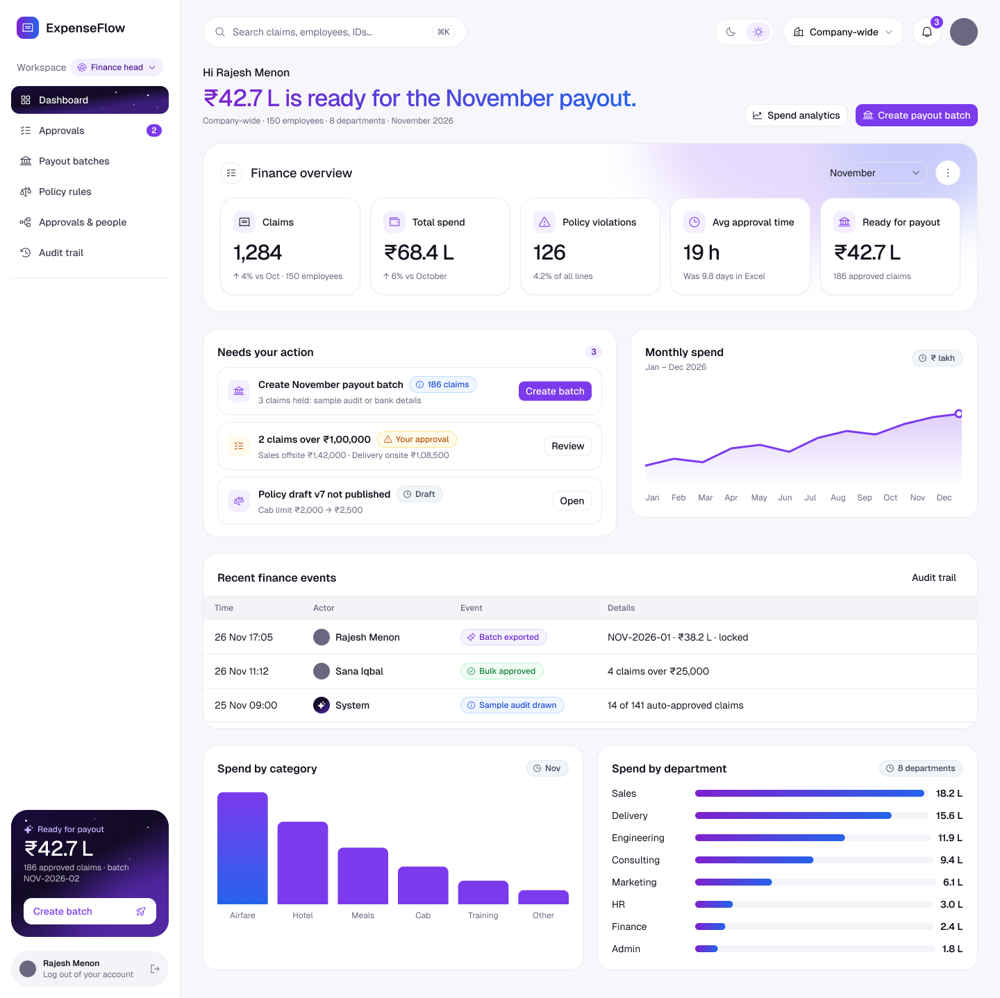

# F0 · Finance head dashboard

| | |
|---|---|
| Role | Finance head |
| Route (suggested) | /finance |
| Figma node | 4017:3392 |
| Frame size | 1440 × 1438 |
| Sidebar variant | Finance head (active item: Dashboard) |

## Purpose
Landing page for the finance head (Rajesh Menon). It shows the month's company-wide spend, what is ready for payout,
the items that need their action (payout batch, high-value approvals, unpublished policy draft), recent finance events,
and where the money goes (spend by category and by department). The separate F1 "Spend analytics" screen was
removed from the design; its category and department charts now live at the bottom of this page.

## Layout
1. Topbar (shared; Context dropdown reads "Company-wide").
2. Greeting header row (1116 × 90): greeting block left, two buttons right.
3. "Finance overview" card (1116 × 244): title row with month Select and kebab, 5 KPI Cards in one row. Soft purple gradient blobs top-right.
4. Two-column row (1116 × 299): "Needs your action" card (596 wide) left, "Monthly spend" chart card (500 wide) right.
5. "Recent finance events" card (1116 × 253): header + 4-column table.
6. Two-column row (1116 × 324): "Spend by category" card (548) left, "Spend by department" card (548) right.

## Content & components

### Sidebar (Finance head)
Workspace switcher "Finance head". Nav: Dashboard (active, dark starry pill), Approvals (badge **2**), Payout batches,
Policy rules, Approvals & people, Audit trail; divider. Compared with the previous design, the "Spend analytics" item
and the Notifications / Policy guide / Settings group were removed (notifications stay on the Topbar bell, badge **3**).
Sidebar Promo Card: "Ready for payout" / **₹42.7 L** / "186 approved claims · batch NOV-2026-02" / button "Create batch"
(ph/rocket-launch). User card: "Rajesh Menon" / "Log out of your account".

### Greeting header
- Small text: "Hi Rajesh Menon"
- Headline (large, primary purple gradient): "₹42.7 L is ready for the November payout."
- Sub-text (muted, small): "Company-wide · 150 employees · 8 departments · November 2026"
- Buttons (right): "Spend analytics" — outline, icon ph/chart-line-up; "Create payout batch" — primary, icon ph/bank.

### Finance overview card
- Title "Finance overview" with round icon ph/list-checks; right side: Select "November" and a ghost icon button (ph/dots-three-vertical).
- KPI Cards (each with a tinted icon tile):

| Label | Icon | Value | Sub-text |
|---|---|---|---|
| Claims | ph/receipt | 1,284 | ↑ 4% vs Oct · 150 employees |
| Total spend | ph/wallet | ₹68.4 L | ↑ 6% vs October |
| Policy violations | ph/warning | 126 | 4.2% of all lines |
| Avg approval time | ph/clock | 19 h | Was 9.8 days in Excel |
| Ready for payout | ph/bank | ₹42.7 L | 186 approved claims |

### Needs your action card
- Title "Needs your action", count badge "3" (purple).
- Three action rows (bordered, icon tile left, action right):

| Icon | Title | Chip (tone) | Sub-text | Button |
|---|---|---|---|---|
| ph/bank | Create November payout batch | 186 claims (info) | 3 claims held: sample audit or bank details | Create batch (primary) |
| ph/list-checks (amber tile) | 2 claims over ₹1,00,000 | Your approval (warning) | Sales offsite ₹1,42,000 · Delivery onsite ₹1,08,500 | Review (outline) |
| ph/scales | Policy draft v7 not published | Draft (neutral, clock icon) | Cab limit ₹2,000 → ₹2,500 | Open (outline) |

### Monthly spend card
- Title "Monthly spend", sub-text "Jan – Dec 2026", chip "₹ lakh" (neutral, clock icon).
- Area chart: single purple series, gradient fill, x-axis Jan…Dec, no visible y-axis or gridlines; last point (Dec) has a hollow circle marker. Trend rises from ~Jan to Dec with small dips (Mar, Jun, Sep). Exact values not labelled.

### Recent finance events card
- Title "Recent finance events"; right link "Audit trail" (ghost).
- Table:

| Time | Actor | Event (chip, tone) | Details |
|---|---|---|---|
| 26 Nov 17:05 | Rajesh Menon (avatar) | Batch exported (purple) | NOV-2026-01 · ₹38.2 L · locked |
| 26 Nov 11:12 | Sana Iqbal (avatar) | Bulk approved (success) | 4 claims over ₹25,000 |
| 25 Nov 09:00 | System (dark sparkle avatar) | Sample audit drawn (info) | 14 of 141 auto-approved claims |

### Spend by category card
- Title "Spend by category"; chip "Nov" (neutral, clock icon) top-right.
- Vertical bar chart, 6 bars of equal width, sorted descending by height: Airfare, Hotel, Meals, Cab, Training, Other
  (category labels under each bar, small muted text).
- Bars are solid purple; the first bar (Airfare) has a purple-to-blue vertical gradient.
- No y-axis, gridlines, legend or value labels. Relative heights read from the PNG (Airfare = 100%):
  Hotel ≈ 73%, Meals ≈ 50%, Cab ≈ 33%, Training ≈ 21%, Other ≈ 13%. Exact ₹ values are not in the design.

### Spend by department card
- Title "Spend by department"; chip "8 departments" (neutral, clock icon) top-right.
- Eight horizontal bar rows (ranked list, not a chart axis): department label left, bar in the middle
  (purple→blue gradient fill on a light grey rounded track), value right in bold, in ₹ lakh. Bar length is relative
  to the largest value (Sales). No legend.

| Department | Value |
|---|---|
| Sales | 18.2 L |
| Delivery | 15.6 L |
| Engineering | 11.9 L |
| Consulting | 9.4 L |
| Marketing | 6.1 L |
| HR | 3.0 L |
| Finance | 2.4 L |
| Admin | 1.8 L |

- The eight values sum to ₹68.4 L, matching the "Total spend" KPI.

## Interactions & states
- "Spend analytics" (header button): its target screen F1 no longer exists in the design. Behaviour (inferred): scroll
  to the "Spend by category / Spend by department" row on this page — **open question for the designer** (keep, retarget
  or remove the button).
- "Create payout batch" / "Create batch" (row and Sidebar Promo Card) → F2 (Behaviour (inferred): creates a draft batch for the selected month, then opens it).
- "Review" (row button) → M2 approvals queue filtered to claims over ₹1,00,000 awaiting the finance head (inferred).
- "Open" → F3 with draft v7.
- "Audit trail" → F5.
- Month Select re-scopes the KPIs, action list and both spend breakdown cards (inferred); the "Nov" chip on
  "Spend by category" should follow it. Kebab menu contents not shown.
- Hover on category bars, department rows and monthly points: Behaviour (inferred): tooltip with the exact ₹ amount.
- Department rows: Behaviour (inferred): could filter the page via the Topbar context dropdown — not designed.
- KPI deltas: "↑" in muted text; no red/green colouring shown.
- Empty/loading states not designed; suggest skeleton KPI Cards and "Nothing needs your action" for an empty list,
  and "No spend recorded for this period" in the two breakdown cards.

## Data & API
- Greeting: current user name — `/users` (logged-in user).
- KPIs (claim count, total spend, violations, avg approval time, ready-for-payout amount/count) — Not yet in API: finance summary/dashboard endpoint.
- Needs-action items (draft batch, claims awaiting finance-head approval, unpublished policy draft) — Not yet in API (approval states, payout batches, policy versions).
- Monthly spend series — Not yet in API.
- Spend by category and spend by department (for a month) — Not yet in API: an analytics endpoint with a `month`
  filter (e.g. `GET /analytics/spend?month=&group_by=category|department`). Departments are not modelled in the API yet.
- Recent finance events — Not yet in API: a global audit feed; only per-claim `GET /claims/{id}/audit` exists.

## Build notes
- shadcn: Card, Button, Select, DropdownMenu, Badge (Status Chip), Table, Avatar, Progress (department bars, custom
  gradient fill), Chart (Recharts AreaChart for monthly spend, BarChart for category), Tooltip.
- Reuse KPI Card, Status Chip, the action-row component (same rows on M1/A0 dashboards), and the gradient bar row
  (same pattern as A0 "Queue by reason").
- Format money with Indian grouping and lakh abbreviation ("₹42.7 L", "18.2 L") via one shared formatter.
- Category bar gradient: define one SVG `linearGradient` in the chart and apply it to the first bar only (or to all bars if the designer confirms).
- Headline uses a purple gradient text fill (bg-clip-text).
