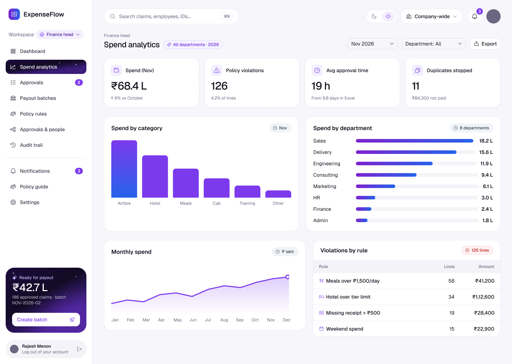

# F1 · Spend analytics dashboard

| | |
|---|---|
| Role | Finance head |
| Route (suggested) | /finance/analytics |
| Figma node | 4017:3795 |
| Frame size | 1440 × 1024 |
| Sidebar variant | Finance head (active item: Spend analytics) |

## Purpose
Lets the finance head analyse company spend for a month: headline KPIs, spend by category and by department,
the monthly trend and which policy rules are breached most. Data can be filtered and exported.

## Layout
1. Topbar (shared).
2. Page header (1116 × 47): eyebrow + title + chip left; two Selects and an Export button right.
3. KPI row (1116 × 140): 4 KPI Cards, equal width (~268 each).
4. Two-column row (1116 × 324): "Spend by category" (548) left, "Spend by department" (548) right.
5. Two-column row (1116 × 274): "Monthly spend" (568) left, "Violations by rule" (528) right.

## Content & components

### Page header
- Eyebrow: "Finance head"; title "Spend analytics"; purple chip "All departments · 2026" (ph/sparkle).
- Select "Nov 2026" (140 wide), Select "Department: All" (180 wide), button "Export" — outline, icon ph/export.

### KPI row

| Label | Icon | Value | Sub-text |
|---|---|---|---|
| Spend (Nov) | ph/wallet | ₹68.4 L | ↑ 6% vs October |
| Policy violations | ph/warning | 126 | 4.2% of lines |
| Avg approval time | ph/clock | 19 h | From 9.8 days in Excel |
| Duplicates stopped | ph/copy | 11 | ₹84,300 not paid |

### Spend by category
- Title "Spend by category", chip "Nov" (neutral, clock icon).
- Vertical bar chart, 6 bars, no y-axis/values shown; bars purple, the first (Airfare) has a purple-to-blue gradient.
- Categories (descending height): Airfare, Hotel, Meals, Cab, Training, Other.

### Spend by department
- Title "Spend by department", chip "8 departments" (neutral).
- Horizontal progress bars (purple→blue gradient on grey track), label left, value right:

| Department | Value |
|---|---|
| Sales | 18.2 L |
| Delivery | 15.6 L |
| Engineering | 11.9 L |
| Consulting | 9.4 L |
| Marketing | 6.1 L |
| HR | 3.0 L |
| Finance | 2.4 L |
| Admin | 1.8 L |

### Monthly spend
- Title "Monthly spend", chip "₹ lakh". Same area chart as F0 (Jan–Dec, single purple series, gradient fill, hollow marker on Dec).

### Violations by rule
- Title "Violations by rule", chip "126 lines" (danger, ph/x-circle).
- Table (Amount right-aligned, Lines right-aligned):

| Rule (icon) | Lines | Amount |
|---|---|---|
| Meals over ₹1,500/day (ph/fork-knife) | 58 | ₹41,200 |
| Hotel over tier limit (ph/bed) | 34 | ₹1,12,600 |
| Missing receipt > ₹500 (ph/receipt) | 19 | ₹28,400 |
| Weekend spend (ph/calendar) | 15 | ₹22,900 |

## Interactions & states
- Month and Department Selects re-filter every card (inferred); header chip should reflect the department filter.
- "Export": Behaviour (inferred): downloads the current view's figures as CSV.
- Hover on bars/area points: Behaviour (inferred): tooltip with exact ₹ amount.
- Violations rows: Behaviour (inferred): may link to A1 audit queue filtered by rule — not shown in design.
- Empty state (no claims in month) and loading not designed; use skeletons and "No spend recorded for this period".

## Data & API
- All figures (KPIs, category/department totals, monthly series, violations by rule, duplicates stopped) — Not yet in API: analytics/reporting endpoints with `month` and `department` filters.
- Department list for the Select — Not yet in API (departments).
- `GET /claims` could be aggregated client-side as a stopgap, but it is paged and has no date/department filter.

## Build notes
- shadcn: Card, Select, Button, Badge, Table, Progress (department bars), Chart (Recharts BarChart, AreaChart), Tooltip.
- Reuse KPI Card and the Monthly spend chart component from F0.
- Values in lakh ("18.2 L") — shared formatter; bar widths relative to the max department.
- Gradient fill on bars: define an SVG linearGradient once in the chart.
