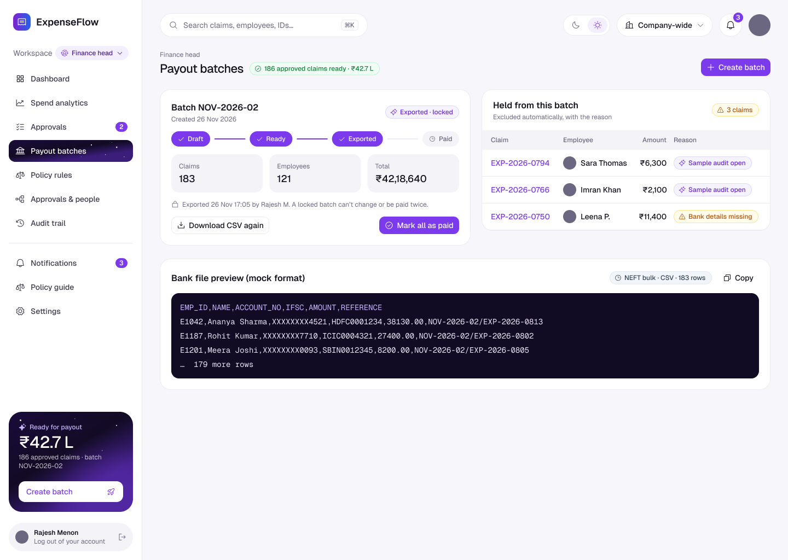

# F2 · Payout batches & CSV export



| | |
|---|---|
| Role | Finance head |
| Route (suggested) | /finance/payouts (batch: /finance/payouts/:batchId) |
| Figma node | 4017:4156 |
| Frame size | 1440 × 1024 |
| Sidebar variant | Finance head (active item: Payout batches) |

## Purpose
The finance head groups approved claims into a payout batch, exports the bank file (CSV) and marks the batch paid.
The screen shows the current batch's lifecycle, the claims held back with reasons, and a preview of the bank file.

## Layout
1. Topbar (shared).
2. Page header (1116 × 47): eyebrow + title + chip left, primary button right.
3. Two-column row (1116 × 286): "Batch NOV-2026-02" card (568) left, "Held from this batch" card (528) right.
4. "Bank file preview (mock format)" card (1116 × 240).

## Content & components

### Page header
- Eyebrow "Finance head"; title "Payout batches"; chip "186 approved claims ready · ₹42.7 L" (success, ph/check-circle).
- Button "Create batch" — primary, icon ph/plus.

### Batch card
- Title "Batch NOV-2026-02", sub-text "Created 26 Nov 2026"; chip "Exported · locked" (purple, ph/sparkle) top-right.
- Stepper (4 pills joined by lines): "Draft", "Ready", "Exported" — completed, filled purple with ph/check; "Paid" — pending, neutral outline with ph/clock. Connector lines purple between completed steps, grey before "Paid".
- Three stat tiles (grey background): Claims "183" · Employees "121" · Total "₹42,18,640".
- Note (muted, ph/lock): "Exported 26 Nov 17:05 by Rajesh M. A locked batch can't change or be paid twice."
- Buttons: "Download CSV again" — outline, ph/download-simple (left); "Mark all as paid" — primary, ph/check-circle (right).

### Held from this batch card
- Title "Held from this batch", sub-text "Excluded automatically, with the reason"; chip "3 claims" (warning).
- Table:

| Claim (purple link) | Employee (avatar) | Amount | Reason (chip, tone) |
|---|---|---|---|
| EXP-2026-0794 | Sara Thomas | ₹6,300 | Sample audit open (purple) |
| EXP-2026-0766 | Imran Khan | ₹2,100 | Sample audit open (purple) |
| EXP-2026-0750 | Leena P. | ₹11,400 | Bank details missing (warning) |

### Bank file preview card
- Title "Bank file preview (mock format)"; chip "NEFT bulk · CSV · 183 rows" (neutral); ghost button "Copy" (ph/copy).
- Dark code block (monospace, near-black #13092b-ish background, light text; header row in purple):

```
EMP_ID,NAME,ACCOUNT_NO,IFSC,AMOUNT,REFERENCE
E1042,Ananya Sharma,XXXXXXXX4521,HDFC0001234,38130.00,NOV-2026-02/EXP-2026-0813
E1187,Rohit Kumar,XXXXXXXX7710,ICIC0004321,27400.00,NOV-2026-02/EXP-2026-0802
E1201,Meera Joshi,XXXXXXXX0093,SBIN0012345,8200.00,NOV-2026-02/EXP-2026-0805
… 179 more rows
```

## Interactions & states
- "Create batch" (header and Sidebar Promo Card): Behaviour (inferred): creates a Draft batch from all approved, not-held claims.
- Stepper reflects batch status Draft → Ready → Exported → Paid. Once Exported the batch is locked (no edits; cannot be paid twice).
- "Download CSV again": re-downloads the same export file (no state change).
- "Mark all as paid": Behaviour (inferred): confirm Dialog, then status → Paid and claims move to paid; button disabled/hidden once Paid.
- Claim IDs → claim detail (E5-style view for finance).
- "Copy" copies the CSV preview text; show a toast.
- Account numbers are masked (XXXXXXXX + last 4) in the preview.
- Batch list/history (other months, e.g. NOV-2026-01) is not shown on this screen; only the current batch.
- Empty state (no approved claims) not designed.

## Data & API
- Batch (id, created_at, status, claim count, employee count, total, exported_at/by) — Not yet in API: payout batch endpoints (create, get, export CSV, mark paid).
- Held claims with reasons — Not yet in API.
- Bank details per employee (account no., IFSC) — Not yet in API.
- Ready-to-pay count/amount (header chip) — Not yet in API (needs APPROVED status; today only DRAFT/SUBMITTED).
- Held-claim links can use `GET /claims/{id}`.

## Build notes
- shadcn: Card, Badge, Button, Table, Avatar, AlertDialog (mark as paid), Tooltip, Sonner toast (copy).
- Stepper is custom (pills + connector lines); can be reused for claim status if needed.
- Stat tiles: small muted Card variant.
- Code block: `<pre>` with monospace font, horizontal scroll, never show full account numbers.
- Money in batch total uses full Indian grouping (₹42,18,640), not lakh shorthand.
