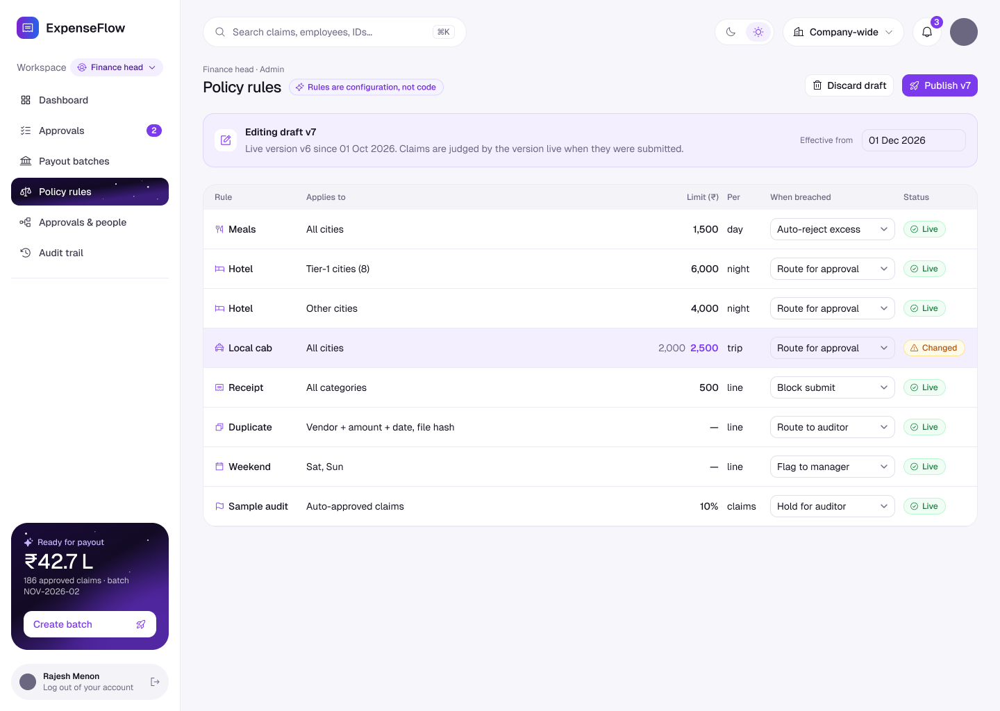

# F3 · Policy rules (configuration)

| | |
|---|---|
| Role | Finance head (Admin) |
| Route (suggested) | /admin/policy |
| Figma node | 4018:4000 |
| Frame size | 1440 × 1024 |
| Sidebar variant | Finance head (active item: Policy rules; nav: Dashboard, Approvals 2, Payout batches, Policy rules, Approvals & people, Audit trail — "Spend analytics" and the Notifications / Policy guide / Settings group were removed) |

## Purpose
The finance head edits expense policy rules as versioned configuration (not code): limits per category, what happens
on a breach, and when a new version takes effect. Draft versions are published over the live version.

## Layout
1. Topbar (shared).
2. Page header (1116 × 47): eyebrow + title + chip left; two buttons right.
3. Draft banner (1116 × 78, light purple, bordered): icon, text, "Effective from" date input right.
4. Rules table card, full content width (1116 × 494). The former "Version history" side card was removed, so the
   table now spans the whole row; the extra width goes to the "Applies to" column.

## Content & components

### Page header
- Eyebrow "Finance head · Admin"; title "Policy rules"; chip "Rules are configuration, not code" (purple, ph/sparkle).
- Buttons: "Discard draft" — outline, ph/trash; "Publish v7" — primary, ph/rocket-launch.

### Draft banner
- Icon tile ph/pencil-simple-line.
- Title "Editing draft v7"; text "Live version v6 since 01 Oct 2026. Claims are judged by the version live when they were submitted."
- Label "Effective from" + Input (date) value "01 Dec 2026".

### Rules table
Columns: Rule · Applies to · Limit (₹) (right-aligned) · Per · When breached (Select) · Status (chip).

| Rule (icon) | Applies to | Limit (₹) | Per | When breached | Status |
|---|---|---|---|---|---|
| Meals (ph/fork-knife) | All cities | 1,500 | day | Auto-reject excess | Live (success) |
| Hotel (ph/bed) | Tier-1 cities (8) | 6,000 | night | Route for approval | Live |
| Hotel (ph/bed) | Other cities | 4,000 | night | Route for approval | Live |
| Local cab (ph/car) | All cities | ~~2,000~~ **2,500** | trip | Route for approval | Changed (warning) |
| Receipt (ph/receipt) | All categories | 500 | line | Block submit | Live |
| Duplicate (ph/copy) | Vendor + amount + date, file hash | — | line | Route to auditor | Live |
| Weekend (ph/calendar) | Sat, Sun | — | line | Flag to manager | Live |
| Sample audit (ph/flag) | Auto-approved claims | 10% | claims | Hold for auditor | Live |

- Changed row ("Local cab") has a light purple row background; old value 2,000 shown muted, new value 2,500 in bold purple.
- "When breached" options visible in the design: Auto-reject excess, Route for approval, Block submit, Route to auditor, Flag to manager, Hold for auditor.

No version history list is shown on this screen any more; the only version information is the draft banner
("Editing draft v7", "Live version v6 since 01 Oct 2026").

## Interactions & states
- Editing a limit or "When breached" value marks the row "Changed" (warning chip, row highlight, old value struck/muted).
  Behaviour (inferred): limit cells are inline-editable numeric inputs; the design shows them as plain text.
- "Publish v7": Behaviour (inferred): confirm Dialog, then v7 becomes live from the "Effective from" date and the banner disappears.
- "Discard draft": Behaviour (inferred): confirm, revert to v6 values, remove draft banner.
- "Effective from" must be a future date (inferred); claims are judged by the version live at submit time.
- "Applies to" lists (e.g. "Tier-1 cities (8)") — editing them is not designed.
- Viewing older versions or a version diff: not designed (the version history panel was removed). Policy changes
  can be traced in F5 Audit trail if the backend logs them there.
- No-draft state (only live v6) not designed: suggest hiding the banner and showing "Create draft".

## Data & API
- Rules, versions, draft, effective date, publish/discard — Not yet in API: policy configuration endpoints (rules are seeded configuration per CLAUDE.md).
- Live version number and its effective date (banner) — Not yet in API. Old versions must still be stored, because
  claims are judged by the version live when they were submitted, even though no history list is shown here.
- Audit of policy changes (who changed what) — Not yet in API (audit exists only for claims); needed for F5, not for this screen.

## Build notes
- shadcn: Card, Table, Select, Input, Popover + Calendar (Effective from), Badge, Button, AlertDialog, Tooltip.
- Keep `—` for rules with no numeric limit; `%` for sample audit.
- Track dirty state per row against the live version to drive the "Changed" chip.
