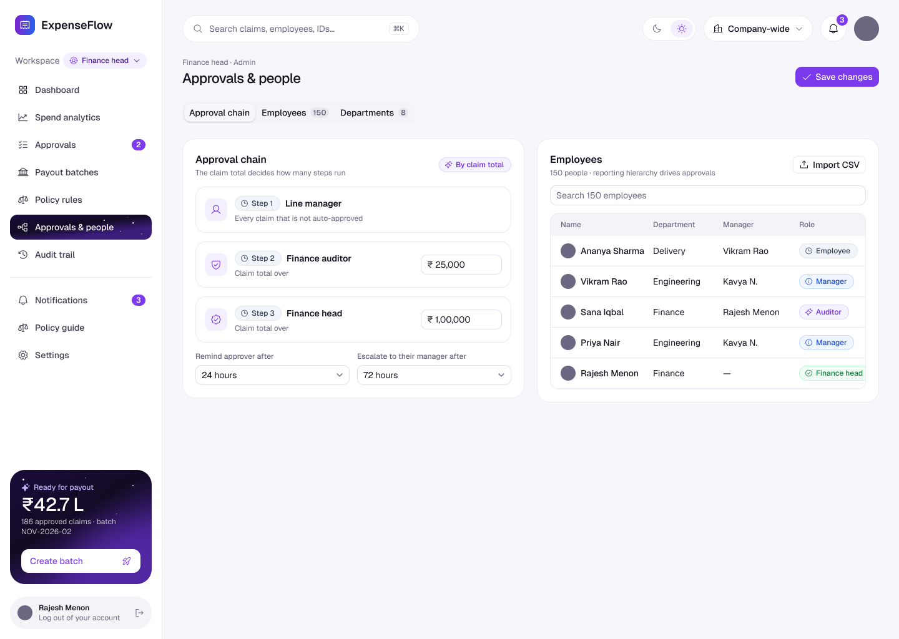

# F4 · Approval chain & people

| | |
|---|---|
| Role | Finance head (Admin) |
| Route (suggested) | /admin/approvals |
| Figma node | 4018:4455 |
| Frame size | 1440 × 1024 |
| Sidebar variant | Finance head (active item: Approvals & people) |

## Purpose
The finance head configures how many approval steps a claim goes through (by claim total), reminder and escalation
timings, and maintains the employee list whose reporting hierarchy drives who approves.

## Layout
1. Topbar (shared).
2. Page header (1116 × 47): eyebrow + title left; "Save changes" button right.
3. Tabs row (373 × 35): segmented tabs.
4. Two-column row (1116 × 423): "Approval chain" card (548) left, "Employees" card (548) right.

## Content & components

### Page header
- Eyebrow "Finance head · Admin"; title "Approvals & people".
- Button "Save changes" — primary, ph/check.

### Tabs
- "Approval chain" (selected, white pill), "Employees" + count badge "150", "Departments" + count badge "8".

### Approval chain card
- Title "Approval chain", sub-text "The claim total decides how many steps run"; chip "By claim total" (purple, ph/sparkle).
- Three step rows (bordered, icon tile left):

| Step chip | Role | Description | Threshold input |
|---|---|---|---|
| Step 1 (ph/clock) | Line manager (ph/user) | Every claim that is not auto-approved | — |
| Step 2 | Finance auditor (ph/shield-check) | Claim total over | ₹ 25,000 |
| Step 3 | Finance head (ph/seal-check) | Claim total over | ₹ 1,00,000 |

- Two Selects at the bottom:
  - "Remind approver after" — "24 hours"
  - "Escalate to their manager after" — "72 hours"

### Employees card
- Title "Employees", sub-text "150 people · reporting hierarchy drives approvals"; button "Import CSV" — outline, ph/upload-simple.
- Search Input, placeholder "Search 150 employees".
- Table:

| Name (avatar) | Department | Manager | Role (chip, tone) |
|---|---|---|---|
| Ananya Sharma | Delivery | Vikram Rao | Employee (neutral) |
| Vikram Rao | Engineering | Kavya N. | Manager (info) |
| Sana Iqbal | Finance | Rajesh Menon | Auditor (purple) |
| Priya Nair | Engineering | Kavya N. | Manager (info) |
| Rajesh Menon | Finance | — | Finance head (success) |

## Interactions & states
- Threshold inputs (₹, numeric, Indian grouping) and the two Selects are editable; "Save changes" persists them.
  Behaviour (inferred): button disabled until something changes; Step 3 threshold must exceed Step 2.
- Tabs: "Employees" and "Departments" tabs are not designed separately. Note the "Approval chain" tab already shows
  both cards side by side — clarify with design whether tabs filter the view or are anchors.
- Employee search filters the table by name (inferred). Table appears to show only 5 of 150 rows; scroll/pagination not designed.
- "Import CSV": Behaviour (inferred): upload a CSV of employees (name, department, manager, role) and preview before applying.
- Clicking an employee row (edit manager/role): not designed.
- Select options beyond the shown values (24 hours / 72 hours) are not visible.

## Data & API
- Employees list (name, department, manager, role) — partially via `/users` (exists for auth/users); department, manager and search filter — confirm or Not yet in API.
- Departments (count 8) — Not yet in API.
- Approval chain thresholds (25,000 / 1,00,000), reminder and escalation hours — Not yet in API: approval configuration endpoint (should be seeded config, not hard-coded).
- Employee CSV import — Not yet in API.

## Build notes
- shadcn: Tabs, Card, Badge, Button, Input (with ₹ prefix), Select, Table, Avatar, Dialog (CSV import preview).
- Role chip mapping: Employee=neutral, Manager=info, Auditor=purple, Finance head=success — reuse wherever roles are shown.
- The Finance head chip is clipped by the card edge in the PNG; give the Role column enough width.
