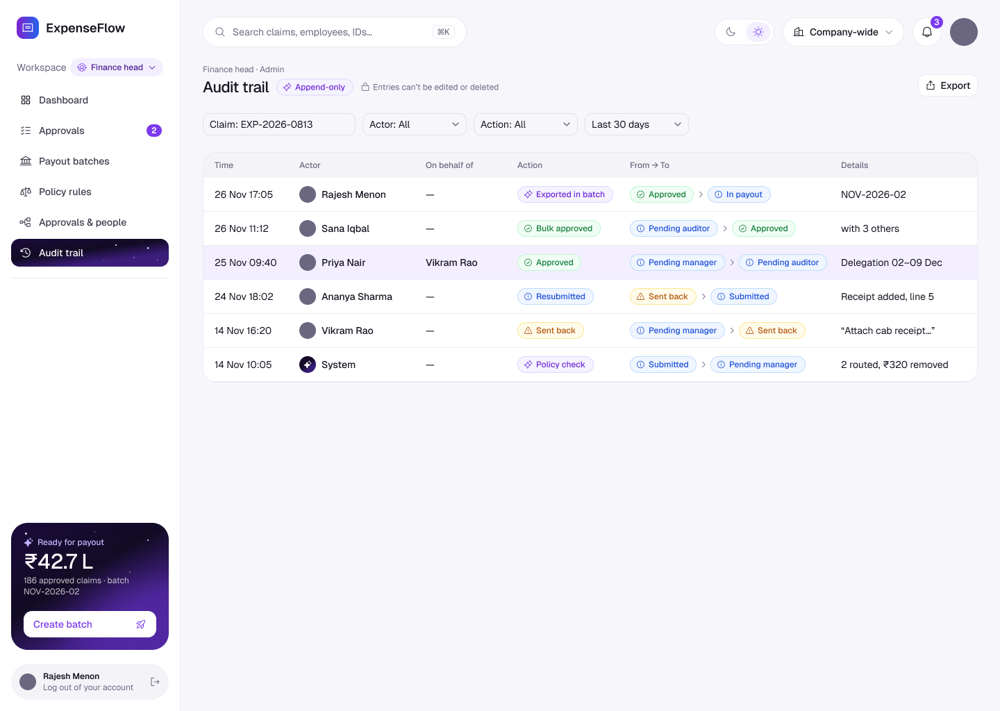

# F5 · Audit trail (append-only)

| | |
|---|---|
| Role | Finance head (Admin) |
| Route (suggested) | /admin/audit |
| Figma node | 4018:4826 |
| Frame size | 1440 × 1024 |
| Sidebar variant | Finance head (active item: Audit trail; nav is Dashboard / Approvals 2 / Payout batches / Policy rules / Approvals & people / Audit trail - no Spend analytics, no Notifications / Policy guide / Settings group) |

## Purpose
A read-only, append-only log of every action on claims (who did what, on whose behalf, and the status change),
filterable by claim, actor, action and period, and exportable for audit.

## Layout
1. Topbar (shared).
2. Page header (1116 × 47): eyebrow, title, chip and lock note left; "Export" button right.
3. Filter row (1116 × 32): one Input (220) + three Selects (150 each), left-aligned.
4. Table card (1116 × 332): 6 columns.

## Content & components

### Page header
- Eyebrow "Finance head · Admin"; title "Audit trail"; chip "Append-only" (purple, ph/sparkle); muted note with ph/lock "Entries can't be edited or deleted".
- Button "Export" — outline, ph/export.

### Filters
- Input: value "Claim: EXP-2026-0813" (claim ID filter).
- Select "Actor: All", Select "Action: All", Select "Last 30 days".

### Table
Columns: Time · Actor · On behalf of · Action · From → To · Details.

| Time | Actor (avatar) | On behalf of | Action (chip, tone) | From → To (chips) | Details |
|---|---|---|---|---|---|
| 26 Nov 17:05 | Rajesh Menon | — | Exported in batch (purple) | Approved (success) › In payout (info) | NOV-2026-02 |
| 26 Nov 11:12 | Sana Iqbal | — | Bulk approved (success) | Pending auditor (info) › Approved (success) | with 3 others |
| 25 Nov 09:40 | Priya Nair | Vikram Rao | Approved (success) | Pending manager (info) › Pending auditor (info) | Delegation 02–09 Dec |
| 24 Nov 18:02 | Ananya Sharma | — | Resubmitted (info) | Sent back (warning) › Submitted (info) | Receipt added, line 5 |
| 14 Nov 16:20 | Vikram Rao | — | Sent back (warning) | Pending manager (info) › Sent back (warning) | "Attach cab receipt…" |
| 14 Nov 10:05 | System (dark sparkle avatar) | — | Policy check (purple) | Submitted (info) › Pending manager (info) | 2 routed, ₹320 removed |

- The delegation row (25 Nov 09:40) has a light purple highlight.
- "From → To" is two Status Chips separated by ph/caret-right.

## Interactions & states
- Filters narrow the table (inferred: claim ID text search, actor, action type, date range presets).
- "Export": Behaviour (inferred): downloads the filtered rows as CSV.
- No edit/delete controls anywhere — rows are immutable by design.
- Row highlight: Behaviour (inferred): marks a delegated action (On behalf of filled); confirm with design whether it is hover/selection instead.
- Details text is truncated ("Attach cab receipt…") — show full comment in a Tooltip (inferred).
- Pagination/infinite scroll not designed (only 6 rows). Empty state ("No audit entries match these filters") not designed.

## Data & API
- Per-claim entries: `GET /api/v1/claims/{id}/audit` (newest first; `action`, `actor_id`, `created_at`, `changes` with old/new values). Usable when the Claim filter is set.
- Global trail across all claims, filter by actor/action/period, export — Not yet in API.
- Actor name: resolve `actor_id` via `/users`; API returns only the id.
- "On behalf of" (delegation) — Not yet in API.
- Actions shown (Exported in batch, Bulk approved, Approved, Resubmitted, Sent back, Policy check) and statuses (Pending manager, Pending auditor, Approved, Sent back, In payout) — Not yet in API; today actions are CREATED / UPDATED / SUBMITTED and statuses DRAFT / SUBMITTED.
- From → To: derive from `changes.status.old/new` when present.
- Details summary text — Not yet in API (would be derived from `changes`).

## Build notes
- shadcn: Card, Table, Input, Select, Badge, Avatar, Button, Tooltip.
- Reuse the status → chip tone map shared with E2/E5/M2 (Pending manager/auditor = info, Approved = success, Sent back = warning).
- Format timestamps "26 Nov 17:05" in IST from ISO strings.
- Same table style as the "Recent finance events" table on F0 (F0's "Audit trail" link → this screen).
