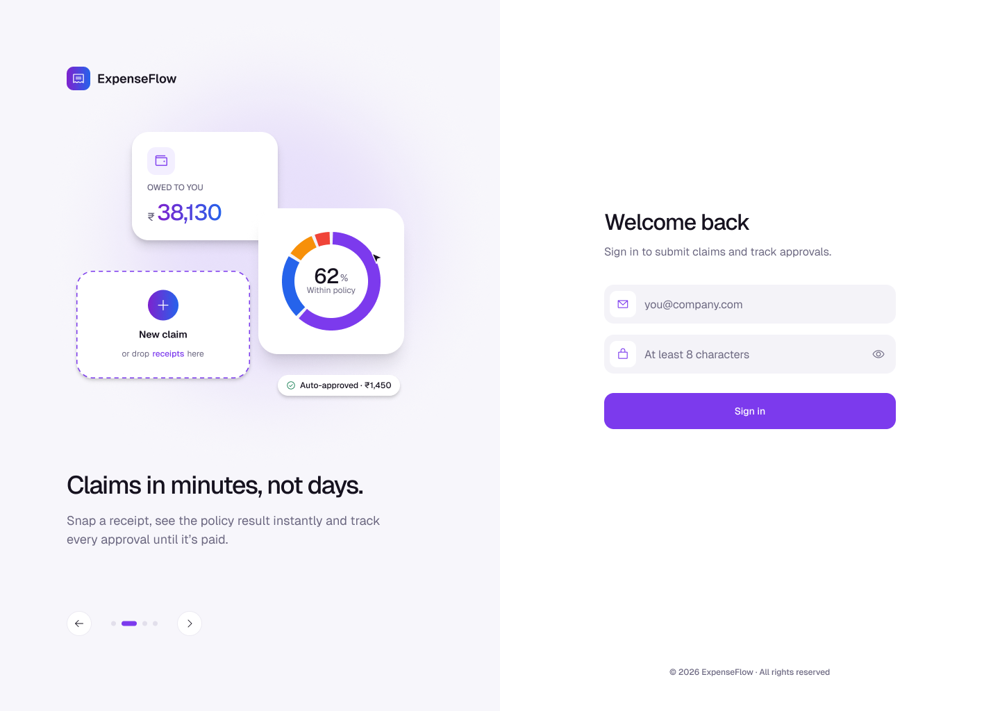

# L1 · Login

| | |
|---|---|
| Role | All (unauthenticated) |
| Route (suggested) | /login |
| Figma node | 4028:4754 |
| Frame size | 1440 × 1024 |
| Sidebar variant | none |

## Purpose
Entry point for every role. The user signs in with email and password. The left half is a light product showcase
(sample cards for "owed to you", new claim, policy result) that explains in one line what ExpenseFlow does.
This replaces the earlier dark gradient brand panel with feature rows (node 4020:4698).

## Layout
Two equal halves, no Sidebar or Topbar.
- **Showcase panel** (left, 720 × 1024, full bleed, no rounded corners): very light lavender-grey background with a
  soft blurred purple glow (420px ellipse) behind the illustration cards.
- **Form side** (right, 720 × 1024, white): the **Sign-in form** (420 × 318) centred horizontally and slightly above
  the vertical centre; a copyright line pinned near the bottom, centred under the form.

## Content & components

### Showcase panel (left padding ~96px)
- Logo row (top-left): 34 × 34 rounded square with purple-to-blue gradient and a white receipt icon, then wordmark
  **ExpenseFlow** (dark, semibold).
- Illustration cluster (overlapping white cards with soft shadows, decorative only):
  - **Card · Owed to you** (210 × 156, radius ~20): lavender icon tile with a wallet icon (ph/wallet), small caps
    label "OWED TO YOU", value "₹ 38,130" — small "₹" then a large number in purple→blue gradient text.
  - **Card · New claim** (250 × 155): dashed purple border, transparent fill; round gradient (purple→blue) button with
    a white "+" (ph/plus), title "New claim", sub-text "or drop **receipts** here" ("receipts" in purple).
  - **Card · Policy donut** (210 × 210): donut chart (160px) with four segments — purple (largest, ~62%), blue
    (~25%), orange and red (small slices at the top); centre label "62 %" with sub-label "Within policy";
    a small black mouse-cursor graphic sits on the donut's right edge.
  - **Chip** (176 × 30, white pill, shadow) below the donut: green ph/check-circle + "Auto-approved · ₹1,450".
- Headline (~36px, dark, semibold, tight tracking): "Claims in minutes, not days."
- Sub-copy (muted, ~17px, two lines): "Snap a receipt, see the policy result instantly and track every approval
  until it’s paid."
- Carousel controls (bottom-left, 195 × 36): round white "previous" button (ph/arrow-left), four indicator dots
  (second one active, shown as a wider purple pill; others small grey), round white "next" button (ph/caret-right).

### Sign-in form (420 wide)
- Heading: **Welcome back** (~32px, dark, semibold).
- Sub-text (muted): "Sign in to submit claims and track approvals."
- Email field (420 × 56, filled light-grey background, radius ~12, no visible label): left icon tile (38 × 38, white,
  purple ph/envelope-simple), placeholder "you@company.com".
- Password field (420 × 56, same style): left icon tile with purple ph/lock-simple, placeholder "At least 8 characters",
  right-aligned eye toggle (ph/eye, muted grey).
- Button: **Sign in** — primary, full width (420 × 52), purple fill (#7c3aed family), white text, radius ~12, no icon.
- Spacing (from the Figma frame): 10 between heading and sub-text, 36 before the first field, 16 between fields,
  28 before the button.

### Footer
- "© 2026 ExpenseFlow · All rights reserved" (small, muted), centred under the form near the bottom of the page.

No "forgot password", "remember me", SSO link or visible field labels are shown.

## Interactions & states
- Behaviour (inferred): **Sign in** submits the form; on success the user lands on the dashboard for their role
  (employee → E1; manager → M1; auditor → A0; finance head → F0).
- Behaviour (inferred): Enter key in either field submits.
- Behaviour (inferred): Button shows a loading/disabled state while the request is in flight.
- Eye toggle: Behaviour (inferred): switches the password field between masked and plain text; icon changes to
  ph/eye-slash when the password is visible.
- Carousel: Behaviour (inferred): previous/next arrows and dots switch between showcase slides; only one slide is
  designed, so the other three slides' content is unknown. Suggest no auto-advance (or pause on hover / reduced motion).
- Showcase cards are decorative and not clickable (the "New claim" drop card does not accept files on this screen).
- Error state (not designed): on 401 show an inline error above the button, e.g. "Email or password is incorrect."
  Keep the email value; clear the password.
- Validation (inferred): both fields required. The placeholder "At least 8 characters" implies a client-side
  minimum length — confirm with backend before blocking submit (seed passwords may be shorter).

## Data & API
- `POST /api/v1/auth/login` with `{"username", "password"}` → `access_token` (8-hour lifetime). Store the token and send
  `Authorization: Bearer <token>` on every call.
- **Gap:** the design asks for an **email** (`you@company.com`), but the API takes a `username` (seed logins are
  `employee`, `manager`, `auditor`, `admin`, …). Either the backend accepts email as username, or the field changes to
  a username field. Team decision needed. (Backend now allows work-email style usernames when creating users.)
- Role for post-login redirect: Not yet in API in the login response as documented — needs either a `role` in the token
  response or a `/users/me` call (confirm with backend).
- Showcase figures ("₹38,130", "62% Within policy", "Auto-approved · ₹1,450") are static marketing content, not live data.

## Build notes
- shadcn: `Input` (with leading icon slot), `Button`, `Form` (react-hook-form + zod), `Alert` for the error. No `Card`
  chrome around the form; add visually hidden `<Label>`s ("Email", "Password") because the design has no visible labels.
- Inputs: `type="email"`, `autocomplete="username"`; password `autocomplete="current-password"`; eye toggle is a
  `button` with `aria-label="Show password"` / "Hide password".
- Showcase panel is a presentational component (`AuthShowcase`); the donut can be a static SVG (no chart library needed),
  cards absolutely positioned inside a fixed-size box. Mark the illustration `aria-hidden`.
- Carousel (if built): shadcn `Carousel` (Embla) — check the dependency with the team first; a single static slide is
  acceptable for the demo.
- Gradient number "38,130": `bg-gradient-to-r from-[#7c3aed] to-blue-600 bg-clip-text text-transparent`.
- Responsive (not designed): hide the showcase panel below `lg` and centre the form.
