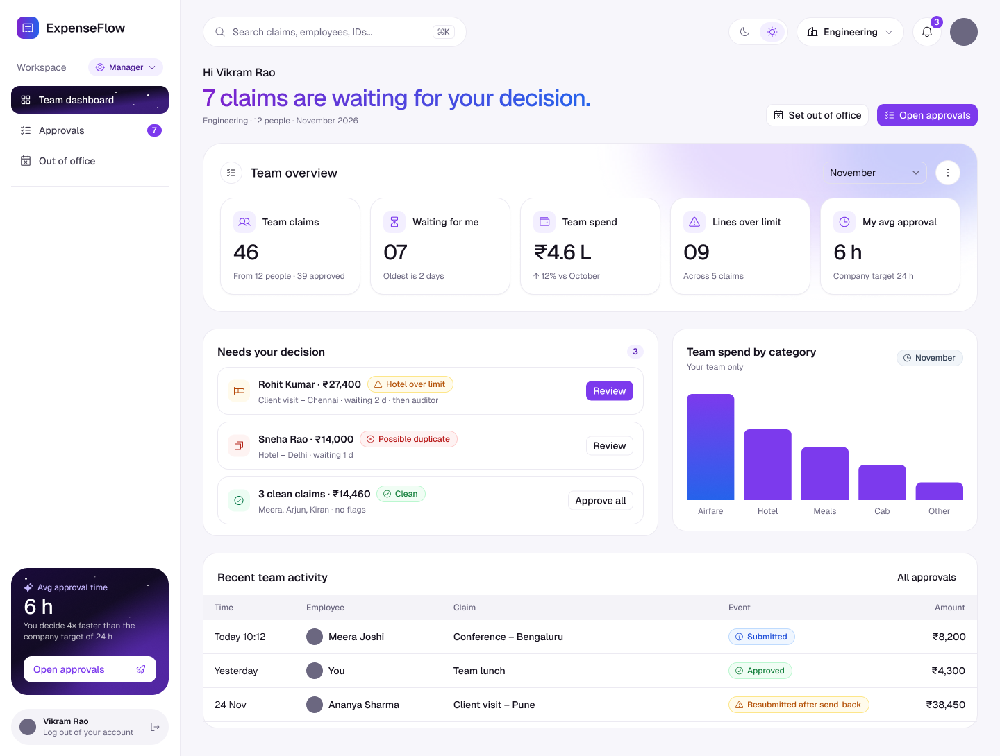

# M1 · Manager dashboard

| | |
|---|---|
| Role | Line manager |
| Route (suggested) | `/manager` |
| Figma node | 4015:1806 |
| Frame size | 1440 × 1090 |
| Sidebar variant | Manager ("Team dashboard" selected; Approvals badge 7; promo card "Avg approval time 6 h") |

Sidebar nav in the current design: Team dashboard, Approvals (7), Out of office, then a divider. The
Notifications / Policy guide / Settings group below the divider was removed; notifications stay on the
Topbar bell (badge 3).

## Purpose
Landing page for a line manager. It shows how many claims wait for a decision, team spend and
the claims that need a decision (approve the clean ones, review the oldest), plus recent team activity.

## Layout
- Sidebar (Manager) + Topbar (context dropdown "Engineering").
- Greeting row (1116 × 90): greeting block left; two buttons right, bottom-aligned.
- "Team overview" card (1116 × 244) with a purple gradient glow top right: header row and 5 KPI Cards
  in a row.
- Two-column row (299px tall): "Needs your decision" card (656px) left, "Team spend by category"
  card (440px) right.
- "Recent team activity" card (1116 × 253) with a table.

## Content & components

### Greeting
- "Hi Vikram Rao" (small)
- Headline (large, purple): "7 claims are waiting for your decision."
- Meta: "Engineering · 12 people · November 2026"
- Button "Set out of office" - outline, ph/calendar-x
- Button "Open approvals" - primary, ph/list-checks

### Team overview
- Header: icon tile ph/list-checks, title "Team overview"; right: Select "November", icon button ph/dots-three-vertical.
- KPI Cards:

| Icon | Label | Value | Sub-text |
|---|---|---|---|
| ph/users | Team claims | 46 | From 12 people · 39 approved |
| ph/hourglass | Waiting for me | 07 | Oldest is 2 days |
| ph/wallet | Team spend | ₹4.6 L | ↑ 12% vs October |
| ph/warning | Lines over limit | 09 | Across 5 claims |
| ph/clock | My avg approval | 6 h | Company target 24 h |

### Needs your decision
- Title "Needs your decision", count badge "3".
- Three rows (icon tile, title, flag chip, sub-text, button):

| Icon | Title | Chip (tone) | Sub-text | Button |
|---|---|---|---|---|
| ph/bed (amber tile) | Rohit Kumar · ₹27,400 | Hotel over limit (warning) | Client visit – Chennai · waiting 2 d · then auditor | Review (primary) |
| ph/copy (red tile) | Sneha Rao · ₹14,000 | Possible duplicate (danger) | Hotel – Delhi · waiting 1 d | Review (outline) |
| ph/check-circle (green tile) | 3 clean claims · ₹14,460 | Clean (success) | Meera, Arjun, Kiran · no flags | Approve all (outline) |

### Team spend by category
- Title "Team spend by category", sub "Your team only"; chip (neutral, ph/clock) "November".
- Vertical bar chart, 5 bars (purple gradient), descending: Airfare, Hotel, Meals, Cab, Other.
  No axis values are shown in the design.

### Recent team activity
- Title "Recent team activity"; link/ghost button right "All approvals".

| Time | Employee | Claim | Event (chip tone) | Amount |
|---|---|---|---|---|
| Today 10:12 | Meera Joshi (avatar) | Conference – Bengaluru | Submitted (info) | ₹8,200 |
| Yesterday | You (avatar) | Team lunch | Approved (success) | ₹4,300 |
| 24 Nov | Ananya Sharma (avatar) | Client visit – Pune | Resubmitted after send-back (warning) | ₹38,450 |

## Interactions & states
- "Open approvals" / Sidebar promo "Open approvals" / "All approvals" → M2.
- "Set out of office" → M4.
- "Review" on a row → M3 review sheet for that claim.
- "Approve all" (row button) → Behaviour (inferred): confirm dialog, then approve the
  3 clean claims; or go to M2 with those 3 pre-selected.
- Month Select changes the KPIs and chart. Kebab menu: options not designed.
- Chart bars: tooltip with amount on hover (inferred).
- Empty state (inferred): when nothing waits, headline reads 0 claims and the "Needs your decision" list is empty.

## Data & API
- `GET /api/v1/claims` lists all claims for non-employee roles (no team filter, no approval
  states yet) - not enough for this page.
- Not yet in API: pending-approval queue for the manager, waiting time, policy flags per claim.
- Not yet in API: team aggregates (team claims, approved count, team spend + month-on-month,
  lines over limit, manager avg approval time, spend by category).
- Not yet in API: team activity feed (events across team claims); `GET /claims/{id}/audit` is per claim only.
- Not yet in API: bulk approve.

## Build notes
- shadcn: Card, Button, Select, DropdownMenu, Badge, Table, Avatar. Chart: shadcn Chart
  (Recharts BarChart) - check the dependency with the team before adding.
- KPI Card and Status Chip are shared foundations; the "Needs your decision" row is reused on
  other dashboards (A0, F0) as an action list item.
- Gradient glow: absolute radial-gradient in the card's top-right corner.
- KPI values "07", "09" are zero-padded in the design.
