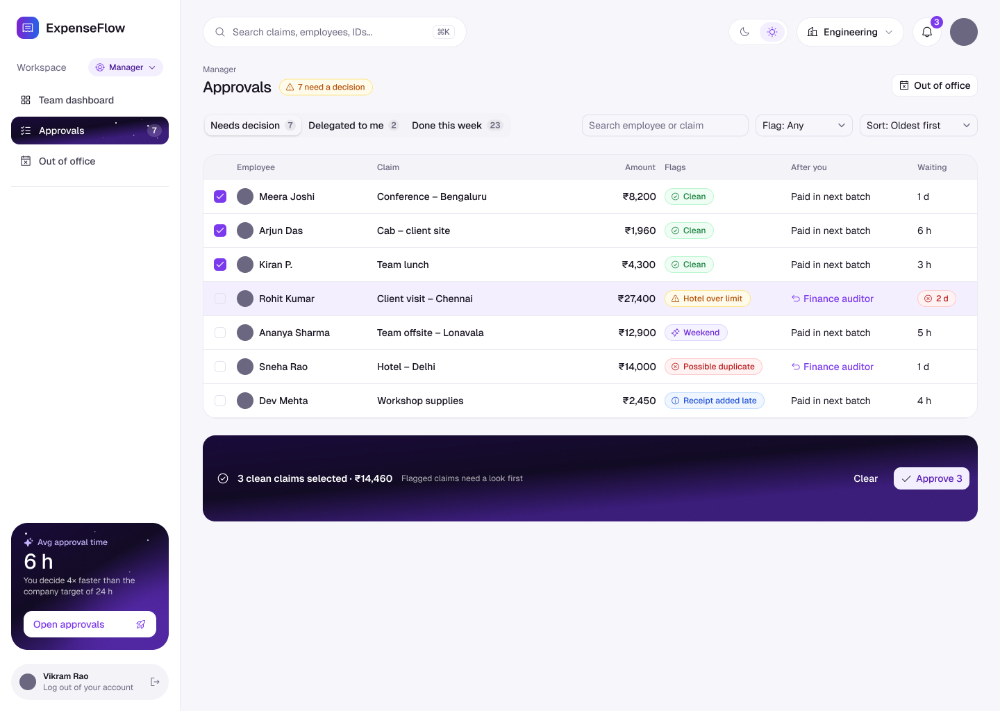

# M2 · Approvals queue (bulk approve)

| | |
|---|---|
| Role | Line manager |
| Route (suggested) | `/manager/approvals` |
| Figma node | 4015:2191 |
| Frame size | 1440 × 1024 |
| Sidebar variant | Manager ("Approvals" selected, badge 7; nav is Team dashboard / Approvals / Out of office only - no Notifications / Policy guide / Settings group) |

## Purpose
The manager's work queue. They scan the claims waiting for them, approve clean ones in bulk, and
open flagged ones to review individually (M3).

## Layout
- Sidebar (Manager) + Topbar (context "Engineering").
- Header row: breadcrumb + title + chip left; "Out of office" button right.
- Toolbar row (35px): tabs left (444px); search input (240px), two selects (140px, 170px) right.
- Table card (1116 × 381), 7 rows.
- Bulk action bar (1116 × 124): dark purple gradient panel below the table.

## Content & components

### Header
- Breadcrumb: "Manager"; title: "Approvals"
- Status Chip (warning, ph/warning): "7 need a decision"
- Button "Out of office" - outline, ph/calendar-x

### Toolbar
- Segmented tabs with counts: "Needs decision 7" (selected, white), "Delegated to me 2", "Done this week 23"
- Input, placeholder "Search employee or claim"
- Select "Flag: Any"
- Select "Sort: Oldest first"

### Table
Columns: (checkbox) · Employee · Claim · Amount (right-aligned) · Flags · After you · Waiting

| ☐ | Employee | Claim | Amount | Flags (tone) | After you | Waiting |
|---|---|---|---|---|---|---|
| ☑ | Meera Joshi | Conference – Bengaluru | ₹8,200 | Clean (success) | Paid in next batch | 1 d |
| ☑ | Arjun Das | Cab – client site | ₹1,960 | Clean (success) | Paid in next batch | 6 h |
| ☑ | Kiran P. | Team lunch | ₹4,300 | Clean (success) | Paid in next batch | 3 h |
| ☐ | Rohit Kumar | Client visit – Chennai | ₹27,400 | Hotel over limit (warning) | ↩ Finance auditor (purple link) | 2 d (danger chip, ph/x-circle) |
| ☐ | Ananya Sharma | Team offsite – Lonavala | ₹12,900 | Weekend (purple, ph/sparkle) | Paid in next batch | 5 h |
| ☐ | Sneha Rao | Hotel – Delhi | ₹14,000 | Possible duplicate (danger) | ↩ Finance auditor | 1 d |
| ☐ | Dev Mehta | Workshop supplies | ₹2,450 | Receipt added late (info) | Paid in next batch | 4 h |

- Each Employee cell has a 24px avatar. The Rohit Kumar row is highlighted (light purple, hover/focus state).
- Header row has no "select all" checkbox drawn.
- Flagged rows have faded checkboxes (disabled look).

### Bulk action bar (dark purple gradient)
- ph/check-circle + "3 clean claims selected · ₹14,460" (white, semibold)
- "Flagged claims need a look first" (muted)
- Button "Clear" - ghost, white text
- Button "Approve 3" - white/light button, ph/check, purple text

## Interactions & states
- Tabs filter the list: Needs decision / Delegated to me / Done this week.
- Search filters by employee name or claim title (inferred: also claim ID).
- "Flag" select filters by flag type; "Sort" select changes order (default oldest first).
- Checkboxes select clean claims only. Behaviour (inferred): flagged claims cannot be bulk-selected
  ("Flagged claims need a look first").
- Bulk bar appears when ≥1 row is selected; it shows count and total. "Clear" deselects all.
- "Approve 3" → Behaviour (inferred): approves selected claims, shows a toast, removes rows and
  decrements the sidebar badge; partial failure listed per claim.
- Row click → opens M3 review sheet over this page.
- "Out of office" → M4.
- Waiting chip turns danger when waiting ≥ 2 d (inferred SLA threshold).
- Empty state (not designed): "Nothing needs your decision" in the table area.

## Data & API
- `GET /api/v1/claims?status=SUBMITTED&limit&offset` gives `id`, `title`, `total_amount`,
  `submitted_at`, `employee_id` - usable as a stop-gap list.
- Not yet in API: queue scoped to "claims waiting for me" (approval states), delegated-to-me,
  done-this-week counts and lists.
- Not yet in API: employee name/avatar in claim summaries (only `employee_id`).
- Not yet in API: policy flags per claim, "after you" next approver, search/flag/sort query params.
- Not yet in API: approve (single and bulk) endpoints.
- Waiting time can be computed client-side from `submitted_at`.

## Build notes
- shadcn: Tabs (or ToggleGroup) with Badge counts, Input, Select, Table, Checkbox, Avatar, Badge, Button.
- Consider TanStack Table only if already in the stack; plain Table is enough for 7–20 rows.
- Bulk bar: sticky to the bottom of the content area when the table is long.
- Flag chips use Status Chip tones: success, warning, danger, info, purple.
- Table component is reused in M3 background and auditor queue (A1).
