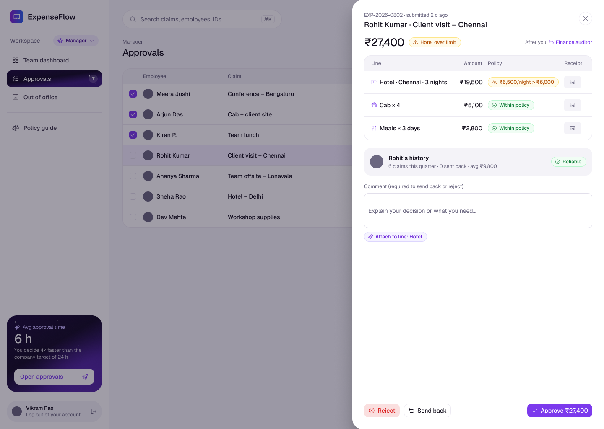

# M3 · Review a claim (approve / reject / send back)

| | |
|---|---|
| Role | Line manager |
| Route (suggested) | `/manager/approvals/:claimId` (sheet over M2) |
| Figma node | 4015:2577 |
| Frame size | 1440 × 1024 |
| Sidebar variant | Manager ("Approvals" selected, badge 7; below the divider only "Policy guide" - Notifications and Settings removed) |

## Purpose
The manager reviews one claim line by line, sees policy results, receipts and the employee's
history, then approves, rejects or sends it back with a comment.

## Layout
- Background: M2 approvals table (simplified: no tabs/toolbar or bulk bar visible; Rohit Kumar row
  highlighted), dimmed by a scrim.
- Right-side Sheet, 600 × 1024, 28px padding. Top to bottom:
  1. Header: overline + title left, close button right.
  2. Amount row: amount + flag chip left; "After you" right.
  3. Lines table card (544 × 203).
  4. Employee history card (544 × 66).
  5. Comment field with chip (544 × 140).
  6. Spacer, then footer: Reject + Send back left; Approve right.

## Content & components

### Header
- Overline: "EXP-2026-0802 · submitted 2 d ago"
- Title: "Rohit Kumar · Client visit – Chennai"
- Close: 32px round outline icon button, ph/x

### Amount row
- "₹27,400" (large)
- Status Chip (warning, ph/warning): "Hotel over limit"
- Right: "After you" (muted) + ph/arrow-u-up-left "Finance auditor" (purple)

### Lines table
Columns: Line · Amount (right) · Policy · Receipt

| Line (icon) | Amount | Policy (chip tone) | Receipt |
|---|---|---|---|
| ph/bed Hotel · Chennai · 3 nights | ₹19,500 | ₹6,500/night > ₹6,000 (warning, ph/warning) | thumbnail button (ph/image) |
| ph/car Cab × 4 | ₹5,100 | Within policy (success) | thumbnail button |
| ph/fork-knife Meals × 3 days | ₹2,800 | Within policy (success) | thumbnail button |

### Employee history (grey card)
- Avatar 32px; "Rohit’s history" (semibold); "6 claims this quarter · 0 sent back · avg ₹9,800"
- Status Chip (success, ph/check-circle): "Reliable"

### Comment
- Label: "Comment (required to send back or reject)"
- Textarea (84px), placeholder "Explain your decision or what you need…"
- Chip (purple outline, ph/sparkle): "Attach to line: Hotel"

### Footer
- "Reject" - destructive soft (light red fill, red text), ph/x-circle
- "Send back" - outline, ph/arrow-u-up-left
- "Approve ₹27,400" - primary, ph/check (amount in the label)

## Interactions & states
- Receipt thumbnail → Behaviour (inferred): opens the receipt in a viewer/lightbox (file download
  endpoint exists).
- "Attach to line: Hotel" → Behaviour (inferred): links the comment to the flagged line; the
  suggested line is the one with a policy warning.
- Validation: "Reject" and "Send back" require a non-empty comment - show an error under the textarea
  if empty. "Approve" does not require one.
- "Approve ₹27,400" → approve; claim moves to the next step (Finance auditor here, because the total is
  over ₹25,000). Close sheet, remove row from M2, toast.
- "Send back" → claim returns to the employee for edits (shows later as "Resubmitted after send-back" in M1).
- "Reject" → Behaviour (inferred): confirm dialog, then the claim is closed as rejected.
- Close / Esc / scrim click → back to M2 (inferred: warn if a comment was typed).
- Loading: disable footer buttons while the action runs.

## Data & API
- `GET /api/v1/claims/{id}` → `title`, `total_amount`, `submitted_at`, `lines[]` (category,
  amount, city, nights, receipt_id), `attachments[]`.
- `GET /api/v1/claims/{id}/attachments/{att_id}` → receipt file for the viewer.
- Line label is built client-side (e.g. "Hotel · Chennai · 3 nights"). The design groups cabs and
  meals ("Cab × 4", "Meals × 3 days") - Not yet in API: grouping; build from lines or show one row per line.
- Not yet in API: employee name on the claim, display number `EXP-2026-0802`.
- Not yet in API: per-line policy result and claim-level flags; next approver ("After you").
- Not yet in API: employee history (claims this quarter, sent-back count, average, reliability).
- Not yet in API: approve / reject / send-back endpoints with comment and optional line reference.

## Build notes
- shadcn: Sheet (side="right", w-[600px]), Table, Badge, Avatar, Textarea, Button, AlertDialog
  (reject confirm), Dialog for the receipt preview.
- Share the `SideSheet` layout with N3 and M4.
- Approve button label includes the formatted claim total.
- Auditor view (A2) likely reuses the lines table - make it a component.
