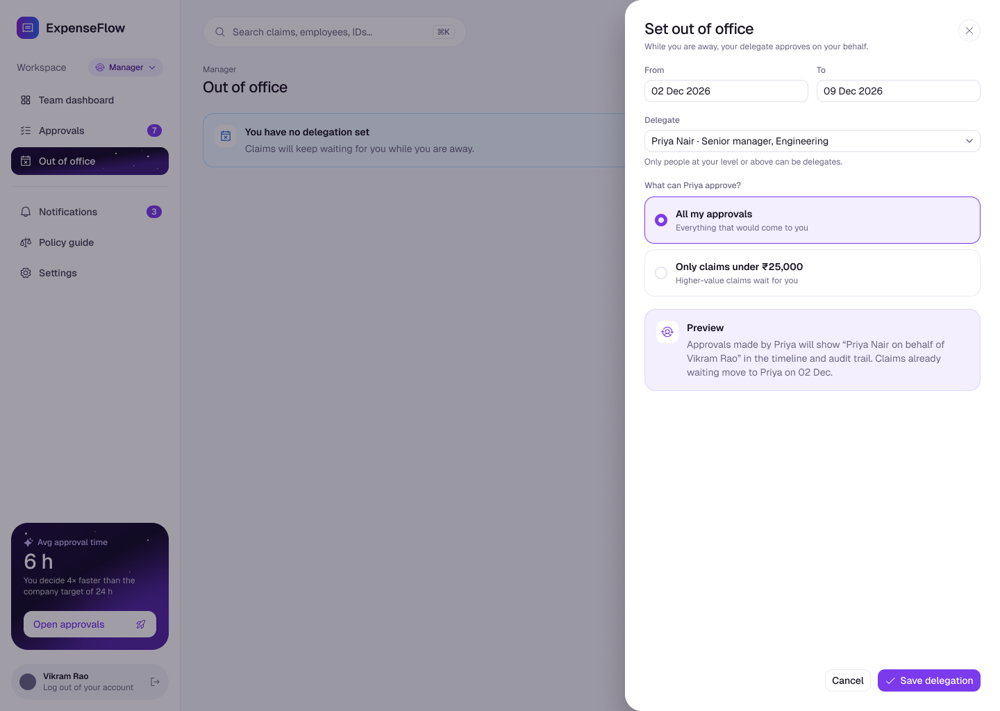

# M4 · Out of office & delegation

| | |
|---|---|
| Role | Line manager |
| Route (suggested) | `/manager/out-of-office` (sheet opens over it) |
| Figma node | 4015:3022 |
| Frame size | 1440 × 1024 |
| Sidebar variant | Manager ("Out of office" selected, Approvals badge 7) |

## Purpose
The manager sets an out-of-office period and picks a delegate who approves on their behalf, so
claims do not stall while they are away.

## Layout
- Page behind the sheet: breadcrumb "Manager", title "Out of office", and an info banner card
  (1116 × 78) - dimmed by a scrim.
- Right-side Sheet, 540 × 1024, 28px padding. Top to bottom:
  1. Header: title + description left, close button right.
  2. From / To dates side by side (236px each).
  3. Delegate select + helper text.
  4. "What can Priya approve?" - two radio cards stacked.
  5. Preview callout.
  6. Spacer, then footer: Cancel + Save delegation right-aligned.

## Content & components

### Page (behind)
- Breadcrumb "Manager"; title "Out of office"
- Banner (info tone, light blue): icon tile ph/calendar-x; "You have no delegation set" (semibold);
  "Claims will keep waiting for you while you are away."

### Sheet header
- Title: "Set out of office"
- Description: "While you are away, your delegate approves on your behalf."
- Close: 32px round outline icon button, ph/x

### Fields
| Label | Control | Value shown | Helper |
|---|---|---|---|
| From | Input (date) | 02 Dec 2026 | |
| To | Input (date) | 09 Dec 2026 | |
| Delegate | Select, ph/caret-down | Priya Nair · Senior manager, Engineering | "Only people at your level or above can be delegates." |

### Scope (label "What can Priya approve?" - uses the delegate's first name)
Radio cards:

| Option | Title | Description | State |
|---|---|---|---|
| 1 | All my approvals | Everything that would come to you | Selected (purple border, light purple fill, filled radio) |
| 2 | Only claims under ₹25,000 | Higher-value claims wait for you | Default |

### Preview callout (purple tone)
- Icon tile ph/user-switch (or similar swap-person icon)
- Title: "Preview"
- Text: "Approvals made by Priya will show “Priya Nair on behalf of Vikram Rao” in the timeline and
  audit trail. Claims already waiting move to Priya on 02 Dec."

### Footer
- "Cancel" - outline
- "Save delegation" - primary, ph/check

## Interactions & states
- Opened from: Sidebar "Out of office", M1 "Set out of office", M2 "Out of office".
- Date pickers: To must be on or after From; From not in the past (inferred).
- Delegate select lists only eligible people (same level or above).
- Changing the delegate updates "What can <name> approve?" and the preview text; changing From
  updates "move to Priya on <date>".
- "Save delegation" → saves, closes sheet; Behaviour (inferred): the banner changes to show the
  active delegation with an edit/cancel option (state not designed).
- "Cancel" / close / Esc → close without saving.
- Validation errors (inferred): all three fields required; inline messages under the field.

## Data & API
- Not yet in API: delegation endpoints (create/read/cancel delegation with from, to, delegate id,
  scope `all` | `under_25000`).
- Not yet in API: eligible-delegate list (users at the manager's level or above, with title and team).
- Not yet in API: "on behalf of" actor in audit events (`GET /claims/{id}/audit` has only `actor_id`).
- The ₹25,000 threshold should come from seeded policy config, not be hard-coded in the UI.

## Build notes
- shadcn: Sheet (side="right", w-[540px]), Popover + Calendar, Select (or Combobox if the list is
  long), RadioGroup styled as cards, Alert for banner and preview, Button.
- Reuse the `RadioCard` from N1 and the `SideSheet` layout from N3/M3.
- Dates shown `DD Mon YYYY`, sent as `YYYY-MM-DD`.
