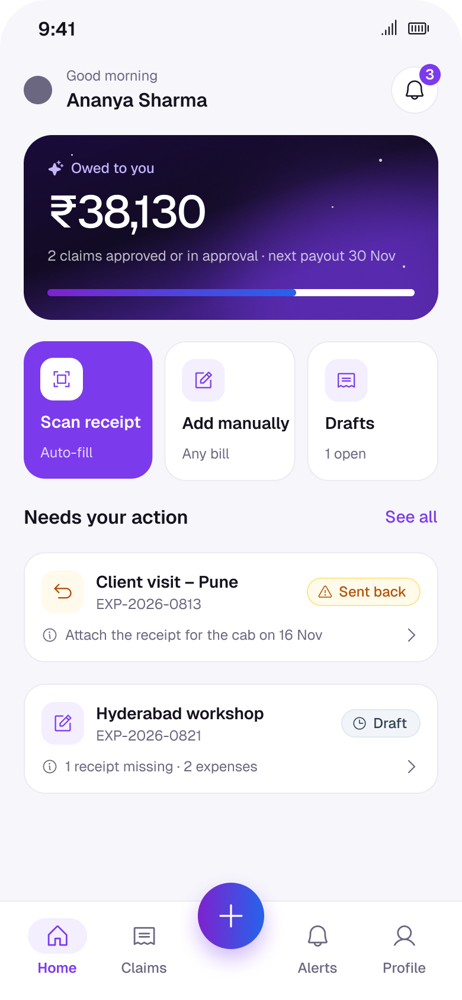

# MB1 · Home

| | |
|---|---|
| Role | Employee (mobile) |
| Route (suggested) | `/m` (mobile home). Mobile counterpart of the employee dashboard E1; render E1's route with this layout below the `md` breakpoint, or mount separately under `/m`. |
| Figma node | 4041:4483 |
| Frame size | 390 × 844 (PNG exported at 2×) |
| Desktop equivalent | E1 (Employee dashboard), entry points of N1 (Start new claim) |

## Purpose
The employee's mobile landing screen. It shows how much money is owed to them, offers the two
ways to capture an expense (scan or type), and lists claims that need their action.

## Layout
Top to bottom, 20px side gutters (content 350 wide), page background light lavender-grey.
1. Status bar (Mobile / Status Bar, 390 × 48): "9:41", ph/cell-signal-full, ph/battery-full.
2. Greeting row (350 × 40): avatar + two text lines left, round notification button right.
3. "Owed to you" hero card (350 × 156), dark gradient.
4. Quick actions row (350 × 118): three tiles, ~110 wide each, 12px gaps.
5. Section header "Needs your action" + "See all" link (350 × 24).
6. Two action cards (350 × 93 each), 16px apart.
7. Empty space, then Tab bar (Mobile / Tab Bar, 390 × 84) fixed at the bottom.

## Content & components

### Greeting row
- Avatar (Avatar With Image, 24 × 24 component; shown ~32px grey circle).
- Overline (muted): "Good morning"
- Name (semibold, ~16px): "Ananya Sharma"
- Notification button: 40 × 40 white circle, 1px border, ph/bell; purple count badge "3" top-right.

### Owed card
- Background: near-black → violet radial gradient, rounded ~24px, a large faint ellipse and four
  tiny white "star" dots as decoration.
- Label row: ph/sparkle (light violet) + "Owed to you" (light violet).
- Amount (bold, ~36px, white): "₹38,130"
- Caption (white, ~80% opacity): "2 claims approved or in approval · next payout 30 Nov"
- Progress bar 310 × 6: white track, violet→blue gradient fill to ~60%.

### Quick actions (three tiles, 1px border, rounded ~20px)
| Tile | Icon (in 36px tile) | Title | Subtitle | Style |
|---|---|---|---|---|
| 1 | ph/scan (purple on white tile) | Scan receipt | Auto-fill | Primary: solid #7c3aed fill, white text |
| 2 | ph/note-pencil (purple on violet-50 tile) | Add manually | Any bill | White card |
| 3 | ph/receipt (purple on violet-50 tile) | Drafts | 1 open | White card |

### Needs your action
- Header: "Needs your action" (semibold) · link "See all" (purple, right).

| Card | Icon tile | Title | Claim no. | Status Chip | Footer line (ph/info, muted) |
|---|---|---|---|---|---|
| 1 | ph/arrow-u-up-left (amber, amber-50 tile) | Client visit – Pune | EXP-2026-0813 | "Sent back" — warning, ph/warning | Attach the receipt for the cab on 16 Nov |
| 2 | ph/note-pencil (purple, violet-50 tile) | Hyderabad workshop | EXP-2026-0821 | "Draft" — neutral, ph/clock | 1 receipt missing · 2 expenses |

Each card: white, 1px border, rounded ~16px, ph/caret-right at the right of the footer line.

### Tab bar (Mobile / Tab Bar, variant "Home" active)
| Position | Icon | Label | State |
|---|---|---|---|
| 1 | ph/house | Home | Active: purple icon + label, violet-50 pill behind the icon |
| 2 | ph/receipt | Claims | Default: slate icon + label |
| centre | ph/plus (white) | — (no label) | Raised 56px circular button, violet→blue gradient, soft shadow, overlaps the bar's top edge |
| 3 | ph/bell | Alerts | Default |
| 4 | ph/user | Profile | Default |

## Interactions & states
- Bell → notifications. Behaviour (inferred): same as the "Alerts" tab; badge = unread count, hidden at 0.
- Scan receipt tile → MB2 (camera). Add manually tile → MB4. Drafts tile → claim list filtered
  to drafts (inferred: Claims tab with `status=DRAFT`), or MB6 when there is exactly one draft.
- Centre "+" in the tab bar → Behaviour (inferred): opens a small action sheet "Scan receipt /
  Add manually", or goes straight to MB2. Not designed.
- Action card tap → claim: Sent back card → MB8 (claim status, sent back); Draft card → MB6.
- "See all" → Claims tab filtered to items needing action (inferred).
- Owed card is display-only (inferred). Progress bar: Behaviour (inferred) share of the owed
  amount already approved vs. still in approval — the design does not say.
- Empty "Needs your action": Behaviour (inferred) hide the section or show a short "All caught up"
  line; see MB9 for the designed mobile empty/loading/offline states.
- Loading: skeletons for the owed card and action cards (inferred, see MB9).

## Data & API
- Name/avatar: from the logged-in user (existing auth/user endpoint).
- Drafts count and action list: `GET /api/v1/claims?status=DRAFT` → count for "1 open"; each
  claim gives `title`/purpose, claim number, `lines` (for "2 expenses", missing receipts =
  lines with amount > 500 and no `receipt_id`).
- Not yet in API: "Owed to you" total, approved / in-approval statuses, next payout date
  (statuses are only `DRAFT` / `SUBMITTED` today).
- Not yet in API: "Sent back" status and the approver's sent-back reason text
  ("Attach the receipt for the cab on 16 Nov").
- Not yet in API: notifications / unread count for the bell badge.
- Amounts are INR with Indian grouping (`₹38,130`), see foundations.md.

## Build notes
- Mobile shell: `MobileLayout` = status-bar safe area (`pt-[env(safe-area-inset-top)]`) +
  scroll body + fixed `TabBar` with `pb-[env(safe-area-inset-bottom)]`; add bottom padding to the
  body equal to the tab bar height so the last card is not hidden.
- Do not render the fake status bar in the app; it is the device's own. Use it only for spacing.
- shadcn: Avatar, Button (icon, rounded-full) + Badge for the bell count, Card for tiles and action
  cards, Progress (custom gradient indicator), Badge for Status Chips (shared `StatusChip`).
- Quick action tiles are buttons/links; whole action card is one link (min 44px touch target).
- Tab bar: `<nav>` with 4 links + centre button; active tab from the router; `aria-current="page"`.
- Reuse the desktop status-chip mapping and INR formatter from E1/E2.
