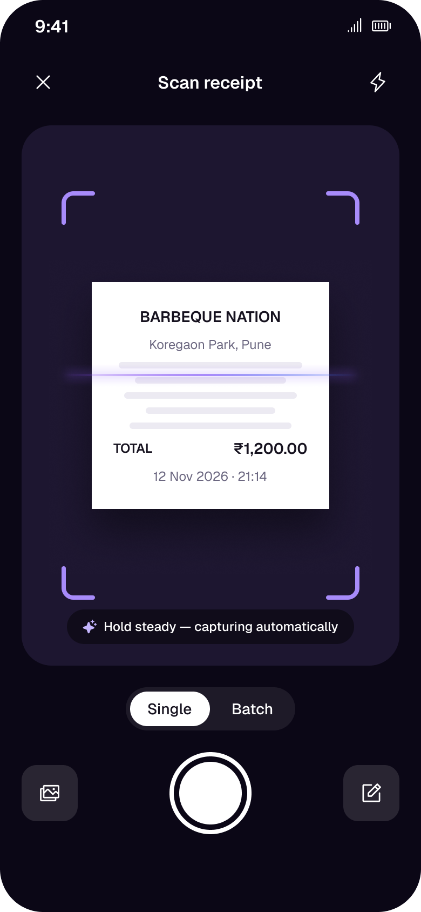

# MB2 · Scan receipt

| | |
|---|---|
| Role | Employee (mobile) |
| Route (suggested) | `/m/claims/:id/expenses/scan` (or `/m/scan` when no draft exists yet). Full-screen, no tab bar. |
| Figma node | 4041:4602 |
| Frame size | 390 × 844 (PNG exported at 2×) |
| Desktop equivalent | none (desktop uploads the receipt file inside N3 / the E3 drop zone) |

## Purpose
A full-screen camera view for photographing a paper receipt. The photo is captured and its
details (vendor, amount, date) are read so the next screen (MB3) arrives pre-filled.

## Layout
Dark theme (near-black `#0b0a14`-ish background, white text). Top to bottom:
1. Status bar (Mobile / Status Bar, dark variant, white glyphs), 390 × 48.
2. App bar (350 × 40): close button left, title centred, flash button right.
3. Viewfinder (350 × 500): rounded ~28px panel, slightly lighter than the background.
   Inside: four purple corner brackets (40 × 40 each) framing the receipt, the live camera
   image (shown here as a mock receipt 220 × 210), a horizontal purple scan line (270 × 2,
   glow), and a hint pill near the bottom (266 × 32).
4. Mode toggle (157 × 40), centred: "Single" | "Batch".
5. Capture row (350 × 76): gallery button left (52 × 52), shutter centre (76px), manual-entry
   button right (52 × 52).
6. Bottom safe area.

## Content & components

### App bar
- Left: ph/x (white), 40 × 40 icon button, no background.
- Title: "Scan receipt" (white, semibold, centred).
- Right: ph/lightning (white outline), 40 × 40 icon button — flash toggle.

### Viewfinder (mock receipt shown in the design is camera content, not UI)
- Receipt sample text: "BARBEQUE NATION", "Koregaon Park, Pune", "TOTAL" "₹1,200.00",
  "12 Nov 2026 · 21:14" — illustration only; do not render.
- Corner brackets: 4px purple (#a78bfa / violet-400) strokes, rounded ends.
- Scan line: purple gradient line with a soft glow, animates top→bottom (inferred).
- Hint pill: dark translucent pill, ph/sparkle (violet) + "Hold steady — capturing automatically" (white).

### Mode toggle
Segmented control on a dark pill track:
| Segment | State |
|---|---|
| Single | Selected — white pill, dark text |
| Batch | Unselected — white text on track |

### Capture row
| Control | Icon | Style |
|---|---|---|
| Gallery | ph/images | 52px rounded-square, dark grey fill (~#27252f), white icon |
| Shutter | — | 76px white circle with a dark gap ring and white outer ring |
| Manual entry | ph/note-pencil | 52px rounded-square, dark grey fill, white icon |

## Interactions & states
- Close (ph/x) → back to where the user came from (MB1 or MB6); discard any capture.
- Flash toggles torch on/off (inferred: icon fills when on; only where the device supports it).
- Auto-capture: when a receipt is detected and steady, the photo is taken automatically (copy:
  "Hold steady — capturing automatically"). Behaviour (inferred): until detected, hint reads
  something like "Point at a receipt"; this is not designed.
- Shutter → manual capture. After capture → upload + read → MB3 (Check details) with fields filled.
  Behaviour (inferred): show a short "Reading receipt…" loading state (see MB9) between MB2 and MB3.
- Gallery → pick an existing photo/PDF from the device, then same flow → MB3.
- Manual entry (ph/note-pencil) → MB4 (Add expense manually) with no receipt.
- Single vs Batch: Single captures one receipt then goes to MB3. Behaviour (inferred): Batch keeps
  the camera open and queues several receipts, each becoming one expense line in the draft
  (MB6) to check later — no batch review screen is designed.
- Camera permission denied / no camera (inferred, not designed): show a message with
  "Choose from gallery" and "Enter manually" fallbacks.
- Offline (see MB9): capture can still work; Behaviour (inferred) queue the upload until online.
- Upload errors map to API codes: 415 `unsupported_file_type`, 413 `file_too_large` (5 MB),
  409 `attachment_limit_reached` (10 per claim).

## Data & API
- Upload the captured image: `POST /api/v1/claims/{id}/attachments` (multipart field `file`,
  JPEG/PNG/PDF, max 5 MB) → attachment `id`, `original_name`, `sha256`. A draft claim must exist
  first — if the user starts from MB1 with no draft, create one with `POST /api/v1/claims`
  (`action: "draft"`) before uploading (inferred flow).
- Not yet in API: OCR / receipt reading (vendor, amount, date, category) — MB3's pre-filled values
  depend on it. Until it exists, go to MB3 with the photo attached and empty fields.
- Not yet in API: duplicate-receipt check result (MB3 shows "no duplicate").

## Build notes
- Prefer the simple path for the hackathon: `<input type="file" accept="image/*,application/pdf"
  capture="environment">` opens the native camera. A live in-page viewfinder (getUserMedia,
  torch, auto-capture) is a stretch goal — the design's look can be approximated with a static
  dark screen + big "Take photo" shutter that triggers the input.
- Gallery button: same input without `capture`. Compress large photos client-side to stay
  under 5 MB (canvas → JPEG ~0.8).
- shadcn: ToggleGroup (type="single") for Single/Batch, Button (icon, ghost) for close/flash.
- Full-screen route: hide the tab bar; respect `env(safe-area-inset-*)` top and bottom.
- All controls ≥ 44px touch targets; add `aria-label`s ("Close", "Flash", "Take photo",
  "Choose from gallery", "Enter manually").
- Dark styling only on this screen; use tokens, not hard-coded hex, where possible.
