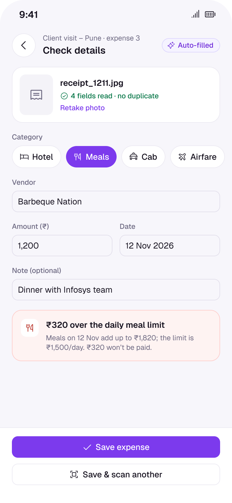

# MB3 · Check details (read from receipt)

| | |
|---|---|
| Role | Employee (mobile) |
| Route (suggested) | `/m/claims/:id/expenses/new?from=scan` (full-screen form, no tab bar). Same form component as MB4, opened with pre-filled values and an attached receipt. |
| Figma node | 4041:4663 |
| Frame size | 390 × 844 (PNG exported at 2×) |
| Desktop equivalent | N3 (Add an expense sheet) |

## Purpose
After a receipt is scanned (MB2), the employee checks the values read from it, corrects them if
needed, and saves the expense line. The live policy result is shown before saving.

## Layout
Top to bottom, 20px gutters, light background:
1. Status bar (390 × 48).
2. Header (350 × 40): back button, overline + title, "Auto-filled" chip right.
3. Receipt card (350 × 94).
4. Category chips row (label + 350 × 38 scroller).
5. Vendor field (full width).
6. Two columns (169 each): Amount (₹) | Date.
7. Note (optional) field (full width).
8. Policy callout (350 × 86), danger tone.
9. Spacer, then sticky actions (390 × 127, white, top border): two full-width buttons.

## Content & components

### Header
- Back: 40px white circle, 1px border, ph/caret-left.
- Overline (muted): "Client visit – Pune · expense 3"
- Title (semibold): "Check details"
- Status Chip, purple tone, ph/sparkle: "Auto-filled"

### Receipt card (white, 1px border, rounded ~16px)
- Thumbnail tile (~56 × 68, grey fill) with ph/receipt icon (photo preview placeholder).
- File name (semibold): "receipt_1211.jpg"
- Status line (green-700, ph/check-circle): "4 fields read · no duplicate"
- Text link (purple): "Retake photo"

### Category (label "Category")
Single-select pill chips, horizontally scrollable (the 4th chip is cut off at the right edge):

| Chip | Icon | State |
|---|---|---|
| Hotel | ph/bed | Default (white, 1px border) |
| Meals | ph/fork-knife | Selected (solid #7c3aed, white) |
| Cab | ph/taxi (car front) | Default |
| Airfare | ph/airplane-tilt | Default |

"Other" is not visible; Behaviour (inferred): it is further right in the scroller.

### Fields (category Meals)
| Label | Control | Value shown | Required |
|---|---|---|---|
| Vendor | Input (Input - Nova) | Barbeque Nation | Yes on submit |
| Amount (₹) | Input, numeric | 1,200 | Yes |
| Date | Date input | 12 Nov 2026 | Yes |
| Note (optional) | Input | Dinner with Infosys team | No |

No visual marker distinguishes auto-filled fields from typed ones (only the header chip).

### Policy callout (danger tone: red-50 fill, red-200 border)
- Icon tile: white rounded square, ph/fork-knife (red).
- Title (semibold): "₹320 over the daily meal limit"
- Text (muted): "Meals on 12 Nov add up to ₹1,820; the limit is ₹1,500/day. ₹320 won’t be paid."

### Sticky actions
| Button | Variant | Icon |
|---|---|---|
| Save expense | Primary (purple), full width | ph/check |
| Save & scan another | Outline, full width | ph/scan |

## Interactions & states
- Back (ph/caret-left) → MB2. Behaviour (inferred): confirm discard if the user edited fields.
- "Retake photo" → MB2; on new capture, replaces the attachment and re-reads fields.
- Category chip change swaps the field set (Hotel → MB4 fields: City, Hotel, Check-in → out,
  Total amount; others as shown here). Keep values that still apply.
- Editing any field re-runs the live policy check and updates/hides the callout. The callout
  tone follows MB5: success (within policy, inferred: no callout or a green one), warning
  (needs approval + reason input, see MB4), danger (capped — over-limit part not paid, as here),
  info (possible duplicate).
- The danger callout here does not block saving; the line is saved and only ₹1,500/day is paid.
- "Save expense" → saves the line, → MB6 (Draft claim) with the new line.
- "Save & scan another" → saves, → MB2 for the next receipt.
- Validation: amount > 0, date not in the future (API rule), vendor required to submit. Show
  errors under the field; map 422 `details.fields` (`lines.N.vendor`) to the field.
- Reading failed / partial (inferred, not designed): status line "2 of 4 fields read" in
  warning tone, empty fields left for the user; header chip hidden.
- Duplicate found (inferred): status line in danger/info tone with "View match", see MB5 card 4.

## Data & API
- Save: `PUT /api/v1/claims/{id}` `action: "draft"` with all lines; this line:
  `category: "meal"`, `amount: "1200.00"`, `expense_date: "2026-11-12"`, `vendor: "Barbeque Nation"`,
  `description: "Dinner with Infosys team"` (Note → `description`), `receipt_id` (from MB2 upload).
- Category mapping: Hotel→`hotel`, Meals→`meal`, Cab→`cab`, Airfare→`airfare`, Other→`other`.
- Receipt preview: `GET /api/v1/claims/{id}/attachments/{att_id}`.
- Not yet in API: OCR / receipt reading ("4 fields read"), live policy check (daily meal total
  across lines, cap amount), duplicate-receipt check.
- Not yet in API: `receipt_number` is required above ₹500 on submit but no field is designed
  here. Behaviour (inferred): fill it from OCR or add a "Bill / invoice no." field.
- Header "expense 3" = line position (`lines[].position`).

## Build notes
- One `ExpenseForm` component for MB3 and MB4 (and desktop N3): props `prefill`, `receipt`,
  `source: "scan" | "manual"`. Mobile renders it as a full-screen page, desktop as a Sheet.
- shadcn: ToggleGroup (single) in a `overflow-x-auto` row with snap for categories, Input,
  Popover + Calendar (or native `<input type="date">` on mobile — simpler), Alert (destructive
  variant styled to danger tone), Badge (StatusChip purple), Button.
- Amount input: `inputMode="decimal"`, keep as string, format with Indian grouping on blur.
- Sticky actions: `fixed bottom-0` white bar with top border, `pb-[env(safe-area-inset-bottom)]`;
  add matching bottom padding to the scroll body. Buttons ≥ 44px tall on mobile (design shows 36).
- Tab bar hidden on this full-screen form.
