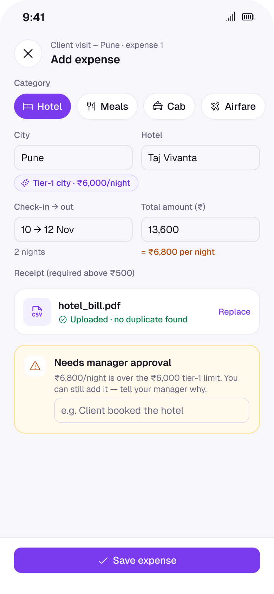

# MB4 · Add expense (manual, hotel)

| | |
|---|---|
| Role | Employee (mobile) |
| Route (suggested) | `/m/claims/:id/expenses/new` (full-screen form, no tab bar). Same `ExpenseForm` as MB3, opened empty. |
| Figma node | 4042:4607 |
| Frame size | 390 × 844 (PNG exported at 2×) |
| Desktop equivalent | N3 (Add an expense sheet) — same content, same hotel example |

## Purpose
The employee types in one expense line by hand (here a hotel stay) and attaches the bill. The
policy is checked as they type; an over-limit hotel can still be added with a reason for the
manager.

## Layout
Top to bottom, 20px gutters, light background:
1. Status bar (390 × 48).
2. Header (350 × 40): close button + overline + title.
3. Category chips (label + 350 × 38 scroller).
4. Two columns (169 each): City (+ tier chip below) | Hotel.
5. Two columns: Check-in → out (+ "2 nights") | Total amount (₹) (+ per-night line).
6. Label "Receipt (required above ₹500)" + receipt card (350 × 66).
7. Warning callout with a reason input (350 × 126).
8. Spacer, then sticky actions (390 × 81, white, top border): one full-width button.

## Content & components

### Header
- Close: 40px white circle, 1px border, ph/x.
- Overline (muted): "Client visit – Pune · expense 1"
- Title (semibold): "Add expense"

### Category (label "Category")
Single-select pill chips, horizontally scrollable (Airfare cut off at right):

| Chip | Icon | State |
|---|---|---|
| Hotel | ph/bed | Selected (solid #7c3aed, white) |
| Meals | ph/fork-knife | Default (white, 1px border) |
| Cab | ph/taxi (car front) | Default |
| Airfare | ph/airplane-tilt | Default |

### Fields (category Hotel)
| Label | Control | Value | Helper below |
|---|---|---|---|
| City | Input | Pune | Status Chip, purple, ph/sparkle: "Tier-1 city · ₹6,000/night" |
| Hotel | Input | Taj Vivanta | — |
| Check-in → out | Date-range input | 10 → 12 Nov | "2 nights" (muted, computed) |
| Total amount (₹) | Input, numeric | 13,600 | "= ₹6,800 per night" (amber-700, computed — amber because over limit) |

### Receipt (label "Receipt (required above ₹500)")
White card, 1px border, rounded ~16px:
- File icon tile (violet-50, purple file icon labelled "CSV" — design bug, use a PDF/generic
  file icon, as noted in N3).
- File name (semibold): "hotel_bill.pdf"
- Status (green-700, ph/check-circle): "Uploaded · no duplicate found"
- Text link right (purple): "Replace"

### Warning callout (warning tone: amber-50 fill, amber-200 border)
- Icon tile: white rounded square, ph/warning (amber-700).
- Title (semibold): "Needs manager approval"
- Text: "₹6,800/night is over the ₹6,000 tier-1 limit. You can still add it — tell your manager why."
- Input inside (white), placeholder: "e.g. Client booked the hotel"

### Sticky actions
- "Save expense" — primary, full width, ph/check. (No "Save & add another" on mobile, unlike N3.)

## Interactions & states
- Close (ph/x) → back to MB6 (draft) or MB1. Behaviour (inferred): confirm discard if dirty.
- Category chips swap the field set: Hotel shows City, Hotel, Check-in → out, Total amount.
  Meals/Cab/Airfare/Other show Vendor, Amount (₹), Date, Note (optional) — as in MB3.
- City → tier lookup shows the tier chip with the per-night limit after the city is entered.
- Nights = check-out − check-in; per-night = total ÷ nights; both update live.
- Live policy: per-night > tier limit → this warning callout with reason input. Behaviour
  (inferred): the reason becomes required to save while the warning shows. Within limit →
  no callout (or success, see MB5).
- Receipt: required when amount > ₹500. Empty state not designed — Behaviour (inferred): a dashed
  "Add receipt" row with Camera (→ MB2 / `capture`) and "Choose file" options.
  "Replace" opens the same picker. Duplicate found → info/danger status (see MB5 card 4).
- "Save expense" → saves the line → MB6 (Draft claim).
- Validation: show field errors inline; map 422 `details.fields` (e.g. `lines.0.city`,
  `lines.0.nights`) to the right field. Amount > 0; dates not in the future.
- Offline (see MB9): Behaviour (inferred) save locally and sync later, or disable Save with a note.

## Data & API
- Save: `PUT /api/v1/claims/{id}` `action: "draft"` (send all lines); this line:
  `category: "hotel"`, `city: "Pune"`, `vendor: "Taj Vivanta"`, `expense_date: "2026-11-10"`
  (check-in), `nights: 2`, `amount: "13600.00"`, `receipt_id`.
- Receipt: `POST /api/v1/claims/{id}/attachments` (PDF/PNG/JPEG, ≤ 5 MB) → `id`, `original_name`.
- Not yet in API: city-tier lookup and per-tier limits, live policy check, duplicate check result.
- Not yet in API: check-out date (only `expense_date` + `nights`), per-line justification/reason.
- Not yet in API: `receipt_number` (required above ₹500 on submit) has no field in this design.

## Build notes
- Share `ExpenseForm` with MB3 and desktop N3; mobile renders full-screen, desktop in a Sheet.
- shadcn: ToggleGroup (single, horizontal scroll), Input, Badge (StatusChip purple), date range:
  Drawer (bottom sheet) + Calendar `mode="range"` on mobile, or two native date inputs;
  Alert (warning) with Input inside; Button.
- Amount: `inputMode="decimal"`; keep string state; Indian grouping on blur.
- Receipt input: `<input type="file" accept="image/*,application/pdf">`; offer a camera option
  with `capture="environment"`.
- Sticky footer with `pb-[env(safe-area-inset-bottom)]`; when the keyboard is open, keep the
  focused field visible (`scrollIntoView`). Buttons ≥ 44px tall.
