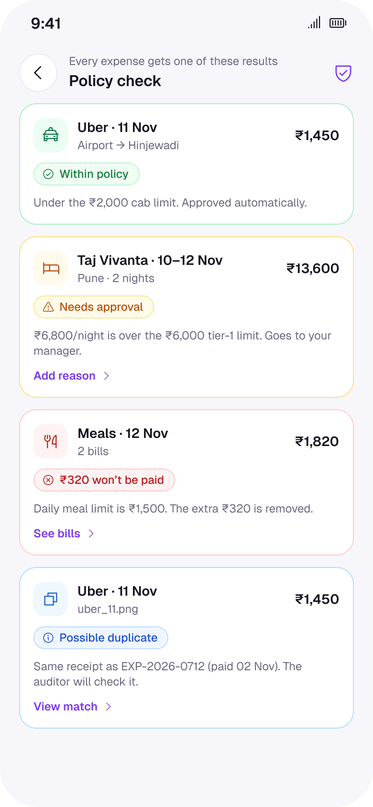

# MB5 · Policy result states

| | |
|---|---|
| Role | Employee (mobile) |
| Route (suggested) | `/m/claims/:id/policy` (full-screen list of the draft's lines with their policy result). Also the reference for the per-line result card reused in MB6/MB7. |
| Figma node | 4042:4766 |
| Frame size | 390 × 844 (PNG exported at 2×) |
| Desktop equivalent | E3 (Policy check card + Policy column of the expense lines table) |

## Purpose
Shows the four possible policy-check results an expense can get, each as a card with the amount,
an outcome chip, a plain-language explanation and a follow-up link. It doubles as a spec sheet
for the result card component.

## Layout
Top to bottom, 20px gutters, light background, no tab bar and no sticky footer:
1. Status bar (390 × 48).
2. Header (350 × 40): back button, overline + title, ph/shield-check icon right (purple, 22px).
3. Four result cards stacked, 12–16px gaps (heights 127, 169, 153, 169). Each card: white fill,
   1px border in the tone colour (green-200 / amber-200 / red-200 / blue-200), rounded ~20px,
   ~28px padding.

Card anatomy: icon tile (36px, tone-50 fill, tone-700 icon) + title + subtitle left, amount right
(bold); Status Chip below; explanation text (muted); optional purple link with ph/caret-right.

## Content & components

### Header
- Back: 40px white circle, 1px border, ph/caret-left.
- Overline (muted): "Every expense gets one of these results"
- Title (semibold): "Policy check"
- Right: ph/shield-check (purple), decorative.

### Result cards
| # | Tone | Icon tile | Title | Subtitle | Amount | Status Chip | Explanation | Link |
|---|---|---|---|---|---|---|---|---|
| 1 | success | ph/taxi | Uber · 11 Nov | Airport → Hinjewadi | ₹1,450 | "Within policy" (success, ph/check-circle) | Under the ₹2,000 cab limit. Approved automatically. | — |
| 2 | warning | ph/bed | Taj Vivanta · 10–12 Nov | Pune · 2 nights | ₹13,600 | "Needs approval" (warning, ph/warning) | ₹6,800/night is over the ₹6,000 tier-1 limit. Goes to your manager. | Add reason |
| 3 | danger | ph/fork-knife | Meals · 12 Nov | 2 bills | ₹1,820 | "₹320 won’t be paid" (danger, ph/x-circle) | Daily meal limit is ₹1,500. The extra ₹320 is removed. | See bills |
| 4 | info | ph/copy | Uber · 11 Nov | uber_11.png | ₹1,450 | "Possible duplicate" (info, ph/info) | Same receipt as EXP-2026-0712 (paid 02 Nov). The auditor will check it. | View match |

Notes:
- Card 3 groups two meal lines on the same day ("2 bills"); the amount is the day total.
- Card 4's subtitle is the receipt file name, not a route.
- The danger chip shows the computed cut amount in its label, not a fixed word.

## Interactions & states
- Back → previous screen (MB6 or MB7).
- "Add reason" → opens the hotel line in MB4 with focus on the reason input in the warning
  callout. Behaviour (inferred): could also be a bottom Drawer with just the reason field.
- "See bills" → Behaviour (inferred): expands the card or opens a Drawer listing the two meal
  lines (Barbeque Nation ₹1,200, Starbucks ₹620 per E3), each tappable to MB3/MB4 edit.
- "View match" → Behaviour (inferred): a Drawer showing both receipts side by side and the other
  claim's number/date; the employee cannot resolve it (auditor checks).
- Tapping a card body → Behaviour (inferred): edit that line (MB3/MB4).
- Outcome rules (from copy): within limit → auto-approved, no action; over a hard limit with
  manager discretion (hotel) → needs approval + reason; over a capped daily limit (meals) →
  excess is cut and not paid; same receipt hash as another claim → flagged for the auditor.
- Ordering: Behaviour (inferred) in a real draft, show issues first (danger, warning, info) then
  success; this screen shows them in a fixed teaching order.
- Loading: card skeletons while the check runs (see MB9). Empty claim: no cards (see MB9).

## Data & API
- Lines come from `GET /api/v1/claims/{id}` (`lines[]`: category, amount, expense_date, vendor,
  description, city, nights, receipt_id; `attachments[]` for `original_name`).
- Not yet in API: policy evaluation per line (outcome, limit used, capped/payable amount,
  explanation). Limits are seeded configuration (CLAUDE.md) — never hard-code ₹2,000 / ₹6,000 /
  ₹1,500 in the frontend; read them from the policy endpoint when it exists.
- Not yet in API: duplicate detection across claims (attachments have `sha256`, which can drive
  it), the matched claim number and paid date.
- Not yet in API: per-line justification ("Add reason").
- Not yet in API: claim statuses beyond `DRAFT`/`SUBMITTED` ("paid 02 Nov").

## Build notes
- Build one `PolicyResultCard` component: props `tone` (success | warning | danger | info),
  `icon`, `title`, `subtitle`, `amount`, `chipLabel`, `message`, `action?: {label, onClick}`.
  Reuse it in MB6/MB7 and as the mobile version of E3's policy column.
- shadcn: Card (border colour from tone), Badge → shared `StatusChip`, Button `variant="link"`
  with ph/caret-right for the action, Drawer for See bills / View match.
- Tone colours come from foundations.md status tones; card border uses the tone's 200 shade.
- Whole link row ≥ 44px tall for touch; amounts formatted with Indian grouping.
- Scrolls normally; respect top/bottom safe-area insets.
