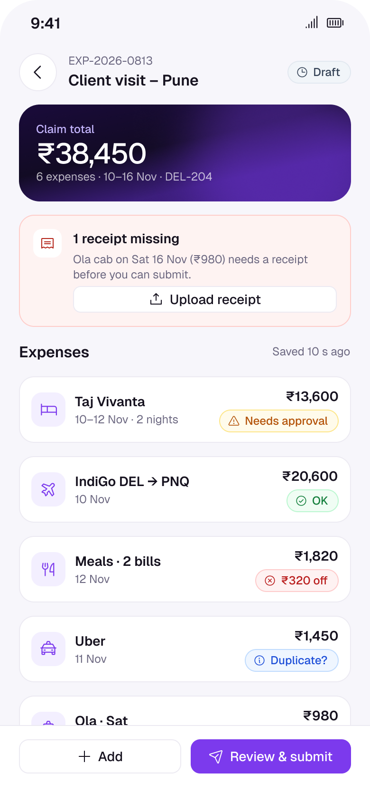

# MB6 · Draft claim

| | |
|---|---|
| Role | Employee (mobile) |
| Route (suggested) | /claims/:id (same route as desktop E3, rendered responsively below the `md` breakpoint) |
| Figma node | 4042:4857 |
| Frame size | 390 × 844 (PNG exported at 2×) |
| Desktop equivalent | E3 (draft with expenses) |

## Purpose
Mobile view of a claim still in `DRAFT`. The employee sees the running total, any blocking issue (here a missing receipt), every expense with its policy pre-check, and moves on to add another expense or to review and submit.

## Layout
Top to bottom (side gutter 20, content width 350):
1. **Mobile / Status Bar** (390 × 48): "9:41", ph/cell-signal-full, ph/battery-full.
2. **Header row** (350 × 40): round back button (40 × 40) · claim number + title · Status Chip right.
3. **Claim total hero card** (350 × 102, dark purple gradient with a decorative 200 × 200 ellipse glow).
4. **Missing-receipt alert card** (350 × 118, danger tint).
5. **Section header** "Expenses" + autosave note (350 × 24).
6. **Expense rows**, one card each (350 × 70), stacked; the list scrolls under the footer (the 5th row is cut off in the export).
7. **Sticky actions** footer (390 × 81, white, top border): two buttons side by side.

No tab bar on this frame: the claim screens are pushed screens, the tab bar (MB1) is hidden.

## Content & components

### Header
- Back button: circular, white, border, ph/caret-left.
- Overline (muted): "EXP-2026-0813"
- Title (semibold): "Client visit – Pune"
- Status Chip: "Draft" (neutral, ph/clock).

### Claim total (hero card)
- Label (light lavender): "Claim total"
- Amount (large, white): "₹38,450"
- Meta (muted white): "6 expenses · 10–16 Nov · DEL-204"

### Missing-receipt alert (danger tone: light red background, red border)
- Icon tile (white, rounded): ph/receipt in red.
- Title: "1 receipt missing"
- Text: "Ola cab on Sat 16 Nov (₹980) needs a receipt before you can submit."
- Button: **Upload receipt** (outline/white, full width of the text column, ph/upload-simple).

### Expenses
- Heading: "Expenses"; right, muted small: "Saved 10 s ago".

Each row: 36 × 36 light-purple icon tile (purple category icon) · name + sub-text · amount (right, semibold) above a policy chip.

| Icon | Name | Sub-text | Amount | Policy chip (tone, icon) |
|---|---|---|---|---|
| ph/bed | Taj Vivanta | 10–12 Nov · 2 nights | ₹13,600 | Needs approval (warning, ph/warning) |
| ph/airplane | IndiGo DEL → PNQ | 10 Nov | ₹20,600 | OK (success, ph/check-circle) |
| ph/fork-knife | Meals · 2 bills | 12 Nov | ₹1,820 | ₹320 off (danger, ph/x-circle) |
| ph/taxi | Uber | 11 Nov | ₹1,450 | Duplicate? (info, ph/info) |
| ph/taxi | Ola · Sat | 16 Nov | ₹980 | hidden under the footer in the export (inferred: "Receipt required", danger) |

"6 expenses" in the hero counts "Meals · 2 bills" as two lines, so five rows = six lines.

### Sticky actions
- **Add** (outline, ph/plus, 171 wide).
- **Review & submit** (primary purple, ph/paper-plane-tilt, 169 wide).

## Interactions & states
- Back → MB1 (home) or the claims list it came from (inferred).
- **Upload receipt** → opens the capture flow for the Ola line: MB2 (scan) or the gallery picker; progress uses the "Uploading receipt…" state in MB9. On success the alert disappears and the Ola chip turns OK (inferred).
- Tap an expense row → edit that line: MB4 (manual form) or MB3 for scanned lines (inferred).
- **Add** → MB2 (scan receipt) with a manual-entry option leading to MB4 (inferred; could also be an action sheet "Scan / Enter manually").
- **Review & submit** → MB7. Behaviour (inferred): disabled, or shows the alert again, while any blocking issue (missing receipt) remains; the server also rejects with 422 `validation_error`.
- "Saved 10 s ago" updates after each autosave; Behaviour (inferred): shows "Saving…" while a save is in flight and the MB9 offline banner when there is no connection.
- Policy chips are a pre-check; the final outcome is computed on submit.
- Empty draft (no expenses): not designed for mobile; reuse the MB9 empty-state pattern with an "Add expense" action (desktop N2).
- Loading: skeleton hero + 3 row skeletons (inferred). Error loading claim: inline error card with Retry (inferred).

## Data & API
- Claim, lines, attachments: `GET /api/v1/claims/{id}` (`status: DRAFT`, `total_amount`, `lines[]` with `category`, `amount`, `expense_date`, `vendor`, `nights`, `receipt_id`).
- Missing receipt rule: a line with `amount > 500` and no `receipt_id` / `receipt_number` blocks submit (422). Compute the alert client-side from the lines.
- Upload receipt: `POST /claims/{id}/attachments` (multipart `file`, PDF/PNG/JPEG, ≤ 5 MB, ≤ 10 per claim), then `PUT /claims/{id}` with `action: "draft"`, every line, and the line's `receipt_id` set.
- Autosave: `PUT /claims/{id}` with `action: "draft"` (send all lines — PUT replaces the claim). "Saved N s ago" from `updated_at`.
- Claim number format "EXP-2026-0813", trip/cost-centre code "DEL-204", date range "10–16 Nov": Not yet in API (derive the date range from line dates; the others need fields).
- Per-line policy pre-check chips (Needs approval, ₹320 off, Duplicate?) before submit: Not yet in API — `GET /claims/{id}/policy-results` exists only after submit.
- Grouping "Meals · 2 bills" into one row: Not yet in API (client-side grouping by category + date, inferred).

## Build notes
- shadcn: `Button`, `Badge` (Status Chip), `Card`, `Alert` (destructive variant, custom layout), `Skeleton`.
- Reuse from desktop: `StatusChip`, `PolicyChip`, category icon map (E3), INR formatter from foundations.
- Hero card: `bg-gradient` dark purple (#1e1b4b-ish → primary #7c3aed); keep the ellipse as a CSS radial glow, not an image.
- Sticky footer: `fixed bottom-0`, white, top border, `padding-bottom: env(safe-area-inset-bottom)`; add bottom padding to the scroll area equal to the footer height so the last row is reachable.
- Buttons are 36 tall in Figma; make tap areas at least 44 px (`h-11` on mobile).
- Whole expense row is one tap target (`button` or link), with chip + amount right-aligned.
- Status bar is the device's; do not render it in the app — respect `env(safe-area-inset-top)` instead.
