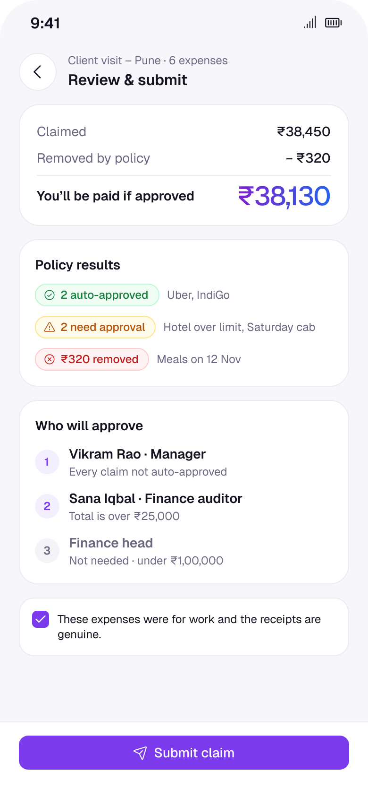

# MB7 · Review & submit

| | |
|---|---|
| Role | Employee (mobile) |
| Route (suggested) | /claims/:id/review (same route as desktop E4, rendered responsively) |
| Figma node | 4043:4750 |
| Frame size | 390 × 844 (PNG exported at 2×) |
| Desktop equivalent | E4 (review & submit) |

## Purpose
Last step before submitting from a phone. The employee sees how much they will be paid after policy, a one-line summary of policy outcomes, who will approve the claim, confirms the declaration and submits.

## Layout
Top to bottom (side gutter 20, content width 350):
1. **Mobile / Status Bar** (390 × 48).
2. **Header row** (350 × 40): round back button (40 × 40) · overline + title.
3. **Amount card** (350 × 129).
4. **Policy results card** (350 × 156).
5. **Who will approve card** (350 × 195).
6. **Declaration card** (350 × 62).
7. Empty space (content scrolls if needed).
8. **Sticky actions** footer (390 × 81): one full-width button.

No tab bar (pushed screen). Compared with E4 the mobile version drops the stepper, the per-line table, the duplicate info alert and the **Save draft** button.

## Content & components

### Header
- Back button: circular, white, ph/caret-left.
- Overline (muted): "Client visit – Pune · 6 expenses"
- Title: "Review & submit"

### Amount card
| Label | Value |
|---|---|
| Claimed | ₹38,450 |
| Removed by policy | − ₹320 |
| *(1 px divider)* | |
| **You’ll be paid if approved** (semibold) | **₹38,130** (large, purple→blue gradient text) |

### Policy results card
Title: "Policy results". Three rows, each a chip + muted reason text:

| Chip (tone, icon) | Text |
|---|---|
| 2 auto-approved (success, ph/check-circle) | Uber, IndiGo |
| 2 need approval (warning, ph/warning) | Hotel over limit, Saturday cab |
| ₹320 removed (danger, ph/x-circle) | Meals on 12 Nov |

### Who will approve card
Title: "Who will approve". Numbered rows (28 px circle, light purple fill, purple number; row 3 grey and muted):

| # | Name · role (semibold) | Reason (muted) | State |
|---|---|---|---|
| 1 | Vikram Rao · Manager | Every claim not auto-approved | active |
| 2 | Sana Iqbal · Finance auditor | Total is over ₹25,000 | active |
| 3 | Finance head | Not needed · under ₹1,00,000 | muted (not needed) |

### Declaration card
- Checkbox (shown checked, purple) + "These expenses were for work and the receipts are genuine."

### Sticky actions
- **Submit claim** (primary purple, full width 350, ph/paper-plane-tilt).

## Interactions & states
- Back → MB6.
- Tapping the label also toggles the checkbox.
- **Submit claim**: Behaviour (inferred) disabled until the declaration is checked. On tap: show a loading spinner in the button and block double taps. On success → claim status screen (MB8 pattern in its normal "Pending manager" state) or a mobile success screen like desktop N4 (not designed for mobile).
- Policy chip rows: Behaviour (inferred) tap → back to MB6 scrolled to those lines.
- Errors:
  - 422 `validation_error` (e.g. a receipt still missing) → back to MB6 with the alert shown.
  - 409 `no_eligible_approver` / 503 `policy_not_configured` → toast "Couldn’t submit, try again later" (inferred copy).
  - Offline → keep the button disabled and show the MB9 offline banner (inferred; queueing a submit offline is not designed).
- Loading: skeletons for the three cards (inferred).

## Data & API
- Claim and lines: `GET /api/v1/claims/{id}`. Overline counts lines (`lines.length`).
- Submit: `POST /claims/{id}/submit` (no body; submits the saved claim; runs the policy engine and builds the approval chain). Older path `PUT /claims/{id}` with `action: "submit"` also works per `docs/claims-api.md`. Result status: `AUTO_APPROVED`, `AUTO_REJECTED`, `DUPLICATE` or `PENDING_APPROVAL`.
- Pre-submit preview of policy results, removed amount and payable amount: Not yet in API — `GET /claims/{id}/policy-results` returns outcomes only after submit. A dry-run/preview endpoint is needed to show this before the claim is submitted.
- Approval chain preview (named manager "Vikram Rao", auditor "Sana Iqbal", finance head needed or not): Not yet in API before submit (`GET /claims/{id}/approval-steps` exists after submit). Thresholds ₹25,000 / ₹1,00,000 come from seeded settings — never hard-code them in the UI copy; build the reason text from the setting values.
- Note: after submit, step 2 is "any finance auditor", not a named person; "Sana Iqbal" can only be shown if the chain assigns one.
- Declaration acceptance: Not yet in API (no field to record it).

## Build notes
- shadcn: `Card`, `Badge`, `Checkbox` + `Label`, `Button`, `Separator`, `Skeleton`, `Sonner` (toast).
- Reuse `AmountSummary` (E4/E5), `PolicyChip`, `ApproverStep` (E4) — mobile only changes spacing and stacks the reason under the name.
- Gradient amount: `bg-gradient-to-r from-violet-600 to-blue-600 bg-clip-text text-transparent`; keep a solid-colour fallback for high-contrast mode.
- "− ₹320" uses a real minus sign (U+2212); amounts use Indian grouping (₹1,00,000).
- Sticky footer with `env(safe-area-inset-bottom)` padding; button min height 44 px on touch.
- Checkbox tap target: make the whole declaration card the label (44 px+ height).
