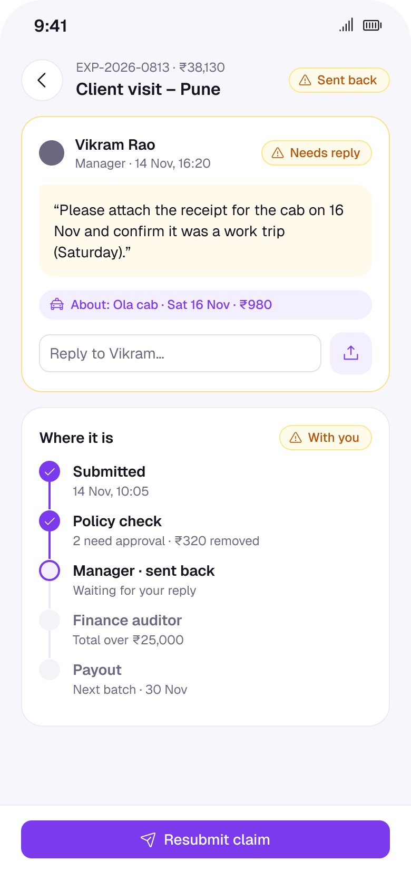

# MB8 · Claim status (sent back)

| | |
|---|---|
| Role | Employee (mobile) |
| Route (suggested) | /claims/:id (same route as desktop E5, rendered responsively) |
| Figma node | 4043:4831 |
| Frame size | 390 × 844 (PNG exported at 2×) |
| Desktop equivalent | E5 (claim detail, timeline & clarification) |

## Purpose
Status view of a submitted claim, shown in the "sent back" state. The employee reads the manager's question, replies or uploads the missing receipt, checks where the claim is in the chain and resubmits.

## Layout
Top to bottom (side gutter 20, content width 350):
1. **Mobile / Status Bar** (390 × 48).
2. **Header row** (350 × 40): round back button · overline + title · Status Chip right.
3. **Manager message card** (350 × 262, white with amber/warning border).
4. **Where it is card** (350 × 303): vertical timeline.
5. Empty space.
6. **Sticky actions** footer (390 × 81): one full-width button.

No tab bar (pushed screen). Compared with E5 the mobile version drops the expense lines table, the amount card, the **Withdraw** button and the separate **Send** button.

## Content & components

### Header
- Back button: circular, white, ph/caret-left.
- Overline (muted): "EXP-2026-0813 · ₹38,130"
- Title: "Client visit – Pune"
- Status Chip: "Sent back" (warning, ph/warning).

### Manager message card
- Avatar (36 px, grey circle placeholder) · "Vikram Rao" (semibold) · "Manager · 14 Nov, 16:20" (muted).
- Chip right: "Needs reply" (warning, ph/warning).
- Quote box (light amber fill, rounded): "“Please attach the receipt for the cab on 16 Nov and confirm it was a work trip (Saturday).”"
- Context pill (light purple fill, purple text, full width, ph/taxi): "About: Ola cab · Sat 16 Nov · ₹980"
- Reply row:
  - Input — placeholder "Reply to Vikram..."; single line; optional.
  - Icon button (40 × 40, light purple, purple ph/upload-simple) — upload receipt.

### Where it is card
- Title "Where it is" + chip "With you" (warning, ph/warning).
- Vertical timeline:

| Step | State | Sub-text |
|---|---|---|
| Submitted | done (filled purple circle, white check) | 14 Nov, 10:05 |
| Policy check | done | 2 need approval · ₹320 removed |
| Manager · sent back | current (white circle, purple ring) | Waiting for your reply |
| Finance auditor | upcoming (grey circle, muted text) | Total over ₹25,000 |
| Payout | upcoming | Next batch · 30 Nov |

Connector line purple between done steps and into the current step, light grey after it.

### Sticky actions
- **Resubmit claim** (primary purple, full width, ph/paper-plane-tilt).

## Interactions & states
- Back → MB1 / claims list (inferred).
- Reply input: Behaviour (inferred) the reply is sent with the keyboard's Send/Return key, or together with **Resubmit claim** — there is no Send button in the design. Decide before build.
- Upload icon → capture flow for the Ola line (MB2 scan or gallery), progress per MB9 "Uploading receipt…". After success the context pill could show the receipt as attached (inferred).
- Context pill tap → that expense line (MB4 / MB3 edit) (inferred).
- **Resubmit claim** → Behaviour (inferred) disabled until the receipt is attached (₹980 > ₹500 needs a receipt); on success the chip becomes "Pending manager", the message card collapses, and the timeline restarts at step 1 (new round).
- Other statuses (not designed): pending / approved / paid hide the message card and the footer, and the timeline shows the matching current step; rejected or duplicate show a final state with the reason.
- Offline: show the MB9 offline banner; reply and upload queue locally (inferred; see MB9).
- Loading: skeleton cards (inferred).

## Data & API
- Claim: `GET /api/v1/claims/{id}`. "Sent back" = status `CLARIFICATION_REQUESTED`; overline amount = payable total (not in the claim shape today; see below).
- Manager message, author, time: `GET /claims/{id}/comments` (the send-back comment is in this list). Author role for "Manager" needs a lookup of the author user.
- Reply: `POST /claims/{id}/comments` with `{"body": "..."}`.
- Upload receipt: allowed in `CLARIFICATION_REQUESTED` — `POST /claims/{id}/attachments`, then `PUT /claims/{id}` (`action: "draft"`, all lines, Ola line's `receipt_id` set).
- Resubmit: `POST /claims/{id}/submit` (re-runs policy, builds a new chain from step 1, `submission_round` + 1).
- Timeline: `GET /claims/{id}/approval-steps` (latest round first) + `GET /claims/{id}/audit` for "Submitted" time; policy summary from `GET /claims/{id}/policy-results`.
- Linking the send-back comment to a line ("About: Ola cab · Sat 16 Nov · ₹980"): Not yet in API (comments have no line reference).
- Payable amount after policy (₹38,130) as a claim field: Not yet in API (derive from policy results, inferred).
- "Next batch · 30 Nov": Not yet in API — payout batches are created on demand (`docs/payouts-api.md`), there is no schedule.

## Build notes
- shadcn: `Card`, `Badge`, `Avatar` (fallback initials instead of grey circle), `Input`, `Button` (icon size), `Skeleton`.
- Reuse the `Timeline` component from E5 (also used on M3/F5) and `StatusChip`.
- Message card: custom `Card` with `border-amber-300`; quote box `bg-amber-50`.
- Reply input: `enterKeyHint="send"`; when the keyboard opens, keep the input visible above it (scroll into view) and hide the sticky footer or lift it with the visual viewport.
- Icon button needs an `aria-label` ("Upload receipt") and a 44 px tap target.
- Sticky footer with `env(safe-area-inset-bottom)`; drive footer and message card visibility from claim status.
