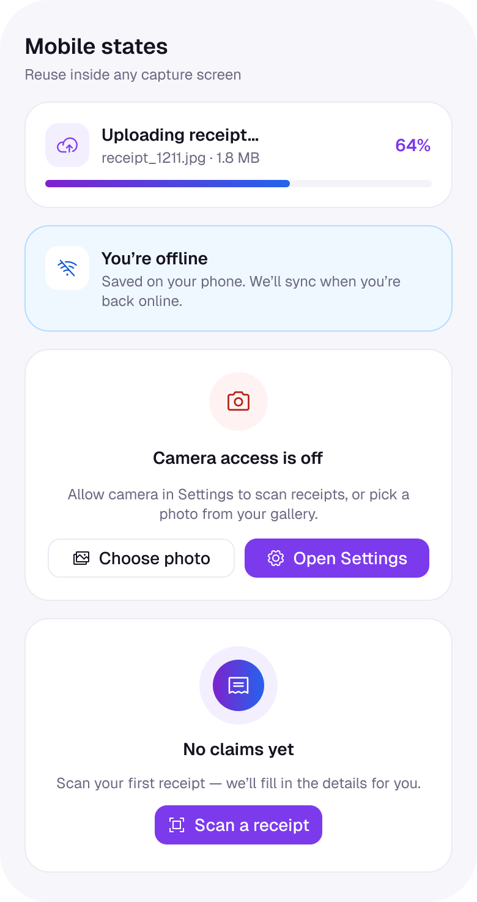

# MB9 · Mobile states

| | |
|---|---|
| Role | Employee (mobile) |
| Route (suggested) | none — reusable components shown inside MB1–MB8 |
| Figma node | 4043:4945 |
| Frame size | 390 × 737 (PNG exported at 2×) |
| Desktop equivalent | none (desktop empty states: E2 / N2) |

## Purpose
A sheet of four reusable states for the mobile capture flow: upload in progress, offline, camera permission denied, and no claims yet. Subtitle says to reuse them inside any capture screen.

## Layout
A 390 × 737 sheet (not a phone screen: no status bar, no footer). Gutter 20, cards 350 wide, stacked with ~16 px gap:
1. Sheet heading (350 × 45).
2. Upload progress card (350 × 87).
3. Offline banner (350 × 87).
4. Camera access off card (350 × 206).
5. No claims yet card (350 × 208).

### Sheet heading
- Title: "Mobile states"
- Subtitle (muted): "Reuse inside any capture screen"

## Content & components

### State 1 · Uploading receipt
White card, border, rounded.
- Icon tile (36 × 36, light purple): purple cloud-upload icon (ph/cloud-arrow-up).
- Title: "Uploading receipt…"
- Meta (muted): "receipt_1211.jpg · 1.8 MB"
- Percent (purple, semibold, right): "64%"
- Progress bar (316 × 6, grey track, purple→blue gradient fill, 64% filled).

Behaviour (inferred): shown in MB2/MB3 after capture and in MB6/MB8 after "Upload receipt"; on success it is replaced by the receipt thumbnail / OK chip; on failure the bar turns red with a **Retry** action (not designed). Error copy for 413 / 415 is not designed — suggested: "File is over 5 MB" / "Use a JPG, PNG or PDF".

### State 2 · You’re offline
Info tone: light blue fill, blue border.
- Icon tile (white): blue ph/wifi-slash.
- Title: "You’re offline"
- Text: "Saved on your phone. We’ll sync when you’re back online."

Behaviour (inferred): appears at the top of the content (under the header) when `navigator.onLine` is false or a request fails with a network error; disappears after sync. The "Saved N s ago" note on MB6 should change to a "Saved on phone" state while offline.

### State 3 · Camera access is off
White card, centred content.
- Icon: 48 px light red circle with red ph/camera.
- Title: "Camera access is off"
- Text (muted, centred): "Allow camera in Settings to scan receipts, or pick a photo from your gallery."
- Buttons (side by side):
  - **Choose photo** (outline, ph/images).
  - **Open Settings** (primary purple, ph/gear).

Behaviour (inferred): replaces the camera viewfinder on MB2 when `getUserMedia` is denied. **Choose photo** opens the file/gallery picker (`<input type="file" accept="image/*,application/pdf">`). **Open Settings**: a web app cannot open OS settings — show short instructions (e.g. a sheet "Allow camera for this site in your browser settings") or hide the button in the browser build.

### State 4 · No claims yet
White card, centred content.
- Illustration: 64 px light purple circle with a 42 px purple→blue gradient circle holding a white ph/receipt icon.
- Title: "No claims yet"
- Text (muted): "Scan your first receipt — we’ll fill in the details for you."
- Button: **Scan a receipt** (primary purple, ph/scan).

Behaviour (inferred): shown on MB1 home / the claims list when `GET /claims` returns no items; **Scan a receipt** → MB2.

### Not on the sheet
Loading and generic error states are not designed. Suggested: `Skeleton` cards for loading; an error card in the same layout as State 3 with ph/warning-circle, "Something went wrong" and a **Try again** button.

## Interactions & states
- All four are components, not routes; each screen decides when to show them.
- States can stack: offline banner above an upload card that is waiting (inferred: upload shows "Waiting for connection" instead of a percentage while offline).
- Respect `prefers-reduced-motion` for the progress bar animation.

## Data & API
- Upload: `POST /api/v1/claims/{id}/attachments` (multipart `file`; PDF/PNG/JPEG; ≤ 5 MB; ≤ 10 per claim). Progress needs `XMLHttpRequest` `upload.onprogress` (or axios `onUploadProgress`); `fetch` gives no upload progress. Errors: 413 `file_too_large`, 415 `unsupported_file_type`, 409 `attachment_limit_reached`, 409 `claim_not_editable`.
- File name and size come from the local `File` object, not the API.
- Offline save and sync: Not yet in API — needs client-side storage (IndexedDB) and a replay queue; the server has no idempotency key or conflict handling for replayed `PUT`s (claim `version` exists after submit only, inferred). Treat as stretch scope.
- Empty state: `GET /claims` with `total` = 0 (or empty `items`).
- Camera permission: browser Permissions API / `getUserMedia`; no API involved.

## Build notes
- shadcn: `Card`, `Progress` (custom gradient indicator), `Alert` (info variant for offline), `Button`, `Skeleton`.
- Build as `UploadProgressCard`, `OfflineBanner`, `CameraDeniedCard`, `EmptyState` (`icon`, `title`, `text`, `action` props — reuse on desktop E2/N2).
- Offline banner: `role="status"` / `aria-live="polite"`; upload percent announced via `Progress` `aria-valuenow`.
- Buttons are 32 tall in Figma; use ≥ 44 px tap targets on touch.
- Icons are Phosphor (regular weight) per foundations.
