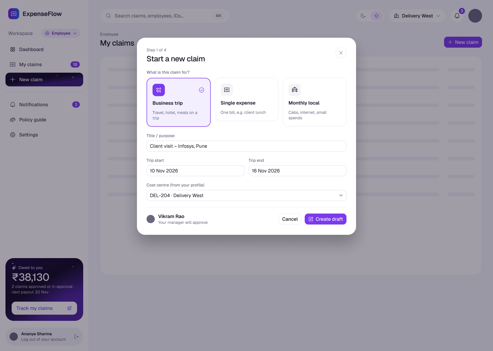

# N1 · Start a new claim

| | |
|---|---|
| Role | Employee |
| Route (suggested) | `/claims/new` (modal over `/claims`) |
| Figma node | 4014:1192 |
| Frame size | 1440 × 1024 |
| Sidebar variant | Employee |

## Purpose
Step 1 of the 4-step new-claim flow. The employee picks the kind of claim, gives it a title,
dates and cost centre, and creates a draft. The draft then opens in N2.

## Layout
- Background: the E2 "My claims" page (breadcrumb "Employee", title "My claims", primary
  "New claim" button top right, a 1116 × 640 card with skeleton rows), dimmed by a full-screen scrim.
- Sidebar (Employee) on the left: "New claim" nav item is in the selected (dark) state.
- Centred Dialog, 640 × 575, 28px padding, rounded ~24px. Top to bottom:
  1. Header row: step label + title left, close button right.
  2. "What is this claim for?" - three option cards in a row (~186px each).
  3. Title / purpose - full-width input.
  4. Trip start / Trip end - two inputs side by side (286px each).
  5. Cost centre - full-width select.
  6. Divider, then footer row: approver (avatar + name) left, Cancel + Create draft right.

## Content & components

### Dialog header
- Overline: "Step 1 of 4" (small, muted)
- Title: "Start a new claim"
- Close button: 32 × 32 round outline icon button, ph/x

### Claim type (label "What is this claim for?")
Three selectable cards (radio-card behaviour):

| Card | Icon | Title | Description | State in design |
|---|---|---|---|---|
| 1 | ph/airplane-tilt (white on purple tile) | Business trip | Travel, hotel, meals on a trip | Selected: purple 2px border, light purple fill, ph/check-circle top right |
| 2 | ph/receipt (grey tile) | Single expense | One bill, e.g. client lunch | Default |
| 3 | ph/car (grey tile) | Monthly local | Cabs, internet, small spends | Default |

### Form fields
| Label | Control | Value shown | Notes |
|---|---|---|---|
| Title / purpose | Input | Client visit – Infosys, Pune | |
| Trip start | Input (date) | 10 Nov 2026 | Shown for Business trip |
| Trip end | Input (date) | 16 Nov 2026 | Shown for Business trip |
| Cost centre (from your profile) | Select, ph/caret-down | DEL-204 · Delivery West | Pre-filled from the user profile |

No required markers, placeholders or helper texts are drawn.

### Footer
- Avatar (24px) + "Vikram Rao" (medium) + "Your manager will approve" (muted)
- Button "Cancel" - outline
- Button "Create draft" - primary, icon ph/note-pencil

## Interactions & states
- Selecting a claim-type card moves the selected state (border, fill, check icon) to it.
- Behaviour (inferred): Trip start / Trip end apply to "Business trip"; for "Single expense" and
  "Monthly local" these fields may change or hide - not designed.
- Behaviour (inferred): date inputs open a calendar popover; Trip end must not be before Trip start.
- "Create draft" → creates a DRAFT claim and navigates to N2 (`/claims/:id/edit`).
- "Cancel", the close button, Esc or scrim click → close dialog, stay on E2.
- Loading: disable "Create draft" and show a spinner while the request runs. Error: show the
  API `error.message` inline (not designed).

## Data & API
- Create: `POST /api/v1/claims` with `{"action": "draft", "title": "...", "lines": []}`. Returns `id`, `status: "DRAFT"`.
- Not yet in API: claim type (business trip / single / monthly local), trip start/end dates,
  cost centre on the claim.
- Not yet in API: cost centre and approving manager from the user profile (an endpoint like
  `GET /me` returning cost centre and manager name/avatar).
- Not yet in API: human claim number (`EXP-2026-0813`); the API returns a numeric `id`.

## Build notes
- shadcn: Dialog, RadioGroup styled as cards (or ToggleGroup), Label, Input, Popover + Calendar
  for dates, Select, Avatar, Separator, Button.
- The radio-card pattern is reused in M4 ("What can Priya approve?") - build one `RadioCard` component.
- Use `react-hook-form` or simple controlled state; dates displayed as `DD Mon YYYY`, sent as `YYYY-MM-DD`.
- The dialog sits over E2, so the route can render E2 with the dialog open.
