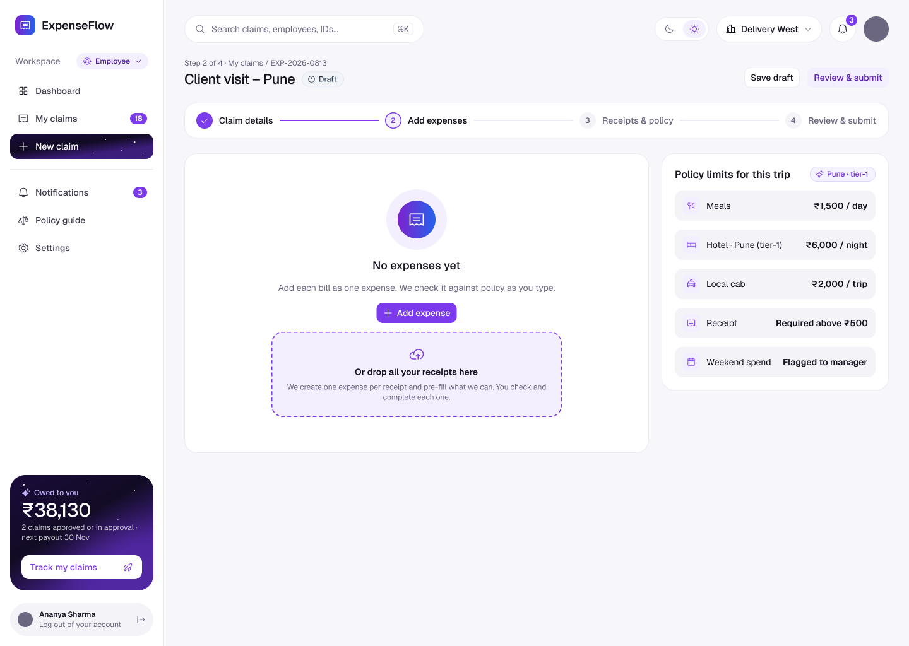

# N2 · Empty draft, add the first expense

| | |
|---|---|
| Role | Employee |
| Route (suggested) | `/claims/:id/edit` |
| Figma node | 4014:1472 |
| Frame size | 1440 × 1024 |
| Sidebar variant | Employee ("New claim" selected) |

## Purpose
Step 2 of the new-claim flow, right after the draft is created. The draft has no expenses yet;
the employee adds the first one manually or drops receipts, with the trip's policy limits visible
alongside.

## Layout
- Sidebar (Employee) + Topbar (context "Delivery West").
- Page header row (1116 × 47): breadcrumb + title + status chip left; two buttons right.
- Stepper card (1116 × 56): 4 steps joined by connector lines.
- Content row (1116 × 475): empty-state card left (736px), "Policy limits" card right (360px), 20px gap.

## Content & components

### Page header
- Breadcrumb: "Step 2 of 4 · My claims / EXP-2026-0813"
- Title: "Client visit – Pune"
- Status Chip (neutral, ph/clock): "Draft"
- Button "Save draft" - outline
- Button "Review & submit" - secondary/soft purple (light purple fill, purple text)

### Stepper
| # | Label | State |
|---|---|---|
| 1 | Claim details | Done - filled purple circle with ph/check, connector after it purple |
| 2 | Add expenses | Current - purple ring with "2", bold label |
| 3 | Receipts & policy | Upcoming - grey circle, muted label |
| 4 | Review & submit | Upcoming - grey circle, muted label |

### Empty state card
- Illustration: purple gradient circle with ph/receipt inside a light purple halo.
- Heading: "No expenses yet"
- Text: "Add each bill as one expense. We check it against policy as you type."
- Button "Add expense" - primary, icon ph/plus
- Drop zone (dashed purple border, light purple fill, ~460 × 134):
  - Icon ph/cloud-arrow-up
  - "Or drop all your receipts here" (semibold)
  - "We create one expense per receipt and pre-fill what we can. You check and complete each one."

### Policy limits card
- Title "Policy limits for this trip"; chip (purple, ph/sparkle) "Pune · tier-1".
- Five rows, each a grey rounded tile with a purple icon, label left, value right (bold):

| Icon | Label | Value |
|---|---|---|
| ph/fork-knife | Meals | ₹1,500 / day |
| ph/bed | Hotel · Pune (tier-1) | ₹6,000 / night |
| ph/car | Local cab | ₹2,000 / trip |
| ph/receipt | Receipt | Required above ₹500 |
| ph/calendar-blank | Weekend spend | Flagged to manager |

## Interactions & states
- "Add expense" → opens the Add expense sheet (N3).
- Drop zone: dragging files over it highlights it; dropping uploads each file.
  Behaviour (inferred): one expense line is created per receipt with fields pre-filled, then
  the user completes each in N3. Pre-fill (OCR) is not in the API - treat as a later feature.
- "Save draft" → saves the claim as DRAFT and shows a toast (inferred).
- "Review & submit" → Review & submit page (E4). Behaviour (inferred): disabled or warns while there
  are no expenses, since submit needs at least one line.
- Stepper steps are display-only (inferred); step 1 may link back to claim details.
- Once lines exist, this page becomes E3 (draft with expenses).

## Data & API
- Claim header: `GET /api/v1/claims/{id}` → `title`, `status`, `lines` (empty here).
- Save draft: `PUT /api/v1/claims/{id}` with `action: "draft"`.
- Drop receipts: `POST /api/v1/claims/{id}/attachments` (one file per call; PDF/PNG/JPEG, 5 MB,
  max 10 per claim; handle 413 / 415 / 409 errors per file).
- Not yet in API: policy limits for the trip (meal, hotel by city tier, cab, receipt threshold,
  weekend rule) - needs a read endpoint for the seeded policy configuration.
- Not yet in API: city tier for the trip ("Pune · tier-1").
- Not yet in API: display claim number `EXP-2026-0813`.

## Build notes
- shadcn: Card, Badge, Button. Stepper is custom (4 items + connector lines) - reuse in E3/E4.
- Drop zone: native drag-and-drop or `react-dropzone` (only if the team adds it; otherwise native).
- Policy limits card is a reusable `PolicyLimits` component (also useful in E3).
- Format amounts with `Intl.NumberFormat('en-IN', { style: 'currency', currency: 'INR', maximumFractionDigits: 0 })`.
