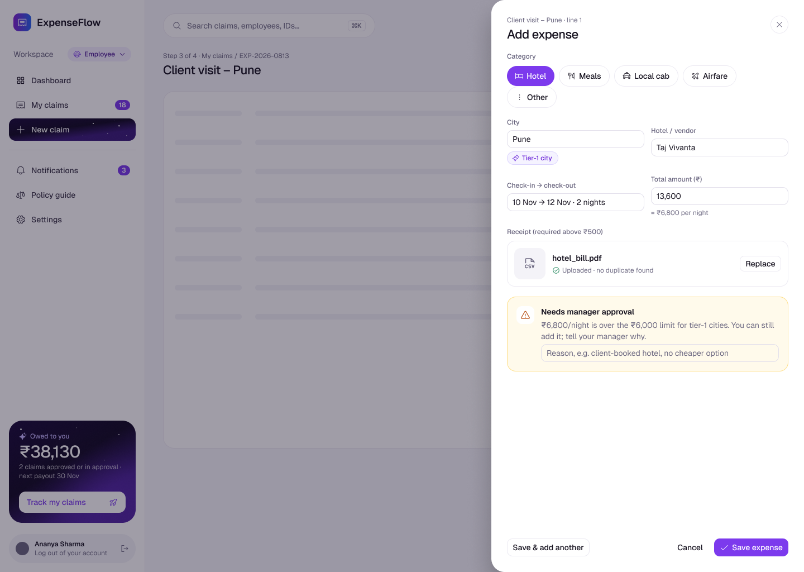

# N3 · Add an expense (sheet)

| | |
|---|---|
| Role | Employee |
| Route (suggested) | `/claims/:id/edit?line=new` (sheet over the draft) |
| Figma node | 4014:1682 |
| Frame size | 1440 × 1024 |
| Sidebar variant | Employee ("New claim" selected) |

## Purpose
The employee enters one expense line (here a hotel bill) with its receipt. Policy is checked as
they type; an over-limit line can still be saved with a justification for the manager.

## Layout
- Background: the draft page (breadcrumb "Step 3 of 4 · My claims / EXP-2026-0813", title
  "Client visit – Pune", card with skeleton rows), dimmed by a scrim.
- Right-side Sheet, 560 × 1024, 28px padding. Top to bottom:
  1. Header: overline + title left, close button right.
  2. Category chips.
  3. Row: City (left) | Hotel / vendor (right), 246px each.
  4. Row: Check-in → check-out (left) | Total amount (₹) (right).
  5. Receipt block.
  6. Policy warning callout.
  7. Spacer, then sticky footer: "Save & add another" left; Cancel + Save expense right.

## Content & components

### Header
- Overline: "Client visit – Pune · line 1"
- Title: "Add expense"
- Close: 32px round outline icon button, ph/x

### Category (label "Category")
Pill toggle chips, single select, wrap to two lines:

| Chip | Icon | State |
|---|---|---|
| Hotel | ph/bed | Selected (solid purple, white text) |
| Meals | ph/fork-knife | Default (outline) |
| Local cab | ph/car | Default |
| Airfare | ph/airplane-tilt | Default |
| Other | ph/dots-three-vertical | Default |

### Fields (shown for category Hotel)
| Label | Control | Value | Helper |
|---|---|---|---|
| City | Input | Pune | Status Chip (purple, ph/sparkle) "Tier-1 city" below |
| Hotel / vendor | Input | Taj Vivanta | |
| Check-in → check-out | Date-range input | 10 Nov → 12 Nov · 2 nights | |
| Total amount (₹) | Input (numeric) | 13,600 | "= ₹6,800 per night" (muted, computed) |

### Receipt (label "Receipt (required above ₹500)")
- File row in a bordered card: file-type icon tile, file name "hotel_bill.pdf",
  status ph/check-circle (green) "Uploaded · no duplicate found", Button "Replace" (outline, small).
- Note: the design shows a "CSV" file icon for a PDF - use a PDF/generic file icon.

### Policy warning callout (warning tone: amber border, cream fill)
- Icon ph/warning in a white tile
- Title: "Needs manager approval"
- Text: "₹6,800/night is over the ₹6,000 limit for tier-1 cities. You can still add it; tell your manager why."
- Input inside, placeholder: "Reason, e.g. client-booked hotel, no cheaper option"

### Footer
- "Save & add another" - outline
- "Cancel" - ghost
- "Save expense" - primary, ph/check

## Interactions & states
- Category chip choice changes the field set. Hotel shows city, vendor, date range (nights),
  total. Behaviour (inferred): Meals/Local cab/Airfare/Other show date, vendor, amount, description
  instead of check-in/out - not designed.
- City → tier lookup shows the "Tier-1 city" chip (inferred: after the city is entered).
- Per-night amount = total ÷ nights, recalculated live.
- Live policy check: when per-night > hotel limit for the tier, show the warning callout.
  Behaviour (inferred): the reason field becomes required to save while the warning is shown.
- Receipt: required when amount > ₹500. Empty state (not designed): a drop/upload button.
  After upload, duplicate check result shows; "Replace" picks a new file.
  Behaviour (inferred): a duplicate found would show a danger-tone status instead.
- "Save expense" → adds/updates the line, closes the sheet, returns to the draft (E3).
- "Save & add another" → saves and resets the form for line 2.
- "Cancel" / close / Esc → discard changes (inferred: confirm if the form is dirty).
- Errors: map `details.fields` from a 422 (e.g. `lines.0.vendor`) to the field.

## Data & API
- Line fields → `PUT /api/v1/claims/{id}` (`action: "draft"`, send all lines):
  `category: "hotel"`, `amount: "13600.00"`, `expense_date` (check-in), `vendor`, `city`, `nights: 2`,
  `receipt_id`. Category mapping: Hotel→`hotel`, Meals→`meal`, Local cab→`cab`, Airfare→`airfare`, Other→`other`.
- Receipt: `POST /api/v1/claims/{id}/attachments` → attachment `id`, `original_name`, `sha256`.
- Not yet in API: `receipt_number` is required above ₹500 on submit but has no field in this design.
- Not yet in API: check-out date (only `expense_date` + `nights`), per-line justification/reason text.
- Not yet in API: city-tier lookup, live policy check endpoint, duplicate-receipt check result.

## Build notes
- shadcn: Sheet (side="right", w-[560px]), ToggleGroup for category chips, Input, Popover + Calendar
  (mode="range"), Badge, Button, Alert (warning variant) with an Input inside.
- Footer sticky at the bottom of the sheet (`mt-auto`).
- Keep amount as a string in state; format with Indian grouping on blur.
- The sheet pattern matches M3 and M4 - share a `SideSheet` layout (header/body/footer).
