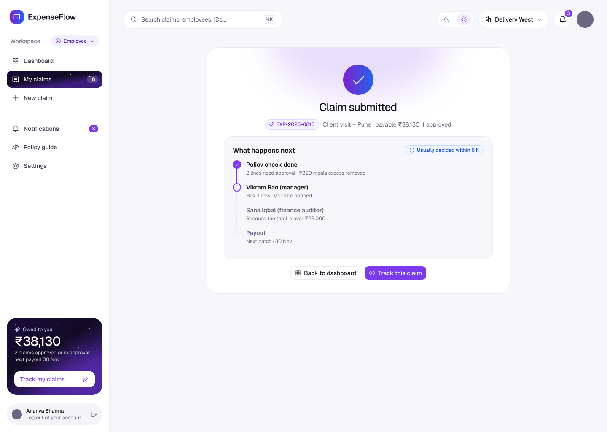

# N4 · Claim submitted

| | |
|---|---|
| Role | Employee |
| Route (suggested) | `/claims/:id/submitted` |
| Figma node | 4014:2007 |
| Frame size | 1440 × 1024 |
| Sidebar variant | Employee ("My claims" selected) |

> The Figma frame is labelled "N6"; in these specs it is N4 (the final step of the new-claim flow).

## Purpose
Confirmation shown right after the employee submits a claim. It confirms the claim number and
payable amount and explains who acts next, so the employee does not need to chase by email.

## Layout
- Sidebar (Employee) + Topbar (context "Delivery West").
- Main area: one centred card, 720px wide (~584px tall), with a soft purple radial glow at the top.
  Top to bottom:
  1. Success icon (72px purple gradient circle, white ph/check).
  2. Heading and summary line.
  3. "What happens next" panel (grey fill, rounded) with a vertical timeline.
  4. Button row, centred.

## Content & components

### Heading
- Title: "Claim submitted"
- Summary line: Status Chip (purple, ph/sparkle) "EXP-2026-0813" + text
  "Client visit – Pune · payable ₹38,130 if approved"

### What happens next
- Panel title: "What happens next"
- Status Chip (info, ph/info) on the right: "Usually decided within 6 h"
- Vertical timeline (4 steps):

| Step | Title | Sub-text | State |
|---|---|---|---|
| 1 | Policy check done | 2 lines need approval · ₹320 meals excess removed | Done - filled purple circle with check |
| 2 | Vikram Rao (manager) | Has it now · you’ll be notified | Current - purple ring, purple connector above |
| 3 | Sana Iqbal (finance auditor) | Because the total is over ₹25,000 | Upcoming - muted dot, muted text |
| 4 | Payout | Next batch · 30 Nov | Upcoming - muted |

### Buttons
- "Back to dashboard" - outline, icon ph/squares-four
- "Track this claim" - primary, icon ph/eye

## Interactions & states
- "Back to dashboard" → E1.
- "Track this claim" → E5 claim detail (`/claims/:id`).
- Timeline is read-only.
- Step 3 (auditor) appears only when the total is over ₹25,000 (per the sub-text). Behaviour (inferred):
  a finance-head step is added when the total is over ₹1,00,000 (backend plan); not shown here.
- Behaviour (inferred): if the page is opened for a claim that is not SUBMITTED, redirect to E5.

## Data & API
- `GET /api/v1/claims/{id}` → `title`, `total_amount`, `status`, `submitted_at`.
- Not yet in API: display claim number (`EXP-2026-0813`).
- Not yet in API: policy-check outcome on submit ("2 lines need approval", "₹320 meals excess
  removed") and the payable amount after policy (₹38,130) vs claimed total.
- Not yet in API: approval chain with named approvers (manager, auditor) and the reason a step applies.
- Not yet in API: next payout batch date, "usually decided within" average.

## Build notes
- shadcn: Card, Badge, Button. Timeline is a small custom component (circle + connector + text) -
  reuse it for the E5 claim timeline.
- Glow: absolutely positioned radial-gradient div behind the icon, `pointer-events-none`.
- Keep amounts as strings from the API; format for display only.
