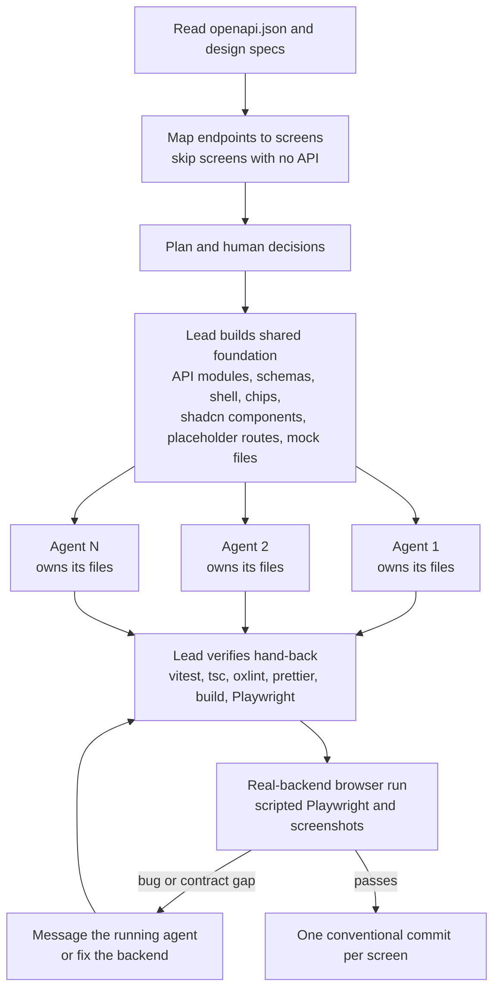

# How we worked with Claude

ExpenseFlow (team18, Track A). This page covers the frontend and integration work that Abhayraj did with Claude Code on the `frontend` branch, which was merged into the protected `main` through pull requests. The backend was led by Himanshu, with Diksha on DevOps/SRE and Rahul on UI/UX, QA and artifacts.

The day-by-day record is in [claude-journal.md](claude-journal.md). The process below is packaged as a reusable skill in [`.claude/skills/contract-first-screens/SKILL.md`](../.claude/skills/contract-first-screens/SKILL.md).

## The process

| Step | What happened | Why |
|---|---|---|
| 1. Plan first, humans decide | For the login page, Claude read the L1 spec, the screenshot, `DESIGN.md` and the API. It wrote a 6-step plan and asked 3 questions before writing code: which login field to use (the team chose "Work email, sent as username"), where to store the token (localStorage), and which form library to use (react-hook-form). | `CLAUDE.md` requires a plan and human sign-off for anything non-trivial. |
| 2. Contract first | `docs/openapi.json` is the source of truth and wins over the markdown docs when they conflict. Claude listed every endpoint, mapped each one to a Figma screen, and built only the screens that had an API. | This avoided building screens that would have needed invented endpoints. E1/M1/A0, A2 and A3 were skipped. |
| 3. Shared foundation before fan-out | The lead built the shared layer first: typed API modules for every endpoint (`features/claims`, `approvals`, `admin`, `payouts` `api.ts`), an AppShell with a per-role sidebar, `StatusChip`, en-IN formatters, every shadcn component installed once, a placeholder route per screen, and MSW handlers split by feature. | Parallel agents then had nothing shared left to edit and nothing to install. |
| 4. Parallel sub-agents with file ownership | Each agent owned specific route and feature folders, its own mock handler file and its own test file. Agents were told not to edit other files and not to run the shadcn CLI, `pnpm add`, the build, E2E or git. | Ownership made merge conflicts impossible by construction. |
| 5. Lead verifies every hand-back | The lead ran the full Vitest suite, `tsc -b`, oxlint, `prettier --check`, `vite build` and Playwright. Then a scripted Playwright run in a real browser against the **real backend**, with screenshots. Only after that did the lead commit. | Mocks alone hid a backend 500 (see below). |
| 6. Small conventional commits | One change per commit, with `feat:`/`fix:`/`test:`/`ci:`/`docs:` prefixes and a Co-Authored-By Claude line. | The history in `git log` reads as a changelog. |
| 7. Mid-flight corrections | Running agents were corrected with messages. For example, after a real-backend test the lead told the claim-form agent that the server hard-validates `receipt_number` and `receipt_id` above ₹500 on submit, and that `ApiError` now exposes field errors. | This was cheaper than letting the agent finish and then redoing its work. |

Rounds of sub-agents:

| Round | Agents | Scope |
|---|---|---|
| 1 | 4 | Employee claims list and form; claim detail, receipt viewer and review actions; approvals queue, bulk approve and delegation; finance-head policy rules and people |
| 2 | 5 | Payouts (F2); dashboard; backend login by email; docker `web` service and CI; 7 more E2E flows |
| 3 | 2 | Dashboard on `GET /dashboard/summary`; audit trail screen (F5) |

### Fan-out / verify loop



## What worked

- **Asking before building.** The three login decisions took one exchange and did not need revisiting on the frontend.
- **File ownership.** In rounds of 4, 5 and 2 parallel agents, no two agents ever owned the same file.
- **Building the foundation first.** Agents got typed API functions and Zod schemas that mirror `openapi.json`, so their screens matched the contract from the start.
- **Real-backend runs before committing.** These found defects that 42 passing mock-backed tests did not, including D1, D2 and D3 in the defect log.
- **Letting Claude fix backend bugs it found.** The user said "if you find any bug in backend then you fix it". Claude fixed D1 and D2 on `fix/backend-validation` (PR #15), with 16 new tests that failed before the fix and passed after.

## What didn't work (and the fix)

| Problem | What happened | Fix |
|---|---|---|
| shadcn CLI and `cn` | On init and on every `shadcn add`, the CLI rewrote the `cn` import to point at a bogus npm package called `cn`. It happened twice and was caught in review. | We replaced it with `clsx` + `tailwind-merge` utils and removed the package each time. Now only the lead runs the CLI, once, before fan-out. |
| Mocks-only tests hid a backend 500 | Agent tests passed against MSW, but `POST /claims` returned 500 for null or blank optional text (D1). Pydantic applied `max_length` to `str \| None`, so the check ran on `None`. | We moved the constraint onto the `str` inside the union (StringConstraints). The frontend also omits nulls. Every screen now gets a real-backend run before it is committed. |
| E2E port reuse | Playwright reused the developer's own `pnpm dev` on port 5173. That server talked to the real backend with no mocks, so the mock login returned 401. | E2E now runs on its own port 5174 with `VITE_ENABLE_MOCKS=true`. |
| CRLF line endings | Prettier failed on 26 files after a stash restore, because `core.autocrlf` had converted line endings to CRLF. | Added `frontend/.gitattributes` with `eol=lf`. |
| Email label vs username login | The UI asked for a work email, but the backend matched on username only, so seeded users could not log in (D3). | The team kept the email label. The backend `/auth/login` now matches username or email, case-insensitive. |

## Prompt library

These are the user prompts that worked, paraphrased from the session.

| Prompt (paraphrased) | What it produced |
|---|---|
| "Create a frontend folder & initialize react + vite with tailwind, shadcn (base ui, phosphor), zod, typescript, tanstack query, oxlint, prettier, vitest, playwright, pnpm." | The `frontend/` scaffold and toolchain |
| "Create login page in frontend using this api" | Claude read the L1 design and `DESIGN.md`, proposed a plan and asked 3 decisions |
| "Read docs/openapi.json & claims-api.md; if conflict the json wins. Use multiple sub agents to pick UI screens… build only whose api is available." | The endpoint→screen map, the shared foundation and round 1 of sub-agents |
| "As you finish anything make necessary commits." | One conventional commit per finished unit |
| "If you find any bug in backend then you fix it." | Backend fixes D1 and D2 (PR #15) |
| "Check the git history what updated… only build things whose APIs are available… run multiple sub agents." | Rounds 2 and 3, driven by new backend endpoints merged into `main` |

### Sub-agent brief template

```text
GOAL
Build <screen name> (<design id>) at route <route>.

STACK
React 19 + Vite + TypeScript, Tailwind v4, shadcn/ui (<primitive library>, <icon set>),
TanStack Router (file-based) + TanStack Query, Zod, react-hook-form, MSW, Vitest + Testing Library.

ALREADY BUILT FOR YOU - USE THESE, DO NOT RECREATE
- API functions + Zod schemas: <src/features/<feature>/api.ts>
- Shell / nav: <src/components/app-shell.tsx>
- Shared UI: <StatusChip>, <formatters (currency, dates)>
- Installed UI components: <list>
- Placeholder route file: <src/routes/...>

API FACTS (from docs/openapi.json, which wins on conflict)
- <METHOD /path> -> <response shape>; errors: <codes>; who may call it: <role>
- <validation rules the server enforces>

DESIGN SPEC
<docs/design/screens/<id>.md>, <DESIGN.md>

YOU OWN ONLY THESE FILES
- <route file(s)>
- <src/features/<feature>/...>
- <src/mocks/handlers/<feature>.ts>
- <src/features/<feature>/<feature>.test.tsx>

DO NOT
- edit any other file (ask in your report if you need a shared change)
- run the shadcn CLI, pnpm add, build, e2e or git

VERIFY BEFORE REPORTING
pnpm vitest run <your test file>; pnpm tsc -b; pnpm lint; pnpm prettier --check <your files>

REPORT BACK
Files created/changed, tests added and their result, gaps or contract questions.
```

## Rules we'd keep

- Treat the OpenAPI file as the contract, and build only the screens it supports.
- Have a human decide anything that changes behaviour (field names, storage, libraries) before code is written.
- Build the shared layer and install dependencies once, before any parallel agent starts.
- Give each agent an explicit list of files it owns, and a list of things it must not do.
- Passing mock tests is not done. Run every screen against the real backend in a real browser before committing.
- Keep E2E isolated from the developer's environment (its own port, mocks on) and pin line endings.
- Commit one change at a time, with a conventional prefix.
